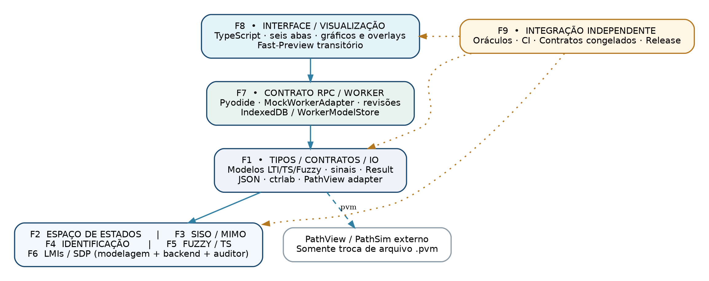
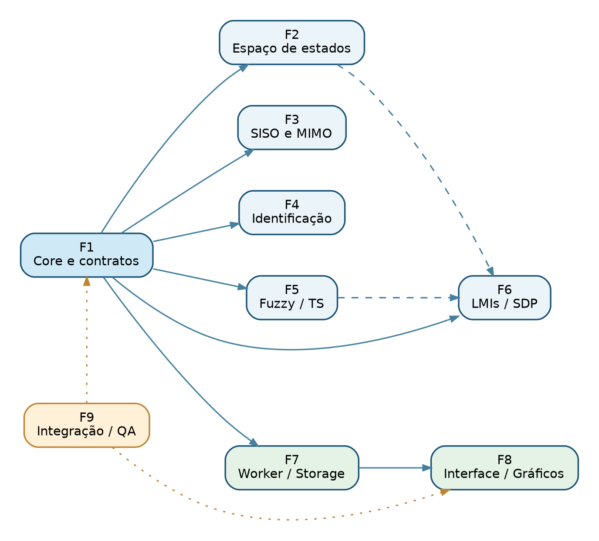

> **Status e alcance desta versão.** Este documento consolida as diretrizes da versão 0.4 recebida, as correções matemáticas acordadas e o novo plano de **oito frentes produtoras (F1–F8) mais uma frente transversal de integração e garantia da qualidade (F9)**. É uma *especificação de desenvolvimento*, não uma alegação de software pronto, de certificado de engenharia nem de funcionamento já comprovado de solvers SDP no navegador. Requisitos funcionais são obrigatórios dentro de seu estágio; capacidades dependentes de experimento aparecem identificadas como **GATE**.

**Controle do documento.** Identificador `CL-DIR-001`; revisão `v1.0.0`; estado `baseline de implementação`; responsável editorial `Coordenação científica do ControlLab`; origem `v0.4 – Baseline para Agentes` (13/11/2026); licença futura do software `DEC-OPEN-05` (a deliberar). Toda alteração a contratos, hipóteses matemáticas, schema de arquivos ou gates demanda ADR e aprovação da Frente F9.

**Convenções de leitura.** **MUST**: requisito obrigatório; **SHOULD**: recomendação forte com exceção documentada; **MAY**: extensão facultativa. **Estável** significa validado no domínio declarado, não apto a segurança funcional crítica. A notação `R-XX` identifica requisitos; `G-XX` identifica gates; `T-XX` identifica testes; `ADR-XX` identifica decisões; `F1…F9` identifica frentes. Os exemplos de parâmetros de desempenho são *metas a medir*, não resultados observados.


# Sumário

**Estratégia, contratos e requisitos técnicos**

- [1. Resumo executivo e carta de projeto](#resumo-executivo-e-carta-de-projeto)
- [2. Decisões arquiteturais congeladas e condições de evidência](#decisões-arquiteturais-congeladas-e-condições-de-evidência)
- [3. Arquitetura lógica e física](#arquitetura-lógica-e-física)
- [4. Modelo de dados científico e semântica de controle](#modelo-de-dados-científico-e-semântica-de-controle)
- [5. Motor científico: escopo, algoritmos e interfaces](#motor-científico-escopo-algoritmos-e-interfaces)
- [6. Arquitetura numérica de otimização e significado dos certificados](#arquitetura-numérica-de-otimização-e-significado-dos-certificados)
- [7. Motor gráfico, usabilidade e interação científica](#motor-gráfico-usabilidade-e-interação-científica)
- [8. Contrato RPC, Worker, concorrência e persistência em sessão](#contrato-rpc-worker-concorrência-e-persistência-em-sessão)
- [9. Interoperabilidade, formatos e exportação para PathView](#interoperabilidade-formatos-e-exportação-para-pathview)
- [10. Protocolo de validação científica, matemática e computacional](#protocolo-de-validação-científica-matemática-e-computacional)
- [11. Desempenho, disponibilidade, compatibilidade e UX operacional](#desempenho-disponibilidade-compatibilidade-e-ux-operacional)
- [12. Segurança, privacidade e governança de dependências](#segurança-privacidade-e-governança-de-dependências)
- [13. Organização operacional: oito frentes produtoras + uma integração independente](#organização-operacional-oito-frentes-produtoras-uma-integração-independente)
- [14. Plano de execução por gates e fases de desenvolvimento](#plano-de-execução-por-gates-e-fases-de-desenvolvimento)
- [15. Integração contínua, governança e Definition of Done](#integração-contínua-governança-e-definition-of-done)
- [16. Matriz de rastreabilidade de requisitos, donos e gates](#matriz-de-rastreabilidade-de-requisitos-donos-e-gates)
- [17. Riscos, mitigações, trade-offs e decisões abertas](#riscos-mitigações-trade-offs-e-decisões-abertas)
- [18. Conclusões operacionais e autorização de início](#conclusões-operacionais-e-autorização-de-início)

**Anexos operacionais e normativos**

- [Apêndice A — Contrato RPC mínimo para agentes (exemplos normativos)](#apêndice-a-contrato-rpc-mínimo-para-agentes-exemplos-normativos)
- [Apêndice B — Contrato canônico de projeto e de modelo](#apêndice-b-contrato-canônico-de-projeto-e-de-modelo)
- [Apêndice C — Catálogo inicial de testes normativos](#apêndice-c-catálogo-inicial-de-testes-normativos)
- [Apêndice D — Especificação de exportação .pvm e seus limites](#apêndice-d-especificação-de-exportação-.pvm-e-seus-limites)
- [Apêndice E — Contrato de trabalho para agentes e protocolo de handoff](#apêndice-e-contrato-de-trabalho-para-agentes-e-protocolo-de-handoff)
- [Apêndice F — Histórico de convergência v0.4 → v1.0](#apêndice-f-histórico-de-convergência-v0.4-v1.0)
- [Apêndice G — Referências e fontes normativas consultadas](#apêndice-g-referências-e-fontes-normativas-consultadas)

---

# 1. Resumo executivo e carta de projeto

## 1.1. Problema de engenharia

A identificação, o projeto, a análise e a avaliação de controladores são hoje frequentemente distribuídos entre planilhas, scripts isolados, ambientes licenciados e simuladores externos. A transcrição manual de modelos e ganhos introduz erros de dimensões, sinais de realimentação, tempo de amostragem, normalização, unidades e hipóteses. Ferramentas didáticas isoladas tornam difícil acompanhar o percurso completo **dados → modelo → requisitos → controlador → diagnósticos → simulação → relatório reproduzível**.

O **ControlLab Web** será um ambiente aberto, modular e local-first de projeto assistido por computador, executado no navegador sem backend científico obrigatório. Ele deverá possibilitar ensinar métodos tradicionais e incorporar algoritmos de pesquisa sem alterar o código da interface. Seu propósito é ser um ambiente de *projeto e verificação*, não um simples editor de expressões nem um substituto integral das ferramentas industriais.

## 1.2. Missão, usuários e resultados esperados

| Usuário | Fluxo prioritário | Evidência de sucesso |
|:--|:--|:--|
| Estudante | Importar `u/y`, identificar ARX, ajustar compensador, comparar requisitos e salvar projeto | Resíduos e métricas interpretáveis; reabertura fiel |
| Docente | Comparar PID, LQR/LQG e síntese LMI, visualizar hipóteses e exportar simulação | Exercícios repetíveis em máquinas comuns e sem instalação especializada |
| Pesquisador | Adicionar algoritmo Python e confrontá-lo com baseline | Experimento CLI, fixtures versionadas, seeds e diagnósticos auditáveis |
| Engenheiro | Examinar estabilidade, robustez e limitações | Convenções, hipóteses, condições numéricas e limites explícitos |

**Objetivos verificáveis**: (a) executar os cálculos essenciais localmente após provisionamento de recursos; (b) compartilhar tipos canônicos sem reconstrução manual; (c) registrar parâmetros, versões, tolerâncias e proveniência; (d) separar motor científico Python de apresentação TypeScript; (e) produzir exportações e reimportações validadas; (f) manter PathView independente; (g) permitir extensão científica modular com testes independentes.

## 1.3. Escopo inicial e exclusões

As **seis áreas de projeto** são: identificação de sistemas; projeto SISO na frequência; controle linear em espaço de estados; análise e projeto MIMO na frequência; controle fuzzy, aproximação e ANFIS; e projeto por LMIs/SDPs. A simulação de diagrama de blocos é feita prioritariamente por **exportação ao PathView/PathSim** (sem fork), não por uma sétima engine acoplada.

**Fora do escopo da versão inicial**: controle embarcado em tempo real garantido, certificação para processos críticos, integração direta e autônoma a hardware, execução de projetos industriais sem revisão, edição completa de `.slx`, suporte integral à sintaxe YALMIP, colaboração simultânea multiusuário e garantia genérica de solução de SDPs grandes em dispositivos móveis. Métodos avançados podem existir como experimentais sem compor o MVP estável.

## 1.4. Princípios de engenharia

1. **Uma verdade matemática auditável**: resultados confirmados provêm do pacote Python, inclusive quando a UI usa pré-visualização efêmera.
2. **Implementação científica independente**: o mesmo pacote `control_lab` executa em CPython, com CLI/pytest, e em Pyodide; a web não entra na dependência do núcleo.
3. **Contratos antes do paralelismo**: tipos, protocolos, códigos de erro e fixtures são definidos e versionados antes de frentes consumidoras implementarem funcionalidades.
4. **Verificabilidade acima de aparência**: testes analíticos, metamórficos, oráculos independentes e resíduos antecedem promoção para Estável.
5. **Dependências desacopladas**: o compilador de LMIs e o auditor não dependem do solver; o exportador `.pvm` não depende internamente do PathView.
6. **Modelos semanticamente explícitos**: sinais, unidades, tempo contínuo/discreto, exogeneidade de referências e premissas TS devem ser tipados.
7. **Privacidade por projeto**: execução e arquivos permanecem locais por padrão; recursos e scripts externos são sujeitos a política de rede.
8. **Evolução reversível**: todo experimento é isolado e todo formato versionado possui migração ou rejeição clara.

# 2. Decisões arquiteturais congeladas e condições de evidência

| ID | Decisão | Situação | Gate / observação |
|:--|:--|:--|:--|
| ADR-001 | Núcleo Python, NumPy/SciPy; Pyodide em Web Worker na produção web | Aprovada | G-0A valida o alvo real |
| ADR-002 | Interface TypeScript + Vite, gráficos desacoplados | Aprovada | Testes de contrato e acessibilidade |
| ADR-003 | Um runtime Python lógico por sessão e repositório de modelos `WorkerModelStore` | Aprovada com limites de RAM | Verificar recuperação após cancelamento |
| ADR-004 | Pré-visualização transitória no arraste, recálculo autoritativo no `commit` | Aprovada | Revisões monotônicas e descarte de resposta obsoleta |
| ADR-005 | Classes distintas para realimentação estática, controlador dinâmico e PDC, com sinal explícito | Aprovada | Testes dimensionais e de interconexão |
| ADR-006 | Distinção TS de premissas medidas, parcialmente observadas e incerteza politópica não medida | Aprovada | Bloquear PDC inexequível |
| ADR-007 | LMIs: modelagem afim canônica + adaptadores de solver + verificador externo ao solver | Aprovada | G-0B seleciona backend de produção |
| ADR-008 | Solver próprio fica em `experimental/sdp_educational/` | Aprovada | Nunca assume validade por apenas terminar |
| ADR-009 | PathView externo, integração por `.pvm` conforme versão fixada da especificação | Aprovada | G-0D confere importação e trajetória |
| ADR-010 | `.ctrlab` ZIP versionado e persistência IndexedDB transacional | Aprovada | Testes de round-trip e segurança |
| ADR-011 | Oito frentes de implementação + F9 independente de integração/testes | Aprovada | Proteção de contratos/ownership |
| ADR-012 | Scripts arbitrários não executam por importação; edição de Python exige ação explícita | Aprovada | Política de rede e advertências |

**Nenhuma das seguintes hipóteses é tomada como comprovada pela v1.0**: `cvxpy-base + clarabel` resolvendo SDP na distribuição Pyodide selecionada; pacote Python opcional de controle robusto disponível em Wasm; `.pvm` gerado pelo ControlLab abrindo e simulando corretamente; metas de desempenho numérico no hardware mínimo; qualquer solver didático identificando infactibilidade corretamente. Tais hipóteses têm experimentos específicos, fallback e critérios de aceitação nas seções 10, 14 e 15.

# 3. Arquitetura lógica e física

{width=15cm}

## 3.1. Camadas e fronteiras de responsabilidade

**Camada A — Interface e motor gráfico (F8).** Formulários, editores, seleção de modelo, gráficos, overlays de requisitos, feedback de progresso, acessibilidade e pré-visualizações transitórias. Não faz síntese numérica autoritativa. Os cálculos estritamente geométricos de renderização são permitidos.

**Camada B — Contrato de aplicação e bridge (F7).** Cliente RPC assíncrono, filas, `request_id`, `project_revision`, transferência binária, cancelamento, `MockWorkerAdapter`, sincronização de snapshots e política de rede. É a única porta de comunicação da interface com o motor.

**Camada C — Biblioteca científica (F1–F6).** Tipos canônicos, algoritmos independentes da web, validação de hipóteses, diagnósticos e resultados estruturados. Executa em CPython e no Worker via Pyodide. Código experimental isolado por namespace e versão.

**Camada D — Interoperabilidade e armazenamento (F1/F7).** Serialização e importadores puros no Python quando necessário; persistência web em IndexedDB, ZIP `.ctrlab`, exportadores CSV/MAT/FML e adaptador `.pvm`. A aplicação não hospeda nem mantém o código do PathView.

**Camada E — Integração e garantia da qualidade (F9).** Contratos de release, CI, fixtures aprovadas, auditoria matemática, testes E2E e distribuição. A F9 não substitui autoria nem testa exclusivamente seu próprio código.

## 3.2. Organização física recomendada

```text
controllab/
  pyproject.toml                 # Python + extras opcionais CPython
  control_lab/
    core/                       # F1: modelos, protocolos científicos e validação
    diagnostics/                # F1: status, resíduos, proveniência, erros
    io/                         # F1: CSV/MAT/ctrlab/FML/PVM via adaptadores puros
    statespace/                 # F2
    frequency/                  # F3: SISO e MIMO (subpacotes separados)
      siso/
      mimo/
    identification/             # F4
    fuzzy/                      # F5
    optimization/               # F6
      modeling/
      backends/
      verification/
    experimental/               # Métodos mantidos pelo responsável científico
      sdp_educational/          # F6; nunca backend padrão
  web/
    bridge/                     # F7: RPC, Pyodide, MockWorkerAdapter
    worker/                     # F7: execução, cache, cancelamento
    storage/                    # F7: IndexedDB/snapshots
    features/                   # F8: seis áreas de projeto
    charts/                     # F8: componentes e overlays
    app/                        # F8: roteamento, tema, acessibilidade
  contracts/                    # F1 propõe; F9 aprova e versiona
    schemas/                    # JSON Schema e RPC
    fixtures/                   # Fixtures ouro aprovadas pela F9
    examples/                   # Mensagens e projetos válidos
  tests/
    unit/ metamorphic/ oracles/ wasm/ e2e/ performance/ security/
  docs/
    architecture/adr/ science/ user/ developer/
  scripts/                      # Builds, geração de fixtures, validação e benchmark
  .github/workflows/            # CI, release, checagens de segurança
```

A fronteira `contracts/` é **coadministrada**: F1 é autora, F9 é proprietária do merge e compatibilidade. Nenhum agente altera schemas publicados para fazer um teste passar localmente sem mudança de versão e revisão cruzada.

## 3.3. Fluxo de uma operação numérica

1. A UI seleciona modelo por `{id, revision}` e parâmetros editados, valida sintaxe/localmente e emite requisição tipada.
2. A bridge associa `request_id`, `project_revision`, `operation`, `deadline_ms` e identifica buffers transferíveis.
3. O Worker resolve referências no cache de sessão, recuperando IndexedDB apenas quando necessário, e chama função Python tipada.
4. A função Python valida hipóteses, executa algoritmo e auditorias e retorna `Result` com `status`, `data`, `diagnostics`, `assumptions`, `provenance`.
5. A bridge rejeita resultados pertencentes a revisão obsoleta; somente resultados atuais podem ser confirmados e persistidos.
6. A UI renderiza resultados sem reexecutar fórmulas científicas. O usuário decide salvar, comparar, duplicar experimento ou exportar.

**Requisito de isolamento.** O Web Worker evita bloquear a interface, mas não é sandbox de segurança completa; código Python executado no navegador ainda pode interagir com APIs disponíveis ao seu contexto e acessar a rede conforme as políticas de origem/CSP. Ver seção 12.

# 4. Modelo de dados científico e semântica de controle

## 4.1. Identidade, imutabilidade e grandezas

Todos os objetos científicos têm `id`, `revision`, `kind`, `schema_version`, `created_at`, `units` quando aplicável e `provenance`. Modelos são tratados como *imutáveis por revisão*: editar `A` cria nova revisão, invalida controladores dependentes e preserva histórico anterior. O hash é opcional para integridade de conteúdo exportado; não substitui `revision` como chave de concorrência.

Matrizes contêm metadados `shape`, `dtype=float64`, `order=C`, `data`; números complexos são representados por arrays separados `real`/`imag` ou formato explicitamente tipado, jamais por conversão implícita de objeto JS. Unidades, escalas, nomes e convenções de tempo de amostragem são preservados. `dt=null` significa tempo contínuo; `dt>0` tempo discreto; conversões exigem procedimento explícito e proveniência.

| Tipo | Dados obrigatórios | Invariantes e precauções |
|:--|:--|:--|
| `StateSpace` | A,B,C,D,dt, canais e unidades | A quadrada; B/C/D compatíveis; sem NaN/Inf; ordem dos canais declarada |
| `TransferFunction` | Num/den, convenção `s`/`z`/`z^-1`, dt | Ordenação explícita; suporte MIMO por matriz de entradas; avisar de conversão mal condicionada |
| `IdentifiedModel` | modelo estimado, dataset, algoritmo, partições, diagnóstico | Fit, resíduos, covariância opcional, hipótese de ruído e excitação |
| `TSStateSpace` | vértices, domínio, premissas, tipo semântico | Mesmas dimensões e dt; `h_i≥0`, soma 1 no domínio quando conhecidas |
| `FuzzySystem` | variáveis, termos, regras, inferência e perfil FML | Distinguir aproximador estático de modelo dinâmico |
| `StateFeedbackController` | K, `feedback_sign`, state_coordinates, referência | Convenção explícita; mapa de estado compatível |
| `DynamicController` | Ac,Bc,Cc,Dc, portas, dt, sinal, estado inicial | Lei `ẋc=Ac xc+Bc y`, `u=Cc xc+Dc y` com esquema de interconexão |
| `PDCController` | K_i, sinal, `membership_ref`, medidas necessárias | Não admitir implementação se premissas necessárias indisponíveis |
| `Experiment` | refs do modelo/controlador, método, parâmetros, resultados | Versões, tolerâncias, fonte de dados, usuário não obrigatório |

## 4.2. Convenção de sinal, referências e interconexões

As duas convenções de realimentação estática são formas igualmente válidas, desde que não implícitas:

- `feedback_sign="negative"`: `u = u_ff - K x`, `Acl=A-BK`.
- `feedback_sign="positive"`: `u = u_ff + K x`, `Acl=A+BK`.

`u_ff` tem dimensão **m** (entradas de planta); uma referência de saída `r_y` tem dimensão **p** e só entra na lei após um mapeamento explicitado, por exemplo `u_ff=N r_y`, onde `N∈R^{m×p}`. O símbolo informal `u=r-Kx` não deve aparecer em objetos serializados sem descrever o significado/dimensão de `r`.

Para controle dinâmico, deve existir `interconnect(plant, controller, wiring, sign_convention)` que construa o sistema aumentado, valide dimensões/tempo de amostragem e **bem-postura do loop algébrico**. Quando há termos de alimentação direta, verificar a invertibilidade da matriz de fechamento relevante (`I - Dc Dp` ou convenção equivalente). Não aplicar `get_closed_loop_matrix(A,B)` a LQG, H∞ dinâmico ou PID com estados internos; esse método fica restrito à realimentação estática completa.

Testes mínimos: `A−BK` e `A+BK` com matrizes pequenas analíticas; integração com prefiltro não quadrado quando `m≠p`; controlador dinâmico com `Dp≠0,Dc≠0`; incompatibilidade entre domínio discreto e contínuo; e reprodução das mesmas dinâmicas no `.pvm` exportado.

## 4.3. Modelos TS, premissas e implementabilidade

`TSStateSpace(kind)` admite:

- `ts_measured`: `h_i(z(t))` conhecidos e mensuráveis; PDC `u(t)=sign·Σ_j h_j(z(t))K_j x(t)` pode ser implementável se o estado requerido for disponível.
- `polytopic_uncertain`: `α_i(t)` convexos mas desconhecidos; PDC agendado com `α_i` **não** é implementável sem estimador. Síntese robusta usa, por padrão, ganho único ou arquitetura explicitamente justificada.
- `ts_partially_observed`: premissas/estados apenas parcialmente disponíveis; requer observador, análise de erro e hipóteses adicionais. Não equivale automaticamente a `ts_measured`.

Para a dinâmica `ẋ=Σ_i h_i(z)(A_i x+B_i u)`, a síntese PDC com `u=Σ_j h_j(z)K_j x` conduz a termos duplos `Σ_iΣ_j h_i h_j(A_i+B_iK_j)x`. Não substituir pela média congelada `Ā+B̄K̄` na validação geral. As LMIs cruzadas devem ser documentadas como condições **suficientes**, com hipóteses e relação exata com o modelo, e não transformadas arbitrariamente em exigência de estabilidade individual de todas as matrizes cruzadas.

## 4.4. Resultado científico comum

Qualquer rotina devolve um envelope imutável:

```python
Result(
    status='success|warning|inconclusive|failure',
    data={...},
    assumptions={'stabilizable': True, 'detectable': True},
    diagnostics={'residual_rel': 2e-12, 'condition': 11.5, 'units': ...},
    provenance={'algorithm': 'scipy.linalg.solve_continuous_are',
                'lib_versions': {...}, 'seed': 42,
                'tolerances': {...}, 'model_revision': 3},
    warnings=[],
    error=None,
)
```

`status=success` não significa exatidão algébrica; corresponde à conclusão dentro do domínio e critérios declarados. `warning` carrega resposta numérica utilizável mas ressalvada; `inconclusive` não autoriza conclusão; `failure` descreve entrada inválida, hipótese necessária violada ou erro não recuperável. O status específico de otimização SDP é campo separado (seção 6), não confundido com o status operacional da API.

# 5. Motor científico: escopo, algoritmos e interfaces

## 5.1. Regras gerais de implementação

Cada função científica é pura sempre que viável e recebe objetos canônicos, não estado do navegador. Algoritmos devem declarar (i) problema matemático; (ii) hipóteses; (iii) convenção e dimensões; (iv) resultado; (v) estimativa de complexidade quando pertinente; (vi) domínio de validação; (vii) falhas e diagnósticos; (viii) testes de referência e procedência bibliográfica. Evitar `inv` explícita para soluções lineares: usar fatorações estáveis (`solve`, Cholesky, QR, SVD com tolerância informada). Variáveis aleatórias usam gerador e semente explícitos; cálculos que operam em amostras temporais mantêm seus tempos originais.

A implementação dos módulos deve evitar dependências não portáveis para Pyodide no caminho estável; bibliotecas opcionais em CPython entram como oráculos/testes ou backend opcional, nunca como pré-requisito implícito do build web. Estados de maturidade: `stable`, `beta`, `experimental`, `unavailable_wasm`.

## 5.2. Aba 1 — Identificação de sistemas (F4)

**MVP estável.** Importar séries `t,u,y`, distinguir SISO/MIMO, inspecionar amostragem, aplicar pré-processamento explícito, selecionar treino/validação, estimar ARX por mínimos quadrados/QR, gerar previsões de um passo e simulações livres, calcular FIT%, RMSE, covariância quando identificável, correlação de resíduos e condição da regressão. Publicar modelos como `IdentifiedModel` interoperável com as abas 2–3.

**Evolução.** OE, ARMAX, Box–Jenkins, MOESP/N4SID/PBSID, seleção de ordem, tratamento de ruído, estado inicial, tendências, atrasos, identificação multivariável, TS por regras e métodos científicos em `experimental/`. Identificação de modelos dinâmicos TS não deve ser confundida com ajuste ANFIS de aproximador estático.

**Protocolo matemático.** No ARX com ruído branco e hipóteses adequadas, verificar posto e condicionamento da matriz de regressores; entrada PRBS não garante por si só excitação da ordem necessária sem janela, frequência e condições apropriadas. Métricas: `FIT=100(1−||y−ŷ||_2/||y−mean(y)||_2)` quando denominador não nulo; informar se previsão de um passo ou simulação livre. Diagnósticos de brancura usam janelas e nível de significância declarados, nunca “garantir brancura” por passar uma única estatística.

**Testes-chave**: sistema ARX de ordem 1–2 sem ruído recupera coeficientes dentro do erro de arredondamento; com ruído e amostras crescentes avaliar tendência estatística e intervalos; sequência constante ou com colinearidade gera `rank_deficient`; amostragem irregular exige erro ou método explicitamente habilitado; estimativa de polos com erro de identificação quantificado; validação em conjunto não usado na estimação.

## 5.3. Aba 2 — Projeto SISO no domínio da frequência (F3)

**MVP estável.** Representar TF contínua/discreta; calcular polos, zeros, ganhos, respostas temporal/frequencial; Bode e Nyquist SISO; múltiplas frequências de cruzamento e margens; lugar das raízes com continuidade dos ramos e rastreamento de polos; editar PID, PI, PD e compensadores avanço/atraso; sobrepor regiões de requisitos e comparação antes/depois.

**Semântica de requisitos.** Região `Re(λ)<−α` é um requisito espectral exato para polos de malha fechada; relações entre `ζ`, `ω_n`, sobressinal e tempo de acomodação decorrentes de uma aproximação de 2ª ordem dominante **não** são garantias exatas em ordem superior, com zeros próximos ou saturação. A interface deve classificar cada overlay como `exact`, `sufficient`, `heuristic` ou `estimated`. Critérios temporais são verificados na simulação numérica efetiva.

**Testes-chave**: G(s)=1/(s+a) com solução analítica de degrau; sistema de 2ª ordem com amortecimento conhecido; integrador e múltiplos cruzamentos; zeros no semiplano direito; cancelamentos quase exatos; atraso com Padé apenas quando seleção explícita; estabilidade com múltiplos polos; atualização dos ramos do lugar das raízes sem “trocar identidade” arbitrariamente; versão discreta com localização correta do círculo unitário.

## 5.4. Aba 3 — Espaço de estados linear (F2)

**MVP estável.** Análise PBH/postos, gramianos quando bem definidos, decomposições e realização mínima com tolerâncias; alocação de polos com verificação; equações contínuas/discretas de Lyapunov e Sylvester; CARE/DARE, LQR/LQI, observador Luenberger e filtro de Kalman nos casos contemplados; simulação temporal linear e respostas da entrada, estado e saída.

**CARE (sinal LQR negativo).** Para `R=Rᵀ≻0`, `Q=Qᵀ⪰0` e pares apropriados de estabilizabilidade/detectabilidade, resolver `AᵀP+PA−PB R⁻¹BᵀP+Q=0`, recuperar `K=R⁻¹BᵀP` por `solve`, verificar `P≈Pᵀ`, `P⪰0` quando justificável, estabilidade de `A−BK` e resíduo normalizado. A ausência de condições suficientes pode produzir erro ou exigir hipótese extra; não presumir que Riccati funciona para qualquer planta.

**DARE.** `P = Aᵀ P A − Aᵀ P B (R+BᵀPB)⁻¹ BᵀPA + Q`, `K=(R+BᵀPB)⁻¹ BᵀPA`, `ρ(A−BK)<1` para solução estabilizante. Modelos discretos não recebem inadvertidamente rotinas contínuas.

**Controladores dinâmicos.** LQG integra lei e estimador num objeto `DynamicController` auditável; exportar e simular estados internos e inicializações. Síntese H₂/H∞ por Riccati é evolução, **condicionada** às hipóteses de planta generalizada e à implementação numérica validada; não usar “equação de Riccati” como promessa genérica de suporte a todas as sínteses H∞.

**Testes-chave**: CARE 2×1 analítica e 12×3 com fixture determinística; discretização ZOH contra `expm`; transformações de similaridade bem condicionadas e condição inicial transformada; casos não estabilizáveis ou não detectáveis; R não PD; Q indefinida fora da classe admitida; sistema com estados não observáveis; residual de Lyapunov; comparação de trajetória via `expm(Acl t)` ou integração de alta precisão.

## 5.5. Aba 4 — Análise MIMO na frequência (F3)

**MVP estável.** Matriz de resposta em frequência, singular values de `G(jω)`, `S=(I+L)⁻¹`, `T=L(I+L)⁻¹` sob convenção coerente, `KS`, RGA `Λ(G)=G ⊙ (G⁻¹)ᵀ` apenas para `G` quadrada e não singular, número de condição e diagnósticos de acoplamento. Conter verificações de polos/transmissão, localização de zeros invariantes quando implementados.

**Evolução.** Nyquist multivariável via princípio do argumento para `det(I+L)` com encirclements e tratamento explícito de polos sobre o eixo imaginário; trajetórias dos autovalores de L; síntese de sensibilidade mista e análise robusta. Nunca decidir estabilidade por uma única curva do determinante sem contar corretamente polos de malha aberta e singularidades. Se a condição analítica não for implementada integralmente, o recurso permanece Beta/Experimental.

**Testes-chave**: identidade `S+T=I` com norma residual escalada; somas de linhas/colunas de RGA para matrizes quadradas invertíveis; invariância de valores singulares por multiplicações unitárias apropriadas; casos com singularidade DC sinalizados; frequência com matriz quase singular; distinção entre `G K` e `K G`, e entre sensibilidade de entrada e saída.

## 5.6. Aba 5 — Controle fuzzy, TS e ANFIS (F5)

**MVP estável.** Editor de universos, funções de pertinência, operadores, inferência Mamdani e TS funcional, regras, normalização e gráficos de superfícies; importação/exportação compatível com perfil declarado de **IEEE 1855-2016** e testes de round-trip sem perda semântica. Validar coerência de universos, regras, conflitos, saturação e denominador nulo em média ponderada TS.

**Evolução.** ANFIS com treinamento híbrido, separação treino/validação, controle de sobreajuste, condições de identificação, otimizações multivariáveis e evolução de regras; conversão tipada para `TSStateSpace` apenas quando a dinâmica e os estados foram efetivamente identificados (não por mera analogia entre regras estáticas e vértices de dinâmica). Os controladores fuzzy exportados a PathView utilizam apenas funções/blocos suportados e previamente validados; os demais geram script autônomo ou erro de capacidade.

**Testes-chave**: pertinências na borda, cobertura e continuidade, soma ponderada, casos com duas regras analíticos, inferência em malha 100×100 com `atol` contextualizada, round-trip XML/schema, superfície de saída sobre grade, ANFIS com seed e erro em dados não vistos, tratamento de conjunto sem ativação e precisão em pontos de descontinuidade de método.

## 5.7. Aba 6 — LMIs, SDPs e síntese robusta (F6)

O usuário pode (i) escolher um template assistido; (ii) editar expressões da API afim pequena (`sdpvar`, `bmat`, `@`, transposição, soma); (iii) observar o problema canônico e status; (iv) resolver em um backend aprovado; (v) inspecionar variáveis, autovalores, resíduos e controlador recuperado; (vi) exportar modelo ou script independente. O sistema não pretende executar sintaxe completa do YALMIP e não aceita produtos não afins entre variáveis como se fossem LMIs.

Templates planejados: factibilidade quadrática, estabilização com decaimento, alocação regional semiplano/disco, H₂/H∞ nos casos explicitamente derivados, síntese PDC com condições cruzadas, observador por LMIs e normas de ganho. Cada template inclui enunciado, hipótese, mudança de variáveis, equações geradas, convenção de sinal, recuperação de ganho, teste e referência bibliográfica. Relaxações avançadas (Polya, region of attraction, SOS) ficam em `experimental/` até validação apropriada.

# 6. Arquitetura numérica de otimização e significado dos certificados

## 6.1. Formato canônico semidefinido

O componente `optimization/modeling/` representa programas convexos com variáveis reais x, objetivo `min cᵀx+c₀`, blocos simétricos afins `F_b(x)=F_{b,0}+Σ_k x_k F_{b,k} ⪰ 0`, restrições lineares `E x = d` e desigualdades `H x ≤ h` quando necessárias. Tipos imutáveis validam `F_{b,k}=F_{b,k}ᵀ`, dimensões, finitude, ausência de bilinearidade e definição exata das bases associadas a variáveis simétricas/retangulares.

As relações de ordem matricial são semidefinidas **não estritas** em solvers cônicos. Uma LMI originalmente estrita `F(x) ≻0` necessita estratégia matemática clara: por exemplo `F(x) ⪰ ε I` com ε declarado e devidamente escalado/normalizado, ou uma reformulação homogênea com normalização quando válida. **Não** interpretar `x > 0` em Python como certificado de estrita positividade exata do cone.

O documento canônico preserva `variable_map` (nomes, shape, bases, offsets), `constraint_map` (blocos, nomes, sinais e original), `scaling`, `objective`, e `recovery_plan` para reconstruir Q, Y, K. Construir um modelo simbólico pequeno e correto é preferível a uma DSL ampla e permissiva. Ao exportar para Clarabel com forma triangular escalada, aplicar a convenção `svec` que multiplica elementos fora da diagonal por `√2`, conforme a implementação selecionada.

## 6.2. Backends e independência do verificador

- `ClarabelCvxpyBackend`: candidato principal, disponível **somente após** gate G-0B demonstrar no Pyodide selecionado suporte real aos blocos PSD, precisão e tratamento de falhas.
- `ClarabelDirectBackend`: extensão opcional caso diminua overhead de canonicalização e mantenha mapeamentos auditáveis.
- `ScipyLinprogBackend`: fallback quando **todas** as restrições PSD se reduzam a escalares/diagonais no mesmo sistema de coordenadas canônico; o modelo é reduzido exatamente a LP, mas a solução é numérica e sujeita a tolerâncias.
- `EducationalBarrierBackend`: algoritmo próprio inteiramente isolado, destinado a explicação de métodos de pontos interiores/barreira e experimentos, sem garantias de certificação por definição.
- `UnavailableBackend`: expõe razões estruturadas (`unsupported_psd`, `missing_wasm_wheel`, `out_of_memory`, `unsupported_cone`); jamais cai silenciosamente em um backend incapaz.

O verificador `optimization/verification/` **não aceita** o campo `status` do backend como prova. Reconstitui todas as matrizes em NumPy/SciPy; verifica primal, objetivo, margens, simetria, condicionamento, variáveis recuperadas, estabilidade e, quando presente, dual e gap. Pode produzir diagnósticos `strictly_feasible`, `approximately_feasible`, `violated`, `not_assessed` como categorias **da auditoria**.

## 6.3. Certificados, dualidade e status (correção matemática essencial)

Para um bloco `F(x)=F₀+Σ_k x_k F_k ⪰0` **sem outras restrições**, um certificado suficiente de infactibilidade forte é encontrar `Z⪰0` tal que `⟨F_k,Z⟩=0` para todos k e `⟨F₀,Z⟩<0`, sendo `⟨U,V⟩=Tr(UᵀV)`. Se existisse `F(x)⪰0`, teríamos `⟨F(x),Z⟩=⟨F₀,Z⟩<0`, contradição. Para múltiplos blocos e igualdades, o certificado generaliza com matrizes `Z_b` e multiplicadores de igualdade na equação adjunta; o verificador implementará a forma canônica exata do backend.

**Atenção:** programação semidefinida admite *weak infeasibility* e falhas de hipóteses de regularidade; nem todo problema sem solução dispõe desse certificado estrito simples. Logo, falha do solver, limite de iterações, primal violado ou ausência de certificado **não** significam matematicamente `infeasible_certified`.

| Dimensão | Valores e exigências |
|:--|:--|
| `solver_status` | `optimal`, `optimal_inaccurate`, `primal_infeasible`, `dual_infeasible`, `max_iterations`, `numerical_error`, `unknown` (mapeado por backend sem esconder status original) |
| `audit_feasibility` | `strictly_feasible`, `approximately_feasible`, `violated`, `inconclusive`; tolerâncias e escala informadas |
| `certificate_status` | `validated_primal`, `validated_dual`, `validated_infeasibility`, `validated_unboundedness`, `not_available`, `failed_validation` |
| `conditioning` | Campo adicional `condition_number`, `scaling_warning`, `near_boundary`, `loss_of_significance`; não substitui status de solver |
| `controller_validity` | `verified_under_assumptions`, `violated`, `not_applicable`, `not_assessed`; uma LMI viável não autoriza toda implementação física |

`infeasible_certified` exige prova estrutural independente ou certificado dual numérico **auditado**, não apenas flag de solver. `unbounded_certified` exige direção recessiva/verificação dual apropriada. `optimal` exige primal/dual dentro das tolerâncias e gap controlado; só autovalores PSD não provam otimalidade. `optimal_inaccurate` é alerta de precisão e não pode receber apresentação idêntica a ótima.

**Resíduos normalizados.** Para bloco de dimensão n, `v_b=max(0,−λ_min(F_b(x*)))`; relatar também `v_b/(1+||F_{b,0}||₂+Σ|x_k|||F_{b,k}||₂)`. Simetria `||F-Fᵀ||_F/(1+||F||_F)`. Complementaridade, gap primal-dual, resíduos da igualdade e violações lineares são calculados quando as variáveis correspondentes estão disponíveis; caso contrário sinalizar `not_available`.

## 6.4. Recuperação de controladores

Para estabilização contínua com **sinal positivo** `u=Kx`, escolher `Q=Qᵀ≻0`, `Y=KQ` e impor:

`(AQ+BY)+(AQ+BY)ᵀ+2αQ ≺ 0`, com `α≥0` e `K=YQ⁻¹`.

Recuperar `K` por `solve(Qᵀ,Yᵀ).T`, verificar `Q` SPD, `κ(Q)`, reconstruir a LMI e testar `max Re eig(A+BK)<−α` com tolerâncias apropriadas. Limites como `I≺Q≺50I` são restrições opcionais de normalização/projeto; não pertencem à condição clássica universal. Para sinal negativo, registrar transformação consistente de Y ou K.

**H∞ — realimentação de estados.** Para `ẋ=Ax+B₂u+B₁w`, `z=C₁x+D₁₂u+D₁₁w`, o template só é válido quando suas hipóteses e dimensões estão satisfeitas. Definindo `Z=AQ+B₂Y`, `W=C₁Q+D₁₂Y`, a LMI de desempenho `||T_{wz}||∞<γ` com estabilidade é:

```text
[ Z + Zᵀ    B₁        Wᵀ   ]
[ B₁ᵀ      -γ Iw     D₁₁ᵀ ]  ≺ 0
[ W         D₁₁      -γ Iz ]
```

com `Q≻0`, `γ>0`, `K=YQ⁻¹`. Toda comparação com síntese por Riccati deve usar a **mesma** planta generalizada, estrutura de controlador, feedthrough, funções objetivo e condições de regularidade; caso contrário os valores ótimos de γ não são comparáveis. Uma grade de singular values é avaliação amostral útil, **não certificado rigoroso da norma H∞**.

**D-estabilidade.** Para disco de raio r em origem, a condição com `M=AQ+BY` é `[[−rQ, M],[Mᵀ,−rQ]]≺0` (com sinais e convenção confirmados); combinar com a condição de semiplano produz região desejada. A restrição `|λ|<r` não implica, por si, limite garantido de esforço de controle.

**TS/PDC.** Em sistemas com `h_i` conhecidos, expandir termos de ordem dupla e documentar as condições suficientes exatas para `i=j` e `i≠j`, antes de gerar matrizes. O verificador deve avaliar LMIs exigidas pelo teorema e as dinâmicas relevantes; não deve adicionar como requisito arbitrário a estabilidade individual de todos `A_i+B_iK_j`.

## 6.5. Solver didático e sua escada de validação

O solver educacional é produto científico independente, com implementação documentada do método usado (barreira primal, primal-dual, Mehrotra etc. — denominação deve corresponder ao algoritmo efetivo). Exige monitoramento de factibilidade, busca de linha com merit function ou centralidade coerente, teste de Cholesky, escalamento, diagnóstico de falhas, critérios de parada e logs reproduzíveis. Métodos de fase I/embedding e certificados só podem ser anunciados se realmente implementados e auditados.

**Nível A — LP/escalares:** caixa `1≤x≤2`, `min x`, infactibilidade `x≥2,x≤1`, ilimitado `min x` com `x≤2`, restrição `x≥1` factível. **Nível B — PSD analítico:** `[[1,x],[x,1]]⪰0` (|x|≤1), extremos ±1, matriz diagonal, bloco PSD singular, casos infactíveis. **Nível C — SDPs construídos:** amostras com interior conhecido, fronteira, infactibilidade forte, matriz quase singular, valores escalares e PSD distintos, comparação com solver de referência. **Nível D — controle:** Lyapunov, estabilização com α, disco/semiplano, BRL H∞, TS/PDC de 2 regras, com recuperação completa e verificação independente.

Aprovação em A–D não transforma automaticamente o solver em produção: requer análise de robustez, benchmark cross-platform, domínio de aplicabilidade explícito e revisão independente F9. Não aceitar `false feasible` ou `infeasible` sem prova em qualquer nível. Em problemas sem certificado, a saída admissível é `inconclusive`.

# 7. Motor gráfico, usabilidade e interação científica

## 7.1. Contrato declarativo de ferramentas

Cada operação da interface é descrita por `ToolDescriptor`: identificador estável, `input_types`, `parameter_schema`, operação RPC, `output_types`, visualizações, requisitos, `interaction_mode`, nível de maturidade, limites e exemplos. A UI descobre novas ferramentas a partir desses descritores; recursos científicos novos não exigem alterar o roteamento global nem duplicar código numérico. O resultado deve portar indicador se a curva é `numeric_verified`, `preview`, `approximate` ou `experimental`.

**Visões comuns**: editor de matrizes/TF, seletor de modelos, polos e zeros, Bode, Nyquist, lugar das raízes, tempo, superfícies fuzzy, singular values, espectro das LMIs, histórico de iterados, comparação lado a lado, painel de hipóteses e diagnósticos. Gráficos vinculam unidades, legendas, sinais de controle, escala e fonte exata do resultado.

## 7.2. Arraste a 60 FPS com resultado científico autoritativo

Durante `pointermove`, a interface pode utilizar (a) `throttle/coalescing` de pedidos rápidos ao Worker ou (b) *Fast-Preview* gráfico/geométrico; ambos são transitórios. A meta de 60 FPS refere-se à responsividade do desenho, **não** à execução de uma análise de ordem elevada a cada 16 ms. Em `pointerup`, a UI marca `pending_commit`, chama obrigatoriamente o algoritmo Python completo e só então atualiza histórico, resultados associados e IndexedDB.

A implementação deve suportar revisões simultâneas, `request_id`, cancelamento do arraste, perda de foco, clique em desfazer, troca de aba e respostas fora de ordem. Cada resultado inclui `project_revision`; resultado de revisão antiga é descartado ou preservado **apenas** como experimento histórico explicitamente nomeado. Proibido usar *preview* efêmero para exportar ganhos, verificar margem de estabilidade ou declarar factibilidade.

## 7.3. Acessibilidade e dispositivos

Interfaces precisam funcionar com mouse, toque e teclado, inclusive em notebooks e tablets; número de casas decimais ajustável sem alterar valor armazenado; combinações de cor não devem ser único indicador de estabilidade; gráficos devem oferecer tabela acessível de valores e exportação; área de toque compatível com tablets; contraste de leitura; mensagens de erro e status anunciáveis; controle por teclado e restauração de foco após modal. Preferir requisitos WCAG 2.2 AA como objetivo de avaliação, sujeitos a auditoria de F9.

## 7.4. Reportabilidade e rastreabilidade visual

Todo relatório numérico deveria incluir: data/identificador do projeto, versão de modelo e controlador, problema matemático, método, hipóteses, parâmetros, tolerâncias, status, resíduo, avisos, gráficos com unidades e proveniência. O PDF exportado é apresentação; `.ctrlab` e scripts reproduzíveis preservam informação suficiente para auditoria.

# 8. Contrato RPC, Worker, concorrência e persistência em sessão

## 8.1. API versionada e transporte

Protocolo inicial **`api_version=1.0`** (namespace de produto distinto de versões históricas v1.2 da v0.4). Todo pedido possui: `api_version`, `request_id` UUID ou equivalente, `project_id`, `project_revision`, `operation`, `payload`, `options`, `timeout_policy`. Resposta contém os mesmos identificadores, `status`, `result`, `diagnostics`, `assumptions`, `provenance`, `warnings` e `error`. Campos adicionais precisam ser backward-compatible ou provocar aumento semântico da versão.

Matrizes pequenas podem circular em JSON tipado; séries longas usam `ArrayBuffer` transferível com descrição de `shape`, `dtype`, `order`. `postMessage(...,[buffer])` move propriedade do `ArrayBuffer` quando transferível: o remetente não pode continuar lendo seu conteúdo; a bridge deve realizar cópia **somente** quando necessária para preservar a versão anterior. Proxies Python são consumidos dentro do Worker e destruídos explicitamente; objetos PyProxy não são enviados à thread principal.

## 8.2. WorkerModelStore

O cache de sessão associa `(project_id, object_id, revision)` a instâncias tipadas em memória, com política LRU/limite de memória medida, pinning de projeto ativo e hidratação pelo IndexedDB. Seu papel é evitar custos repetidos de serialização, não ser fonte persistente durável. Recuperação depois de `terminate()` exige snapshot confirmado e reconstrução explícita, nunca se assume que a RAM permaneceu disponível.

**Revisão e corrida**: `project_revision` é monotônico por projeto; resposta obsoleta não comita. Requisições de leitura podem ser concorrentes se o backend permitir; mutações científicas de estado devem ser serializadas ou isoladas em cópias imutáveis. `cancel` pode usar sinal cooperativo quando possível ou matar/recriar Worker em tarefas síncronas bloqueadas; preservar última transação consistente.

## 8.3. Integração MockWorkerAdapter

O `ControlLabEngineClient` tem implementações `PyodideEngineClient` e `MockWorkerAdapter`; ambas obedecem ao **mesmo schema**. O mock lê fixtures certificadas (com hash e proveniência) geradas por CPython, suporta latência, erro, cancelamento e respostas obsoletas simuladas. A F8 não pode tratar fixtures sintéticas arbitrárias desenhadas apenas para satisfazer a interface como evidência de correção científica. F9 realiza testes de contrato cruzados mock vs. motor real.

## 8.4. Erros tipados e recuperação

Categorias: `VALIDATION_ERROR`, `DIMENSION_MISMATCH`, `UNSUPPORTED_MODEL`, `HYPOTHESIS_VIOLATED`, `NUMERICAL_INCONCLUSIVE`, `SOLVER_UNAVAILABLE`, `RESOURCE_LIMIT`, `CANCELLED`, `WORKER_RESTARTED`, `SCHEMA_UNSUPPORTED`, `IMPORT_UNTRUSTED_CODE`, `INTERNAL_ERROR`. Erro apresenta resumo legível, código estável, parâmetros relevantes e próximo passo; stack trace técnico fica no diagnóstico local opcional, não deve ser enviado automaticamente à rede.

# 9. Interoperabilidade, formatos e exportação para PathView

## 9.1. Contêiner `.ctrlab`

O formato portátil é um ZIP com manifesto e arquivos internos tipados, com schemas versionados e limites de descompressão. Estrutura conceitual:

```text
projeto.ctrlab (ZIP)
  manifest.json               # formato, app_version, hashes, criação e capacidades
  models.json                 # modelos tipados e revisões
  controllers.json            # leis de controle, sinais e interconexões
  experiments.json            # algoritmos, opções, status e diagnósticos
  datasets/ensaio_001.csv    # dados brutos e metadados de canais/unidades
  artifacts/plots/*.svg       # opcional; derivados, não autoridade científica
  exports/malha_001.pvm       # opcional; exportação externa
```

Importação é **passiva**: verificar path traversal, Unicode normalizado, tamanho compactado e descompactado, número de membros, ZIP bomb, duplicidade de nomes, JSON Schema, versão e hash antes de disponibilizar objetos; não executar scripts presentes em arquivos. Reabrir preserva exatamente valores serializados e metadados; recalcular é operação separada, sujeita a tolerâncias e versões de motor. Migrações `v→v+1` são funções puras com testes e possibilidade de *dry-run*; versões futuras desconhecidas não são silenciosamente reinterpretadas.

## 9.2. Matriz de formatos

| Formato | Entrada | Saída | Regra operacional |
|:--|:--|:--|:--|
| CSV/TSV | Sim | Sim | Inferir ou solicitar mapeamento de colunas, tempo, canais e decimais; não supor amostragem uniforme |
| JSON científico tipado | Sim | Sim | Schema, tipos, shapes e convenção complexa explícitos |
| MATLAB `.mat` v5 | Etapa posterior | Etapa posterior | `scipy.io.loadmat/savemat`; MATLAB v7.3/HDF5 é distinto, condicionado a implementação |
| IEEE 1855 FML | Perfil suportado | Perfil suportado | Validar XML e semântica de regras; round-trip com entradas de teste |
| `.ctrlab` ZIP | Sim | Sim | Backup portátil, hashes, limites e migração |
| PathView `.pvm` | Parcial e passivo | Sim | Gerar conforme spec fixada; não interpretar código externo como confiável |
| PNG/SVG/PDF | Não | Sim | Exports com unidades e proveniência; gráficos não são repositório dos números |
| Python `.py` | Restrita | Sim | Exportar experimento reexecutável; importação de código exige ação e consentimento específicos |

## 9.3. PathView como simulador externo

A integração principal é o **download do `.pvm`** gerado localmente e sua abertura manual no PathView. Links `?model=` só são opção para arquivos hospedados em URL acessível e não servem para transferir diretamente um modelo privado gerado em memória. Não incorporar fork nem acoplar estado interno do editor externo ao ControlLab.

A especificação oficial `.pvm` v1.0.0 exige `version`, `metadata`, `graph.nodes`, `graph.connections`; os campos `events`, `codeContext.code` e `simulationSettings` têm semânticas especificadas. Nós incluem `id`, `type`, `name`, `position`, `inputs`, `outputs`, `params`; portas incluem `nodeId`, `direction`, `index`; conexões referenciam índices de portas e IDs de nós. O exportador deve usar o registro de blocos da **versão do PathView efetivamente testada**, inclusive número de portas, parâmetros aceitos e conexões; não inferir que um bloco escalar representa matriz de ganhos arbitrária.

**Teste de aceitação `.pvm`**: JSON/schema correto, IDs únicos, portas resolvidas, sem fan-in proibido, importação sem erro no PathView oficial da versão-alvo, blocos visualmente distintos, geração de Python sem erros, simulação executável, equivalência entre dinâmicas internas e simuladas para caso linear sem saturação. Com saturação, perturbações ou discretização, comparar com **modelo de referência que contém as mesmas não linearidades e solvers**, não com solução linear idealizada.

**Sinais e porta de referência**: exportar `feedback_sign`, sinal de Adder e mapa `u_ff` com dimensão m. Para LQR, a lei típica é `u=−Kx + N r_y`; para LMI PDC `u=Σ h_i K_i x` (ou negativa quando declarada). Uma malha com realimentação de estados deve disponibilizar explicitamente x e não apenas y quando `C≠I`. Para LQG, exportar observador/controller dinâmico completo, nunca substituí-lo por um ganho estático.

**Blocos customizados e segurança**: parâmetros de blocos podem ser expressões Python e `codeContext.code` executa no PathView; por isso o ControlLab gera **apenas código derivado determinístico** para matrizes/funções suportadas e oferece preview textual, sem jamais importar e executar `codeContext.code` recebido de terceiros. Exportações de controles Fuzzy/PDC dependem da disponibilidade real dos blocos e callbacks aceitos na versão-alvo; senão gerar script CPython/PathSim ou mensagem transparente de limitação.

## 9.4. FML e modelos fuzzy

Adotar como baseline interoperável o perfil **IEEE 1855-2016**, padrão ativo consultado em 13/11/2026, sem prometer suporte automático a rascunhos de revisão. Validar XML com proteção contra entidades externas (XXE), expansões e payloads excessivos. Registrar operador de implicação/agregação, método de defuzzificação, regras, parâmetros e ordenação. O round-trip deve preservar semântica numérica na classe de controladores suportada; detalhes sem representação direta são preservados com aviso ou rejeitados sem conversão silenciosa.

# 10. Protocolo de validação científica, matemática e computacional

## 10.1. Pirâmide de testes e fontes independentes

1. **Unitários analíticos:** igualdade fechada, dimensões, simetria, ordem de operações, sinais.
2. **Metamórficos:** transformações de similaridade, permutação de canais, reescalonamento controlado, invariância dimensional, relações de composição.
3. **Oráculos independentes:** bibliotecas e algoritmos distintos sempre que possível (SciPy, `python-control`, SCS/Clarabel, literatura); evitar testar uma função comparando-a consigo mesma por outro wrapper.
4. **Numéricos extremos:** condicionamento, degenerescência, pontos sobre fronteira, overflow, NaN/Inf e condições teóricas violadas.
5. **Paridade CPython/Pyodide:** mesmas entradas, resíduos e invariantes dentro de tolerâncias dependentes do problema; não bitwise equality do resultado recalculado.
6. **Contratos e integração:** Python ↔ RPC ↔ UI, mock vs real, persistência, PathView e gestão de revisões.
7. **Desempenho e segurança:** cold/warm, memória máxima, falhas de cache, dispositivos, importações maliciosas e modo offline.

A F9 mantém um conjunto fechado de fixtures ouro produzido fora das funções sob teste; mudanças em *expected values* exigem justificativa matemática e revisão distinta da autoria do algoritmo.

## 10.2. Tolerâncias e resíduos matemáticos

**CARE**: para `E=AᵀP+PA−PBR⁻¹BᵀP+Q`, relatar

`rCARE=||E||_F / (1+||AᵀP||_F+||PA||_F+||PBR⁻¹BᵀP||_F+||Q||_F)`.

Verificar `||P−Pᵀ||_F/(1+||P||_F)`, positividade semidefinida quando cabível e estabilidade `max Re eig(A−BK)<0`. **DARE**: resíduo análogo e `ρ(A−BK)<1`. Para matriz de Lyapunov `AX+XAᵀ+Q=0`, usar norma residual relativa normalizada por termos efetivamente somados, não apenas norma de A multiplicada por X. Dados singulares/degenerados exigem limiares adequados a escala e posto.

**Transformação de similaridade LQR**: se `x̃=T x`, então `Ã=TAT⁻¹`, `B̃=TB`, `Q̃=T⁻ᵀQT⁻¹`, `P̃=T⁻ᵀPT⁻¹`, `K̃=KT⁻¹`, **`x̃₀=T x₀`**. Somente assim `x̃₀ᵀP̃ x̃₀=x₀ᵀP x₀`; autovalores correspondentes devem coincidir dentro da precisão numérica. Testar T com κ(T) controlado e também com condicionamento alto com aviso.

**MIMO**: `S+T=I` para definição coerente e matriz invertível de fechamento; tolerância escalonada por `κ(I+L)` e valores de resposta. RGA possui soma de linhas/colunas igual a 1 somente quando G é quadrada e não singular; não aplicar regra a frequências com matriz singular.

**SDP**: verificar blocos PSD semidefinidos, resíduos primal/dual e gap (quando disponíveis), escala, complementaridade, status e recuperação de decisão. `λ_min>−ε` é **aproximação numérica**; factibilidade estrita requer margem positiva robusta à tolerância. Não exigir `λ_min>0` para ótimo na fronteira do cone.

**Critérios preliminares (calibráveis)**: para fixtures `float64` bem condicionadas, `rCARE≤10⁻⁹`, invariância de ganhos/valores com erro relativo `≈10⁻⁷`, resíduos de identidade `≈10⁻¹¹` quando condições numéricas o permitirem. Um limiar é especificado por fixture, com condição, escala, hardware e justificativa; não é limite universal para todas as classes de sistemas.

## 10.3. Casos de falha obrigatórios

| Domínio | Cobertura exigida |
|:--|:--|
| Matricial | Dimensões inválidas; matrizes não finitas; simetria defeituosa; singularidade; dtype incorreto; escala 10^±6 |
| CARE/DARE | (A,B) não estabilizável; modos não detectáveis; R indefinida; Q fora do domínio; polos sobre borda |
| SISO | Integradores; cruzamentos múltiplos/ausentes; zeros RHP; cancelamentos; atraso aproximado explicitamente |
| MIMO | Planta não quadrada; RGA singular; proximidade de polo no eixo jω; malha não bem posta |
| Identificação | PE insuficiente; amostragem irregular; dados perdidos; ruído colorido; validação contaminada |
| Fuzzy | Regras não cobertas; divisões 0/0; extremos; inconsistência FML; parâmetros inválidos |
| LMI/SDP | Factibilidade interior e de borda; infactível forte; weak infeasibility; ilimitado; problema mal escalado; saída falsa do backend |
| Web/IO | ZIP bombs; traversal; versão incompatível; Worker morto; transferência de buffer destacada; requisições obsoletas |
| PathView | Portas incorretas; `feedback_sign` trocado; `C≠I`; controlador dinâmico; arquivo abre mas simulação diverge |

## 10.4. Benchmarks com definição fechada

Os benchmarks padrão devem ser salvos como fixtures com **matrizes e dados completos**, não apenas sementes. A semente faz parte da proveniência, mas não basta para garantir independência de versões do gerador. A F9 fixa referência CPython, versão de bibliotecas e valor esperado/intervalo de erro.

- `B-CARE-02`: planta 2 estados e uma entrada com solução analítica.
- `B-CARE-12x3`: sistema 12 estados e 3 entradas, matrizes explícitas, A com um modo instável, Q,R SPD, x₀ fixado; resíduo, estabilidade, tempo cold/warm.
- `B-DARE-12x3`: discretização explicitamente documentada e comparação independente.
- `B-ARX-PRBS`: ordem, SNR, gerador de ruído, atraso, n de amostras, divisão treino/validação e limiares de erro definidos.
- `B-MIMO-2x2`: matriz invertível em grade conhecida; singular values, RGA, S+T e casos singulares separados.
- `B-SDP-A-D`: casos analíticos e benchmark SDP/controle com escala e certificado quando existir.
- `B-PVM-LQR`: malha com C=I, depois C≠I, referência dimensionalmente correta e saturação desativada/ativada.

## 10.5. Política de liberação e auditoria

Uma função só entra em `stable` quando (a) hipóteses documentadas; (b) pelo menos um exemplo analítico e um oráculo independente onde viável; (c) metamórficos pertinentes; (d) degenerescências e diagnósticos; (e) paridade CPython/Pyodide; (f) CI limpa; (g) dados/versões reproduzíveis; (h) revisão matemática independente da F9. Métodos `experimental` podem falhar em casos conhecidos, mas devem reportar isso sem fornecer conclusões falsas.

**Definição de “100% dos testes passam”**: significa todos os testes **obrigatórios do escopo ativo**, não autorização para ignorar testes difíceis. Testes marcados `xfail` precisam de issue, dono, justificativa e prazo de revisão; não contam como aprovação de funcionalidade estável.

# 11. Desempenho, disponibilidade, compatibilidade e UX operacional

## 11.1. Métricas de execução

Medir separadamente `T_download`, `T_init_pyodide`, `T_import_packages`, `T_first_call`, `T_warm_call`, `T_bridge_transfer`, `T_plot` e `RSS_peak`/memória do navegador quando instrumentável. Não comparar SciPy nativo diretamente com RunMat/Wasm como se fossem equivalentes. Os relatórios devem identificar dispositivo, RAM, CPU, SO, navegador/versão, arquitetura, threads, número de repetições, medidas mediana/p95 e variação. Não usar médias isoladas de uma execução para marketing ou gate.

**Metas iniciais sujeitas a medição**: CARE 12×3 aquecida e simulação LTI de baixa ordem devem ser interativas no notebook de referência; 60 FPS significa desenho fluido no arraste, com commit completo posterior; soluções SDP de dimensão modesta devem oferecer status, opção de cancelamento e progresso quando disponível. O limite de “30/100/200 variáveis” não determina automaticamente a dificuldade de SDP: blocos PSD, esparsidade e escala são determinantes.

## 11.2. Offline e distribuição estática

Hospedar HTML/JS/Wasm/wheels/estilos e templates como arquivos estáticos (ex.: GitHub Pages ou domínio institucional). Para **offline real**, registrar Service Worker versionado e garantir que os recursos efetivos de Pyodide e pacotes sejam cacheados integralmente; validar com rede desconectada **após carregamento e provisionamento**. Dependências CDN de terceiros não são compatíveis com garantia offline se não foram previamente cacheadas. Atualizações precisam ser atômicas para evitar misturar versões incompatíveis de JS, Python e wheels.

## 11.3. Escala e limites de recursos

Definir orçamentos verificáveis por dispositivo para RAM, tamanho de upload, tempo por operação e pontos de renderização. Cada operação declara estimativa de complexidade quando possível e sinaliza consumo excessivo **antes** de alocar estruturas densas grandes. Em análise temporal, `downsampling` é permitido só na visualização, salvo opção explícita de pré-processamento científico documentada. Múltiplas instâncias Pyodide exigem justificativa medida; o padrão é uma sessão de Worker reutilizada.

# 12. Segurança, privacidade e governança de dependências

## 12.1. Modelo de ameaça

Atores e vetores: arquivos `.ctrlab`, `.pvm`, FML e CSV maliciosos; scripts Python arbitrários copiados para o editor; supply-chain de pacotes JS/Wasm; URLs externas, DOM injection e XSS; origem de rede, clipboard e downloads; dados de experimentos confidenciais; consumo abusivo de RAM/CPU. Local-first **não** significa automaticamente ausência de exfiltração: scripts podem ter acesso a APIs de rede se permitidos pelo ambiente, e o Worker não é barreira de segurança formal contra código hostil.

## 12.2. Controles mandatórios

- Importações passivas com XML/JSON schema, limites de tamanho/membros, traversal/ZIP bomb e nenhuma execução de `codeContext.code` ou `eval`.
- Recursos distribuídos sob versões fixas e inventário SBOM; bloquear telemetria científica; CSP restritiva quando compatível com Pyodide/Worker, comprovada por testes, e não apenas declarada.
- Para execução de código livre: ação explícita, aviso de risco e preferência por projeto próprio/confiável; não prometer sandbox de segurança por usar Worker. Se o risco exigir isolamento mais forte, separar origem e implantar política adicional testada.
- Higienização de conteúdo exibido, escape de HTML e exportações; CORS/requisições somente sob política documentada.
- Dependências e licenças de Pyodide, NumPy, SciPy, Clarabel, CVXPY, Plotly e componentes de UI auditadas em versões fixadas; licenças de bibliotecas e uso de padrões registrados em `docs/legal/`.
- Testes de segurança em browser real: nenhuma requisição externa em cenário offline, importação maliciosa sem execução, CSP não quebrando runtime, caminho `../` rejeitado, worker interrompido sem corrupção.

# 13. Organização operacional: oito frentes produtoras + uma integração independente

## 13.1. Critério de divisão

A v0.4 separava seis frentes, concentrando em uma só LMIs, solvers, fuzzy e ANFIS e em outra SISO e identificação. A v1.0 cria **oito frentes efetivas** orientadas por fronteiras de especialidade e uma **nona frente não produtora de funcionalidade** responsável pela integração, revisão e liberação. A consolidação SISO/MIMO na F3 é deliberada: compartilha API de resposta em frequência e gráficos sem misturar identificação, algoritmos fuzzy ou otimização. F7 cuida do runtime/estado web; F8 exclusivamente da UI, de modo que podem trabalhar em paralelo com `MockWorkerAdapter`.

**Regra central de ownership**: cada arquivo possui um proprietário primário. A F9 pode modificar arquivos de `contracts/` e integração/CI, mas não “consertar silenciosamente” funções científicas de outra frente; encaminha issue e solicita PR à frente autora. Correções emergenciais exigem registro de exceção em ADR e revisão cruzada.

## 13.2. Mapa das frentes, propriedade e dependências

| Frente | Dono de diretórios | Interfaces entregues | Dependência de início |
|:--|:--|:--|:--|
| **F1 — Core, contratos e I/O** | `control_lab/core/`, `diagnostics/`, `io/`; propõe `contracts/` | Tipos, Result, serialização, adapters `.ctrlab/.pvm` | Nenhuma; contratos congelados por F9 |
| **F2 — Estados e controle linear** | `control_lab/statespace/` | CARE/DARE/LQR/observadores, simulação e diagnóstico | F1 tipos mínimos/fixtures |
| **F3 — Frequência SISO e MIMO** | `control_lab/frequency/` | Bode/RL/Nyquist/RGA/σ, compensadores e modelos de curvas | F1; interfaces para F8 |
| **F4 — Identificação** | `control_lab/identification/` | datasets → modelos, validação estatística | F1 `Dataset/IdentifiedModel` |
| **F5 — Fuzzy, TS e ANFIS** | `control_lab/fuzzy/` | inferência/FML/ANFIS/TS e PDC semantics | F1, contratos com F6 |
| **F6 — Otimização, LMIs/SDP** | `control_lab/optimization/`, `experimental/sdp_educational/` | CanonicalSDP, backends, verificador, templates | F1; conexão com F2/F5 |
| **F7 — Worker/Bridge/Storage** | `web/bridge/`, `web/worker/`, `web/storage/` | RPC, Pyodide, store, cancelamento, IndexedDB, Mock | Contrato RPC F1/F9; mock permite antecipar |
| **F8 — UI e visualização** | `web/features/`, `web/charts/`, `web/app/` | editores, overlays, vistas, a11y, fluxo de projeto | Descriptors e mock F7 |
| **F9 — Integração, CI e garantia independente** | `contracts/` aprovado, `tests/integration/`, `tests/oracles/`, `tests/e2e/`, `docs/architecture/`, CI | Contratos congelados, oráculos, revisão e release | Início imediato, atua continuamente |

**Regras para código compartilhado**: `pyproject.toml`, lockfiles, versão de dependências e scripts CI pertencem à F9; modificações em `control_lab/core` somente F1; fixtures ouro pertencem à F9; implementação de testes unitários científicos fica com a respectiva frente em `tests/unit/<frente>/` e testes cruzados sob F9; alterações em schema devem ocorrer em PR separado com migração/fixtures aprovadas.

## 13.3. F1 — Núcleo canônico, contratos e interoperabilidade

**Objetivo.** Fornecer tipos científicos corretos e persistíveis para todas as frentes, sem dependência de web ou método científico específico.

**Entregas**: `StateSpace`, `TransferFunction`, `Dataset`, `IdentifiedModel`, `TSStateSpace` (3 tipos), `FuzzySystem`, hierarquia `Controller` (estático/dinâmico/PDC), `Experiment`, `Result`, erros tipados; validação dimensional, unidades, `dt`, sinal; serializadores JSON/tensor; schemas versionados propostos; `ctrlab` ZIP e exportação `.pvm` inicial; fixtures de projetos válidos/inválidos. O exportador `.pvm` usa blocos cujo contrato externo foi validado com F9 e não deve introduzir matemática própria.

**Interfaces fornecidas**: `load_model`, `serialize_model`, `restore_model`, `validate_interconnection`, `make_closed_loop`, `make_pvm(plant, controller, scenario, target_spec_version)`. Saída é determinística para dados iguais, exceto metadados de data explicitamente injetados; preservar ordem de canais, estado e unidades.

**Testes de aceite F1**: tipos com `NaN`, `Inf`, A não quadrada, dimensões incompatíveis; `A−BK`, `A+BK` e m≠p; interconexão de controlador dinâmico; PDC proibido para premissas desconhecidas; round-trip bits de matrizes serializadas e metadados; ZIP traversal/bomba; `.pvm` port-complete gerado, aberto e executado pelo PathView (gate conjunto F9); FML/CSV sem execução de código. Testes `F1-U01…U20`, `F1-I01…I06` sob revisão F9.

**Não é responsabilidade**: implementar LQR, solver SDP, interface gráfica ou IndexedDB. **Risco**: sobrecarregar F1 com I/O; mitigar com MVP `ctrlab/JSON/pvm` e adiar MAT/FML especializado a interfaces F4/F5.

## 13.4. F2 — Álgebra de sistemas e controle em espaço de estados

**Objetivo.** Entregar um núcleo de projeto linear rigoroso, utilizável em CLI e nas abas de espaço de estados.

**Entregas por marcos**: (i) estabilizabilidade, detectabilidade, controlabilidade e observabilidade (PBH/QR/SVD); (ii) simulação temporal LTI e gramianos; (iii) Lyapunov, Sylvester, CARE/DARE, LQR e alocação; (iv) observador/Kalman/LQG; (v) H₂/H∞ por Riccati em subclassses documentadas (experimental inicialmente). Cada rotina devolve tolerâncias, estabilidade e resíduos; não usar `.value` de bibliotecas externas como único critério de sucesso.

**Interfaces fornecidas**: `statespace.analyze`, `statespace.design_lqr`, `design_pole_placement`, `design_observer`, `simulate_lti`, `solve_lyapunov`. Publicar controladores tipados via F1; não alterar a estrutura do modelo para acomodar algoritmo.

**Testes F2**: CARE/DARE analíticas, CARE 12×3, meta `rCARE≤1e−9` em fixtures bem condicionadas, x0 transformado em metamórfico, PBH em modos não estabilizáveis, R indefinida, simetria P, simulação `expm` versus método independente, controle dinâmico com D, LQR discreto/contínuo; resultado em CPython/Pyodide. Os testes H∞ só comparam problemas matematicamente idênticos e não bloqueiam o MVP de LQR.

**Entregáveis documentais**: README de convenções, catálogos de falha, manual de derivação/hipóteses, fichas de benchmark de tempo e resíduo.

## 13.5. F3 — Frequência SISO e MIMO

**Objetivo.** Implementar sobre um núcleo comum de avaliação `G(s)`/`G(z)` as análises e ferramentas de projeto em frequência.

**Entregas**: resposta em frequência, Bode, Nyquist SISO, margens múltiplas, lugar das raízes com rastreamento de ramos, PID e compensadores de avanço/atraso; módulos MIMO para valores singulares, `S/T/KS`, RGA, condição e, depois, Nyquist multivariável com contagem correta do princípio do argumento. Dados são retornados à F8 como séries etiquetadas com unidades, frequência, incerteza numérica e status.

**Interfaces**: `frequency.eval_response`, `siso.root_locus`, `siso.design_lead_lag`, `mimo.rga`, `mimo.singular_values`, `mimo.sensitivity`, `mimo.nyquist_generalized` (beta após validação). SISO e MIMO ficam em **subpacotes e testes distintos** sob uma frente por compartilharem arquitetura, não por serem obrigatoriamente entregues juntos.

**Testes F3**: sistemas analíticos de primeira e segunda ordem, polos na origem, margens não definidas, múltiplas frequências de cruzamento, G não mínima, discretização, RGA singular, identidade S+T, invariância por transformações unitárias, casos Nyquist com polos instáveis e sobre eixo imaginário. As tolerâncias são especificadas por fixture e sensíveis a condicionamento.

**Gate**: sem funções de Nyquist MIMO garantidas antes de bateria com exemplos de contorno/encirclement; exibir como experimental quando incompleta.

## 13.6. F4 — Identificação de sistemas

**Objetivo.** Fornecer métodos estatísticos e determinísticos de identificação com metadados e validação explícita, produzindo objetos interoperáveis.

**Entregas**: importador lógico de datasets (coordenado com F1), ARX por QR/SVD, cálculo de previsão e simulação livre, ajuste/normalização com provenance, partição treino/validação, análise de resíduos, seleção de ordem, tratamento de PE. Na evolução, ARMAX/OE/Box-Jenkins e MOESP/N4SID com hipóteses de ruído e estado inicial documentadas; identificação TS avançada experimental.

**Interfaces**: `identification.fit_arx`, `fit_oe`, `fit_subspace`, `predict`, `simulate`, `validate_model`, `publish_identified_model`. Explicitar `na`, `nb`, `nk`, tipo de ruído e convenção de atraso; retornos contêm dados suficientes para reproduzir a identificação.

**Testes F4**: ARX sem ruído com recuperação exata dentro de tolerância, ruído branco e tendência estatística, PRBS insuficiente, entrada constante, colunas colineares, NaN, desbalanceamento u/y, amostragem irregular, estimativa multivariável, fidelidade em holdout; FIT não é limite universal de aprovação sem especificar problema. Análises de resíduos devem conter intervalos de confiança e tamanho efetivo da amostra.

## 13.7. F5 — Fuzzy, TS e ANFIS

**Objetivo.** Manter inferência fuzzy auditável e permitir passagem segura para modelos TS dinâmicos e síntese PDC.

**Entregas**: conjuntos e regras, operadores e defuzzificação, modelos TS funcionais, editor sem backend gráfico, validadores de cobertura; FML IEEE 1855-2016 (parser/exportador numérico); ANFIS híbrido com treino/validação, early stopping e seeds; `TSStateSpace` apenas sob modelo dinâmico comprovado, não por transcrição ad hoc de aproximador.

**Interfaces**: `fuzzy.evaluate`, `fuzzy.export_fml`, `fuzzy.import_fml`, `fuzzy.fit_anfis`, `fuzzy.to_ts_state_space` (somente sob requisitos), `fuzzy.make_pdc_spec`. `PDCController` exige `membership_ref` e `measurement_requirements`, e versão das funções de pertinência.

**Testes F5**: forma das funções, casos fronteira/sem ativação, regras analíticas, round-trip FML com tolerância especificada, curvas e superfícies, ANFIS em dados não vistos, detecção de overfitting, PDC proibido para premissas não disponíveis, equivalência da dinâmica TS sob pesos fixos como caso particular (não validação geral do TS).

## 13.8. F6 — Modelagem afim, backends SDP, validador e solver didático

**Objetivo.** Manter a matemática de otimização desvinculada do solver e oferecer auditoria independente; não prometer solver Wasm sem prova.

**Entregas**: DSL afim pequena, base simétrica correta, `CanonicalSDPProblem`, mapas de variáveis/igualdades/cones/custos, adaptadores, G-0B Clarabel/CVXPY, fallback LP quando exato, verificação independente, templates de controle, `experimental/sdp_educational` com seus próprios testes A–D e documentação do método efetivamente implementado.

**Interfaces**: `optimization.compile`, `optimization.solve(problem, backend)`, `optimization.verify(problem, solution, claimed_status)`, `optimization.recover_controller`, `optimization.describe_solver_capabilities`. Um backend deve anunciar explicitamente suporte a PSD, LP, tolerâncias, dual, warm start e cancelamento.

**Testes F6**: índices de base para variáveis simétricas/full, produtos bilineares rejeitados, bmat com blocos vazios/dimensões incompatíveis, equivalência com CVXPY direto em CPython, viabilidade escalar/PSD, infactibilidade forte, weak infeasibility como `inconclusive` quando apropriado, caso ótimo de fronteira, objetivo ilimitado, certificados falsos injetados, Q mal condicionada, γ H∞ comparado com referência equivalente. Solver didático segue escada A–D sem converter falha em infactível.

**Gates internos**: `G-0B` é bloqueador somente para **backend SDP de produção**, não para desenvolvimento da DSL, verificador ou solver educacional. Se falhar, a aba de LMIs disponibiliza modelagem, auditoria de soluções importadas e execução exportada a CPython, sinalizando indisponibilidade de solução SDP local.

## 13.9. F7 — Runtime Web, bridge e armazenamento

**Objetivo.** Oferecer interface de execução e persistência que não tenha conhecimento sobre a implementação matemática interna.

**Entregas**: Web Worker `type=module`, provisionamento/versionamento Pyodide/wheels, lifecycle, `ControlLabEngineClient`, `MockWorkerAdapter`, `WorkerModelStore`, armazenamento IndexedDB, transações, snapshots, cancelamento, timeout, `project_revision`, coalescing, buffers transferíveis e reload offline versionado.

**Interfaces**: `execute(request)`, `cancel(request_id)`, `register_object`, `get_object`, `commit_project`, `export_project`, `reset_worker`, `get_capabilities`. Implementar estados de carregamento (`uninitialized/loading/ready/error/recovering`) e debouncing de eventos, sem alterar resultados científicos.

**Testes F7**: sequência de 20+ requisições fora de ordem, validação dos hashes/revisions, transfer de ArrayBuffer e uso pós-transfer bloqueado, descarte de preview obsoleto, kill+rehydrate, recuperação de snapshot em falha, recursos Wasm offline, CSP, browser cross-origin e fuga de PyProxy; correr testes mock/real com mesmo contrato. Medir tempo de inicialização separadamente da resolução matemática.

## 13.10. F8 — Interface, editor e gráficos científicos

**Objetivo.** Desenvolver experiência gráfica e fluxos de projeto completos sem duplicar o motor matemático.

**Entregas**: shell da aplicação, gerenciamento de projeto, seis áreas visuais, `ToolDescriptor` renderer, editores TF/matrizes e dados, gráficos sincronizados (polos, tempo, Bode, Nyquist, RGA/σ, Fuzzy, SDP), overlays semânticos, comparação de experimentos, mensagens de maturidade/status, acessibilidade, exportação visual, feedback de cálculo e documentação contextual. Integração exclusiva via interface F7.

**Interfaces**: consumo de `ControlLabEngineClient` e schemas `Result`; UI não importa diretamente o pacote Python. Dados de gráficos contêm `model_revision`, `provenance`, `series_semantics`, unidades, escala e status. Componentes de preview separam estado local efêmero de `committed_result`.

**Testes F8**: todas as telas renderizam com fixtures ouro, estados loading/error/inconclusive, mudanças rápidas e commit final; mapeamento de sinais positivos/negativos, `m≠p`, unidades, gráficos com valores repetidos, 60 FPS de desenho no alvo em testes automatizados instrumentados (não prometer em todos dispositivos), teclado/toque, snapshots, comparativo de controladores e exportação sem depender de mock após integração.

## 13.11. F9 — Integração, revisão matemática independente e release

**Missão.** Garantir que as oito frentes entreguem um **sistema único coerente**, com critérios numéricos legítimos e contratos estáveis, em vez de oito demonstrações desconectadas. F9 deve ser independente da autoria das rotinas avaliadas; mantém e aprova referências, executa CI e arbitra conflitos de contrato.

**Responsabilidades**: aprovar schemas e ADRs; manter `contracts/`, `tests/oracles`, E2E, matriz R→T→F; revisar matemática dos algoritmos e seus testes; validar paridade CPython/Pyodide e PathView; segurança, desempenho, a11y e licenças; gerir compatibilidade de dependências, branches/release e migração. F9 pode suspender uma funcionalidade com status `unavailable` quando evidência não atende ao gate.

**Entregáveis**: `release-manifest.json`, relatórios de testes com resultados e ambiente, matriz de rastreabilidade atualizada, lista de riscos/falhas abertas, fixtures ouro assinadas por hash, registro de ADR e checklist de release reproduzível. F9 não “cria resultado esperado” usando diretamente o código sob teste.

**Testes F9**: artefatos independentes da função implementadora; E2E completo (dataset→identificação→LQR/SDP→PathView→ctrlab→reabertura), contratos mock vs real, controles de falhas críticas, verificação de certificados SDP, suporte a navegação e uso offline, testes de segurança e regressões por versão. Entrega final só aceita após revisão científica + técnica + integração.

## 13.12. Regras de colaboração multiagente

**PR mínimo**: issue vinculada a requisito R, arquivos sob ownership, testes novos, evidência de execução, revisão científica, documentação matemática, atualização de contrato/versão se necessário e log de riscos. **Proibição de alterações cruzadas silenciosas**: se F8 precisa de campo de resultado não existente, propõe schema via F9/F1, não inventa localmente. Se F6 precisa de tipo de controle, solicita F1 e fornece fixture do problema. Se F7 altera erro, sobe versão e testa todos os consumidores.

**Dependência cíclica** deve ser resolvida por interface/fixture, não por importação cruzada. F9 tem poder de rejeitar merge com testes sem evidência, abuso de `skip`, troca arbitrária de tolerâncias ou modificação do benchmark para mascarar falha. Agentic tooling deve trabalhar em branches isoladas, com revisão humana da arquitetura e de mudanças matemáticas significativas.

# 14. Plano de execução por gates e fases de desenvolvimento

## 14.1. Política de gates

Um gate é decisão **baseada em evidência**, não em previsão de implementação. Cada gate possui relatório contendo código commit, configurações, ambiente, dados de entrada, resultados, métricas, casos falhos, responsável, revisor F9 e decisão `pass|conditional|fail`. Um `conditional` não libera funcionalidade de produção; apenas trabalho dependente explicitamente não crítico.

### G-0A — Núcleo Python/Pyodide e benchmark CARE 12×3

**Entrada**: tipos StateSpace e Result mínimos; Pyodide Worker com NumPy/SciPy; fixture congelada B-CARE-12x3. **Execução**: importar pacote `control_lab` idêntico em CPython e Pyodide, executar CARE e recuperar P, K, polos; comparar resíduos e hipóteses; medir cold/warm separadamente; executar pelo menos um teste de reinicialização de Worker. **Aprovação**: ambas as plataformas retornam resultado correto dentro das tolerâncias da fixture, sem travar a UI ou vazar proxies. **Plano de contingência**: corrigir embalagem/fatoração ou reduzir escopo da primeira versão; não substituir resultado silenciosamente por número pré-computado.

### G-0B — Capacidade real de SDP no navegador

**Entrada**: `CanonicalSDPProblem` mínimo, `optimization/verification`, testes A/B do catálogo e backend candidato. **Execução**: efetuar load real de versões fixadas `cvxpy-base + clarabel` no Pyodide alvo; resolver LP, bloco PSD 2×2 com variável não diagonal, SDP pequeno, BRL de controle; conferir primal, objetivo, status, dual/certificados conforme disponibilidade e uso de memória; executar casos infactíveis/limite; repetir em pelo menos dois navegadores. **Aprovação**: backend não apenas importa, mas resolve casos PSD com saída auditada. **Se falhar**: marcar `SDP backend unavailable on WASM`, manter modelagem/inspeção, exportar script CPython, investigar build alternativo; solver educacional não é substituto automático.

### G-0C — UI mínima e contrato RPC

**Entrada**: G-0A, `MockWorkerAdapter` e schemas aprovados. **Execução**: editar planta, executar LQR, mostrar ganho/polos/resíduos, variar Q/R, simular x/u, provocar edição durante cálculo e cancelar. **Aprovação**: commit correto, preview não persistente, dados revisados coerentes, fluxos de erro/dimensionamento e mobile/teclado funcionais; teste mock e engine real convergem no mesmo contrato.

### G-0D — Persistência e PathView independente

**Entrada**: G-0C, exportador `.pvm` baseado no registro de blocos aprovado e `.ctrlab` schema. **Execução**: salvar/reabrir projeto com matrizes idênticas; gerar LQR C=I e C≠I; abrir `.pvm` no PathView externo; executar simulação e comparar com solução interna sem saturação; depois demonstrar saturação com referência do mesmo modelo; garantir nenhuma execução automática de script importado. **Aprovação**: 100% dos arquivos e dinâmicas de teste preservados ou falhas claramente sinalizadas. **Se falhar**: manter exportador desativado ou oferecer script PathSim com aviso; não apresentar `.pvm` JSON sintaticamente válido como integração concluída.

## 14.2. Fases verticais após gates

| Fase | Objetivo funcional | Evidência para avanço | Dependências |
|:--|:--|:--|:--|
| **F1** | Contratos científicos completos, tipos, persistência e testes de esquema | API 1.0 congelada, round-trip, múltiplas revisões sem perda | G-0A/G-0D parciais |
| **F2** | Vertical de espaço de estados | LQR/LQG e observadores verificados, curvas e exportação corretas | F1, G-0A |
| **F3** | Vertical SISO frequência | Bode/RL/margens/compensadores com overlays e commit | F1/F3/F8 |
| **F4** | Vertical de identificação | ARX e pelo menos um método de subespaços com benchmark e model reuse | F1/F4 |
| **F5** | Vertical fuzzy e MIMO | FML/inferência e RGA/σ validados, TS tipado reutilizável | F3/F5 |
| **F6** | Vertical LMIs | Modelagem, backend gate aprovado ou fallback explícito, auditor, templates | G-0B, F6 |
| **F7** | Métodos científicos ampliados | Cada algoritmo experimental com baseline, testes e domínio | Frentes científicas |
| **Release 1.0** | Fluxo completo e qualidade integrados | F9 aprova requisitos do escopo, segurança e documentação | Todos gates obrigatórios |

**Nota de nomenclatura**: `F1…F9` identifica *frentes de trabalho*; `Fase 1…7` identifica *etapas do produto*. Essa distinção é obrigatória para evitar ambiguidades presentes nas versões anteriores.

## 14.3. Gráfico de dependências dos pacotes

{width=15cm}

**Ordem recomendada**: F9 define contrato e CI mínimos no início; F1 cria tipos essenciais; F7 cria mock/Worker; F2 executa CARE; F6 comprova/nega SDP; F8 inicia UI sobre fixtures; F3/F4/F5 trabalham em paralelo após tipo básico. F9 integra incrementos continuamente. Nenhuma dependência longa deve bloquear o desenvolvimento de testes ou documentação das outras frentes.

# 15. Integração contínua, governança e Definition of Done

## 15.1. Política de branch e code review

- Uma *issue* por requisito/hipótese, com owner, evidência e critério de aceite específico.
- Branch por frente/issue; PRs pequenos e com caminhos de arquivo permitidos por `CODEOWNERS`.
- Proteção obrigatória das branches principais: CI, linter, type-check, testes da frente, testes de contrato, revisão F9 (e científica independente para matemática).
- Mudanças em `contracts/`, schema `.ctrlab`, assinatura de rotina científica, convenção de sinais ou protocolo RPC são PRs próprios com versão, migração e fixtures.
- Nenhum agente altera tolerâncias ou “resultado esperado” para coincidir com algoritmo defeituoso; discrepância gera issue com hipótese de erro no oráculo ou na implementação.
- Dependências novas exigem avaliação de uso em Pyodide, licença, tamanho, segurança e disponibilidade offline.

## 15.2. Pipeline CI mínimo

**Job A — Python estático**: formatador, type-check pragmático, importabilidade, dependências. **Job B — Matemática**: unitários, propriedades e oráculos em CPython. **Job C — Web**: TS type-check, unitários e mock fixtures. **Job D — Wasm**: Worker real em Chromium/Firefox quando viável, com execução de benchmarks curtos. **Job E — integração**: salvar/reabrir, fluxo LQR, controle de revisions, exportador PathView. **Job F — segurança**: verificação de ZIP/XML/XSS/CSP, dependências. **Job G — release**: geração de artefatos, hash de wheels/assets, manifesto e verificação offline.

Se jobs de browser forem caros, PRs executam suíte reduzida e `main`/release executa suíte completa; **nenhum recurso marcado Estável** pode ser liberado sem prova Wasm na matriz de suporte. Resultados de CI devem ser preservados como artefatos auditáveis.

## 15.3. Definition of Done — por algoritmo

Uma operação só é *Done* quando possui: derivação/hipótese publicada; API versionada; validação de entrada; retorno `Result`; resíduos e diagnósticos; testes analítico e degenerado; referência independente quando aplicável; paridade Wasm; benchmark de regressão; guia de usuário; log de alterações; revisão matemática independente. Para alterações gráficas: acrescentar a11y, atualização correta de estado e testes E2E. Para exportadores: teste round-trip sem execução de conteúdo importado e importação pela aplicação externa real.

## 15.4. Versionamento e releases

Aplicar SemVer separadamente a `control_lab`, contrato RPC, schema `.ctrlab` e UI. Uma versão de produto registra a matriz de versões compatíveis, hashes de ativos Wasm/wheels e versão-alvo PathView. Exemplos de depreciação devem acompanhar migração de `schema_version`; projetos antigos ficam recuperáveis ou recebem diagnóstico de impossibilidade, nunca transcodificação silenciosa. Manter changelog com motivação matemática e funcional.

# 16. Matriz de rastreabilidade de requisitos, donos e gates

| ID | Requisito verificável | Dono | Evidência / teste de aceite |
|:--|:--|:--|:--|
| R-01 | Ausência de backend de cálculo obrigatório | F7/F9 | Offline completo depois de provisionamento, sem rede externa |
| R-02 | API científica única CPython/Pyodide | F1–F6/F9 | Mesmo pacote, testes e resíduos contextualizados |
| R-03 | Tipos canônicos LTI/TS/Fuzzy e revisões | F1 | Schemas e invariantes; round-trip de objeto |
| R-04 | Convenção de sinal e bem-postura explícitas | F1/F2 | A±BK, controle dinâmico e m≠p |
| R-05 | TS medido versus politópico incerto | F1/F5/F6 | Bloqueio de PDC sem acesso a premissas |
| R-06 | Modelos identificados disponíveis em outras abas | F4/F1 | ARX → LQR e SISO sem cópia manual |
| R-07 | Análise/projeto SISO com requisitos honestos | F3/F8 | Oráculos e overlays exato/heurístico |
| R-08 | Análise MIMO bem definida | F3 | RGA somente em G quadrada/invertível; S+T |
| R-09 | LQR/Riccati com diagnósticos e stress | F2 | CARE/DARE, resíduo/estabilidade, G-0A |
| R-10 | Inferência Fuzzy/FML documentada | F5 | Round-trip e simulação em grade analítica |
| R-11 | Modelagem LMI canônica independente de solver | F6 | F0,Fk, mapas, LP/PSD testados |
| R-12 | Backend SDP Wasm só após prova real | F6/F9 | G-0B e fallback explícito |
| R-13 | Solver didático isolado | F6 | Escada A–D; zero falsa certificação |
| R-14 | Verificador SDP independente | F6/F9 | Injetar saídas falsas e rejeitá-las |
| R-15 | Classificação correta de infeasibilidade | F6/F9 | Certificado dual auditado ou inconclusive |
| R-16 | Worker único, sessão e revisões | F7 | Corrida, cancelamento, reidratação |
| R-17 | MockWorkerAdapter fiel ao contrato | F7/F8 | Fixtures certificadas e equivalência E2E |
| R-18 | UI responsiva com preview transitório | F8/F7 | Arraste/commit e regressão de FPS |
| R-19 | Projeto `.ctrlab` reproduzível | F1/F7 | Round-trip, versionamento e hashes |
| R-20 | Exportação `.pvm` compatível PathView | F1/F9 | G-0D com abertura e trajetória |
| R-21 | Importação passiva e controle de código | F1/F7/F9 | Sem `eval/exec` de arquivos importados |
| R-22 | Privacidade, CSP, recursos fixos e offline | F7/F9 | Testes de rede e supply chain |
| R-23 | Testes científicos independentes de autoria | F9 | Oráculo de pacote distinto/analítico |
| R-24 | Ownership de diretórios e governança multiagente | F9 | CODEOWNERS, ADR e CI de contratos |
| R-25 | Métodos de pesquisa isolados e reproduzíveis | Dono científico/F9 | CLI, baseline, testes e proveniência |
| R-26 | Acessibilidade e dispositivos heterogêneos | F8/F9 | Teclado, toque, contraste, tabelas acessíveis |
| R-27 | Relatórios e resultados com proveniência | F1/F8 | Parâmetros, algoritmo, versões e resíduo |
| R-28 | Limites de recursos e falhas honestas | F7/F9 | Memória, timeout, resource limit, fallback |

# 17. Riscos, mitigações, trade-offs e decisões abertas

## 17.1. Registro de riscos

| Risco | Impacto | Mitigação / contingência | Responsável |
|:--|:--|:--|:--|
| Clarabel sem SDP utilizável no Pyodide fixado | Aba 6 sem solver geral local | G-0B antecipado; exportação CPython; investigar outro backend | F6/F9 |
| Solver educacional errado, porém aparentemente factível | Falsa garantia de estabilidade | Isolamento experimental, prova A–D, verificador independente | F6/F9 |
| Interface travando ou memória excessiva | UX inutilizável em notebook/tablet | Worker, LRU, downsampling visual, limites e benchmark | F7/F8 |
| Compensador exportado com sinal/portas erradas | Simulação diferente da síntese | Tipos de controle e testes de trajetória E2E | F1/F2/F9 |
| Modelo TS sem premissas disponíveis | Controlador inexequível | Tipagem semântica e bloqueio pré-síntese | F1/F5/F6 |
| Testes superficiais gerados pelo mesmo agente | Regressões matemáticas escondidas | Oráculos F9 independentes e revisão cruzada | F9 |
| Drift entre APIs e seis telas | Integração quebrada | Schemas congelados, mocks e versionamento RPC | F1/F7/F8/F9 |
| Dados confidenciais em rede externa | Privacidade comprometida | Distribuição offline, CSP, assets locais e avisos de scripts | F7/F9 |
| Mudança do formato externo PathView | Exportador quebra | Adaptador versionado, fixtures, teste real periódico | F1/F9 |
| Escopo técnico exceder capacidade da equipe | Atraso e trabalho não validado | MVP vertical, gates independentes, níveis de maturidade | F9 |

## 17.2. Decisões deliberadamente não congeladas

- **DEC-OPEN-01** — versão final do Pyodide/NumPy/SciPy e inventário de pacotes; fixar somente após G-0A.
- **DEC-OPEN-02** — backend de SDP de produção (Clarabel/CVXPY, Clarabel direto ou alternativa); G-0B decide.
- **DEC-OPEN-03** — limites de memória/latência por classe de dispositivo; calibrar com benchmarks.
- **DEC-OPEN-04** — modelo detalhado de cache offline e política de atualizações; validar em hardware real.
- **DEC-OPEN-05** — licença do código ControlLab e distribuição de dependências; revisão jurídica/licenças de terceiros.
- **DEC-OPEN-06** — subclasse H∞ por Riccati que entrará em Estável; depende de prova matemática/implementação.
- **DEC-OPEN-07** — extensão `.pvm` para controladores fuzzy e dinâmicos que não se reduzam a blocos existentes; validar suporte real.

# 18. Conclusões operacionais e autorização de início

A presente v1.0 **autoriza iniciar as oito frentes mais F9** nas atividades não bloqueadas por experimentos, sob os contratos e gates aqui definidos. Não aprova, por si só, o uso do solver SDP, de uma exportação PathView não testada ou de algoritmos experimentais em aplicações críticas. Seu núcleo estável começa com tipos corretos, CARE/LQR, bridge tipada, visualização e persistência. As demais funções são promovidas progressivamente mediante evidência mensurável.

**Primeira ação recomendada**: F9 abre o repositório com este documento e `contracts/` mínimo, congela fixtures CARE 12×3 e SDP 2×2, publica a matriz de ownership e distribui as tarefas iniciais F1/F2/F6/F7/F8. As frentes F3/F4/F5 começam com requisitos, testes analíticos e implementação compatível com os contratos de F1, mesmo antes de o runtime completo estar concluído.

---

# Apêndice A — Contrato RPC mínimo para agentes (exemplos normativos)

Os trechos seguintes ilustram a **forma do contrato**, não são respostas reais de algoritmos. Campos de arrays binários são representados como descritores e enviados separadamente por `postMessage`.

```json
{
  "api_version": "1.0",
  "request_id": "req-000021",
  "project_id": "proj-exemplo",
  "project_revision": 7,
  "operation": "statespace.design_lqr",
  "payload": {
    "plant_ref": {"id": "plant-001", "revision": 3},
    "Q": {"dtype": "float64", "shape": [12,12], "order": "C", "buffer_ref": "Q-01"},
    "R": {"dtype": "float64", "shape": [3,3], "order": "C", "buffer_ref": "R-01"}
  },
  "options": {"method": "care", "compute_time_response": true},
  "timeout_policy": {"hard_timeout_ms": 30000}
}
```

```json
{
  "api_version": "1.0",
  "request_id": "req-000021",
  "project_id": "proj-exemplo",
  "project_revision": 7,
  "status": "success",
  "result": {
    "controller_ref": {"id": "ctrl-lqr-001", "revision": 1},
    "controller_kind": "StateFeedbackController",
    "feedback_sign": "negative",
    "closed_loop_poles": {"real": ["fixture-dependent"], "imag": ["fixture-dependent"]}
  },
  "assumptions": {"stabilizable": true, "detectable": true, "R_positive_definite": true},
  "diagnostics": {"care_residual_rel": "computed", "symmetry_error": "computed"},
  "provenance": {"algorithm": "scipy.linalg.solve_continuous_are", "lib_versions": {}, "model_revision": 3},
  "warnings": [],
  "error": null
}
```

**Normas adicionais**: respostas com `error` têm código estável e mensagem; arrays computacionais são realmente numéricos, não strings como no exemplo ilustrativo; `NaN`/`Infinity` não são serializados como JSON numérico; `buffer_ref` referencia payload binário explicitamente transportado. `project_revision` antigo não é persistido. Quando um único script da Aba 6 cria múltiplas variáveis globais, sua execução ocorre em namespace dedicado e seu resultado científico deve ser serializado explicitamente, evitando colisão com outras sessões.

# Apêndice B — Contrato canônico de projeto e de modelo

Exemplo esquemático de `StateSpace` (matrizes pequenas apenas para demonstrar shape):

```json
{
  "schema_version": "1.0.0",
  "id": "plant-001",
  "revision": 3,
  "kind": "StateSpace",
  "dt": null,
  "state_names": ["x1", "x2"],
  "input_names": ["u"],
  "output_names": ["y"],
  "matrices": {
    "A": {"shape": [2,2], "dtype": "float64", "order": "C", "data": [0,1,-2,-3]},
    "B": {"shape": [2,1], "dtype": "float64", "order": "C", "data": [0,1]},
    "C": {"shape": [1,2], "dtype": "float64", "order": "C", "data": [1,0]},
    "D": {"shape": [1,1], "dtype": "float64", "order": "C", "data": [0]}
  },
  "units": {"time": "s", "inputs": ["V"], "outputs": ["rad"]},
  "provenance": {"source": "example"}
}
```

Em `StateFeedbackController`, incluir `feedback_sign`, `K.shape=[m,n]`, `state_coordinates` e `reference_map` opcional com shape `[m,p_ref]`. Em `DynamicController`, registrar `Ac,Bc,Cc,Dc`, nomes/ordem das portas de entrada (`y`, `r`, `w`), forma de fechamento, condições iniciais e feedthrough. Em `TSStateSpace`, registrar `kind`, `membership_spec`, `premise_availability`, `domain`, `vertices` e versão das funções de pertinência. Ausência de campos críticos deve falhar na construção, não surgir como exceção tardia durante a simulação.

# Apêndice C — Catálogo inicial de testes normativos

| Código | Entrada / cenário | Oráculo | Aprovação esperada |
|:--|:--|:--|:--|
| T-CORE-01 | A 3×3, B 2×1 | Regras de dimensão | Erro tipado, sem objeto parcial |
| T-CORE-02 | Ganho K e sinal ± | Álgebra analítica | A−BK/A+BK corretos |
| T-CORE-03 | Controlador dinâmico com D não nulo | Sistema aumentado derivado | Interconexão bem posta ou erro específico |
| T-TS-01 | `polytopic_uncertain` com PDC agendado | Requisito físico | Recusar sem estimativa de premissa |
| T-CARE-01 | CARE 2×1 | Solução analítica | Resíduo e polos corretos |
| T-CARE-02 | CARE 12×3 | Fixture CPython + resíduos | Paridade numericamente justificada |
| T-CARE-03 | A não estabilizável | Critério PBH | Hipótese violada; sem ganho falso |
| T-CARE-04 | Similaridade com `x̃0=T x0` | Relações de congruência | Autovalores e custo invariantes |
| T-FREQ-01 | TF 1ª ordem | Degrau/Bode analíticos | Ganho e fase corretos |
| T-FREQ-02 | G com margens múltiplas | Método independente | Todas as travessias identificadas |
| T-MIMO-01 | G quadrada e inversível 2×2 | Identidade analítica | RGA soma 1 e S+T≈I |
| T-MIMO-02 | G singular em DC | Álgebra matricial | `undefined` com diagnóstico |
| T-ID-01 | ARX sem ruído | Coeficientes plantados | Estimativa dentro de tolerância |
| T-ID-02 | Entrada constante | Posto da regressão | Aviso de PE insuficiente |
| T-ID-03 | Holdout sintético | Modelo gerador | FIT/polos dentro de faixa da fixture |
| T-FML-01 | Duas regras TS | Avaliação manual | Saída numérica idêntica |
| T-FML-02 | FML export/import | Avaliação em grade | Equivalência no perfil suportado |
| T-SDP-A1 | x≥1, min x | x*=1 | Resíduo e objetivo; fronteira aceita |
| T-SDP-A2 | x≥2, x≤1 | Farkas/LP | Sem falso feasible; certificado se disponível |
| T-SDP-A3 | min x, x≤2 | Direção recessiva | Unbounded auditado ou inconclusive |
| T-SDP-B1 | [[1,x],[x,1]]⪰0 | |x|≤1 | x*=-1 em min x, PSD de fronteira |
| T-SDP-C1 | SDP com Slater conhecido | Solução/oráculo | Primal/dual/gap compatíveis |
| T-SDP-D1 | Estabilização α | Lyapunov + espectro | Q SPD, ganho e decaimento verificados |
| T-SDP-D2 | H∞ BRL generalizado | Solver independente | γ viável e ganho correto, sem falsa otimalidade |
| T-RPC-01 | 20 revisões rápidas | Semântica da revisão | Só a revisão atual comita |
| T-RPC-02 | Worker cancelado e reiniciado | Snapshot IndexedDB | Estado confirmado recuperado |
| T-IO-01 | ZIP traversal | Caminhos normalizados | Rejeitar sem criar arquivos |
| T-IO-02 | `.pvm` com codeContext malicioso | Política de importação | Nenhuma execução automática |
| T-PVM-01 | LQR com sinal negativo | Sistema linear analítico | Curvas PathView equivalentes |
| T-PVM-02 | Controller dinâmico | Estado aumentado | Curvas e estados equivalentes |
| T-UI-01 | Arrastar e soltar ganho | RPC commit | Preview nunca salva; resultado final correto |
| T-SEC-01 | Recursos estáticos offline | DevTools / requests | Cálculo sem rede após cache completo |

**Parâmetros de teste**: a definição de cada fixture traz valores numéricos completos, ordens, tolerâncias, hardware permitido e algoritmo de referência. A matriz acima é a *lista de obrigações*, não evidência de que tais testes já passaram.

# Apêndice D — Especificação de exportação `.pvm` e seus limites

O `.pvm` de referência possui o seguinte **esqueleto** (não é, sozinho, um modelo executável, pois os nós devem conter portas e parâmetros reais do registro de blocos):

```json
{
  "version": "1.0.0",
  "metadata": {"created": "2026-11-13T00:00:00Z", "modified": "2026-11-13T00:00:00Z", "name": "ControlLab_LQR"},
  "graph": {"nodes": [], "connections": [], "annotations": []},
  "events": [],
  "codeContext": {"code": "import numpy as np\nA_plant = np.array([[0,1],[-2,-3]])\n"},
  "simulationSettings": {
    "duration": "10", "dt": "0.01", "solver": "RKCK54", "adaptive": true,
    "atol": "1e-6", "rtol": "1e-4", "ftol": "1e-9", "dt_min": "", "dt_max": "",
    "ghostTraces": 0, "plotResults": true
  }
}
```

O gerador real precisa preencher `graph.nodes` com `id/type/name/position/inputs/outputs/params`, atribuir `nodeId` e índices às portas, preencher `connections` com `sourceNodeId/sourcePortIndex/targetNodeId/targetPortIndex`, obedecer à restrição de uma origem por porta de entrada e validar o modelo com o PathView distribuído. A importação do ControlLab para análise apenas lê estrutura, não avalia `codeContext.code` nem parâmetros Python. Blocos parametrizados com arrays só são usados após verificar o suporte real do registro da versão-alvo.

# Apêndice E — Contrato de trabalho para agentes e protocolo de handoff

**Cabeçalho de cada tarefa**: `WorkPackage ID`, requisito R, frente F, módulo/caminhos permitidos, contratos consumidos, entradas/saídas, hipótese matemática, limite da implementação, testes de aceite, fixtures, dependências, bloqueadores, evidência/PR esperado, risco e nível de maturidade pretendido. F9 fornece formulário padrão, sem exigir sistema externo conectado.

**Checklist de handoff**:

1. API foi testada com contrato F1/F9 aprovado e fornecido a consumidores F7/F8?
2. Saída contém status, diagnósticos e proveniência, inclusive casos de falha?
3. Testes analíticos foram escritos antes da otimização prematura?
4. Existe confronto independente da implementação, em vez de autorreferência?
5. O PR respeita ownership e não modificou mocks/expected values para esconder defeito?
6. O mesmo teste funciona em CPython e Pyodide no domínio anunciado?
7. Alterações de schema tiveram migração/versão e revisão F9?
8. Logs, matrizes de fixture e resultados de benchmark foram anexados?
9. Um método experimental permanece visualmente classificado como tal?
10. Qualquer limitação conhecida tem issue e mensagens de falha adequadas?

**Contrato F9 com as frentes**: F9 devolve `accepted`, `changes_requested`, `blocked_by_gate` ou `rejected_with_evidence`, referenciando teste e artefato; decisões de produto que mudam escopo vão para ADR e não são resolvidas por mensagens privadas entre agentes.

# Apêndice F — Histórico de convergência v0.4 → v1.0

| Identificador | Correção ou ampliação introduzida | Justificativa |
|:--|:--|:--|
| C-01 | Seis frentes → oito produtoras + F9 independente | Equilibrar especialidades e impedir validação circular |
| C-02 | Separar frequência de identificação e LMIs de fuzzy | Reduzir escopo por agente e dependências indevidas |
| C-03 | F9 proprietária de contracts/oracles/CI | Integrar com revisão independente e disciplina de merge |
| C-04 | Corrigir certificado dual SDP e semântica dos status | Evitar falsos resultados de infactibilidade/otimalidade |
| C-05 | Distinguir factibilidade aproximada/estrita e condicionamento | Separar status numérico de diagnóstico |
| C-06 | Generalizar controladores estáticos/dinâmicos e referência dimensional | Evitar `A±BK` inválido para compensadores dinâmicos |
| C-07 | Corrigir teste metamórfico de LQR com `x̃0=T x0` | Preservar custo sob similaridade |
| C-08 | Comparar γ H∞ somente em problemas equivalentes | Evitar rejeição errada de métodos corretos |
| C-09 | Corrigir escopo FIT%/PE e RGA | Requisitos matemáticos condicionais, não universais |
| C-10 | Separar provas de conceito 0A–0D e fallback SDP | Não bloquear todo produto por solver Wasm |
| C-11 | Reforçar segurança local e advertência sobre Worker | Evitar falsa promessa de isolamento/exfiltração zero |
| C-12 | Detalhar `.pvm` completo, portas e integração dinâmica | JSON válido não implica simulação válida |
| C-13 | Normalizar numeração, ADRs, riscos, IO e testes | Documento autossuficiente para agentes |
| C-14 | Reintroduzir desempenho, licenças, dispositivos e offline | Cobrir requisitos operacionais omitidos no resumo da v0.4 |

# Apêndice G — Referências e fontes normativas consultadas

**Documento-base**: *Documento Diretor ControlLab Web v0.4 (Baseline para Agentes)*, fornecido para esta revisão, 18 páginas, 13/11/2026. Mantidas as seis áreas, Worker/TypeScript, modelo científico independente, `.ctrlab`, PathView externo e escada A–D de SDP; correções listadas no Apêndice F.

**Fontes oficiais externas consultadas em 13/11/2026** (endereços devem ser arquivados com commit/revisão quando o desenvolvimento iniciar):

- [R1] Pyodide — documentação do projeto e distribuições WebAssembly: https://pyodide.org/en/stable/
- [R2] Pyodide — lista de pacotes distribuídos (presença de `numpy`, `scipy`, `cvxpy-base` e `clarabel` **não** prova SDP executável): https://pyodide.org/en/stable/usage/packages-in-pyodide.html
- [R3] Pyodide — execução em Web Worker e ponte JS↔Python: https://pyodide.org/en/stable/usage/webworker.html
- [R4] PathView — especificação `.pvm` v1.0.0 e semântica de portas/`codeContext`: https://github.com/pathsim/pathview/blob/main/docs/pvm-spec.md
- [R5] PathView / PathSim — repositório e documentação: https://github.com/pathsim/pathview e https://pathsim.org/
- [R6] Clarabel — cones suportados, incluindo `PSDTriangleConeT` (sujeito a build real do alvo): https://clarabel.org/stable/api_cone_types/
- [R7] CVXPY — documentação de modelagem convexa/SDP: https://www.cvxpy.org/
- [R8] SciPy — referência de `scipy.linalg` e Riccati: https://docs.scipy.org/doc/scipy/reference/linalg.html
- [R9] IEEE Standards Association — IEEE 1855-2016, Fuzzy Markup Language (ativo): https://standards.ieee.org/ieee/1855/5418/
- [R10] IEEE P1855 — projeto de revisão em andamento, **não** substitui automaticamente IEEE 1855-2016: https://standards.ieee.org/ieee/1855/10546/

**Nota de proveniência**: as formulações matemáticas, critérios de validação, matrizes de risco e divisão de frentes foram consolidados neste documento a partir da revisão crítica do material-base e de conhecimento técnico de controle/otimização. Fontes acima respaldam interfaces e capacidades declaradas, mas não constituem ensaio de benchmark nem validação ponta a ponta da aplicação que ainda será desenvolvida.

# Adendo normativo — ADR-009 e ADR-010

As decisões do coordenador registradas em `docs/architecture/ADR-009-personal-repository-governance.md` e `docs/architecture/ADR-010-native-sdp-and-offline-exports.md` têm precedência sobre os trechos anteriores relativos à proteção de servidor e ao empacotamento de solver SDP binário no Wasm. A governança de release é em arquivos/CI com auditoria F9. O backend SDP padrão no Pyodide passa a NumPy/SciPy primal-dual com verificador independente obrigatório, contingência offline CVXPY/YALMIP e envelope explícito. A evidência exigida para G-0B é execução nativa da escada A–D e geração dos scripts de contingência na matriz de navegadores, com os cinco estados numéricos separados.

# Adendo normativo — ADR-011 e DEC-OPEN-05

A decisão do coordenador registrada em `docs/architecture/ADR-011-mit-license-and-third-party-notices.md` resolve a escolha da licença do código e documentação originais em DEC-OPEN-05: MIT, conforme o arquivo `LICENSE`, com preservação dos avisos de autoria e permissão e sem garantia nos termos do texto padrão. O pedido de citação acadêmica é voluntário, sem condição adicional de licença. Dependências e materiais de terceiros mantêm suas licenças e obrigações, incluindo os arquivos cobertos por MPL-2.0 de Pyodide/micropip e acesso ao código-fonte correspondente. O inventário e os avisos em `docs/legal/` integram a preparação da distribuição; esta decisão não declara clearance jurídico integral, ausência de vulnerabilidades ou release estável. As referências históricas à licença futura permanecem como histórico e são substituídas por esta decisão apenas quanto à licença própria.
