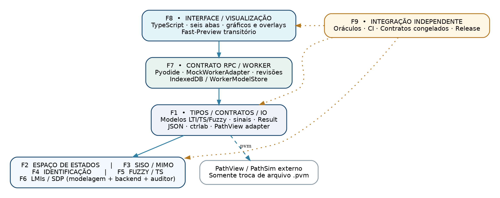
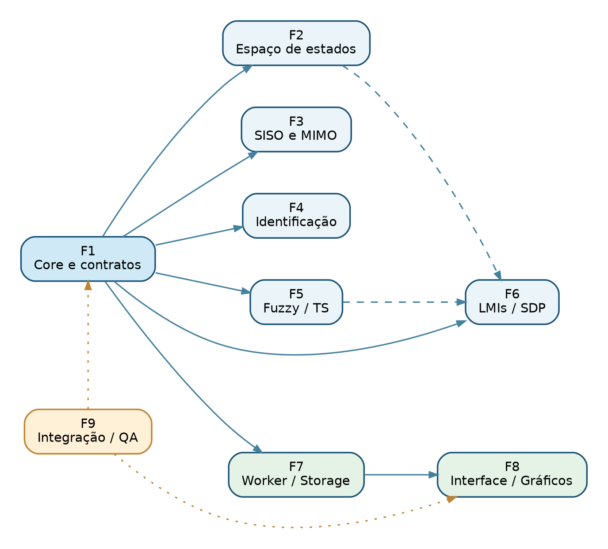

# ControlLab Web

**Ambiente Integrado, Aberto e *Local-First* para Identificação, Análise, Síntese e Verificação de Sistemas de Controle no Navegador**

[](./ControlLab_Web_Documento_Diretor_v1.0.md)
[_%2B_TypeScript-2563eb)](./ControlLab_Web_Documento_Diretor_v1.0.md#3-arquitetura-lógica-e-física)
[-059669)](./ControlLab_Web_Documento_Diretor_v1.0.md#93-pathview-como-simulador-externo)
[-d97706)](./PROJECT_STATE.json)

---

## 1. Visão Geral

O **ControlLab Web** é uma plataforma assistida por computador para ensino, pesquisa e engenharia de controle e automação, executada **100% no dispositivo do usuário (*client-side / local-first*)** sem necessidade de backend científico remoto.

O objetivo do ambiente é unificar em um único fluxo reprodutível e auditável o ciclo completo de engenharia de controle:

$$\text{Dados Experimentais} \longrightarrow \text{Modelo Identificado / Canônico} \longrightarrow \text{Requisitos} \longrightarrow \text{Síntese do Controlador} \longrightarrow \text{Auditoria Numérica} \longrightarrow \text{Simulação Externa (.pvm)} \longrightarrow \text{Arquivo Portátil (.ctrlab)}$$

### Princípios Inegociáveis de Engenharia
1. **Autoridade Científica Única (`control_lab` em Python):** Todo resultado confirmado, resíduo ou diagnóstico provém do pacote Python científico (`NumPy`/`SciPy`), que roda de forma idêntica em **CPython nativo** (via CLI/`pytest`) e no navegador via **Pyodide em Web Worker**.
2. **Interatividade a 60 FPS com Commit Autoritativo:** A interface em TypeScript pode exibir pré-visualizações cinemáticas efêmeras (*Fast-Preview*) durante o arraste de polos/ganhos, mas a persistência, os diagnósticos e a exportação exigem recálculo completo pelo motor Python no *commit* (`pointerup`).
3. **Semântica de Controle Explícita:** Convenções de sinal (`feedback_sign = "negative" | "positive"`), mapeamento dimensional de referências ($u_{ff} = N r_y$), interconexão dinâmica bem-posta e distinção estrita entre sistemas Takagi-Sugeno com premissas medidas (`ts_measured`), parcialmente observadas (`ts_partially_observed`) e incerteza politópica não medida (`polytopic_uncertain`).
4. **Verificação Independente de Solvers:** Nenhum status retornado por um solver numérico é aceito sem auditoria externa de resíduos matriciais, autovalores, simetria, condicionamento e certificados duais.

---

## 2. Arquitetura do Sistema



### Escopo Funcional (6 Abas de Projeto + Simulação Externa)

| Módulo / Aba | Frente | Escopo Técnico Principal |
| :--- | :---: | :--- |
| **1. Identificação de Sistemas** | `F4` | Importação de séries `t, u, y` (SISO/MIMO), pré-processamento, divisão treino/validação, estimação **ARX** (QR/SVD), **OE/ARMAX/BJ** e **Subespaços (MOESP/N4SID/PBSID)**, previsão de 1 passo, simulação livre, `FIT%`, RMSE e diagnóstico de persistência de excitação (PE). |
| **2. Projeto SISO na Frequência** | `F3` | Funções de transferência contínuas/discretas, Bode, Nyquist SISO, múltiplas frequências de cruzamento e margens, **Lugar das Raízes** interativo com rastreamento de ramos, síntese de **PID / Avanço-Atraso** e overlays semânticos (`exact`, `sufficient`, `heuristic`, `estimated`). |
| **3. Espaço de Estados Linear** | `F2` | Testes de posto/PBH (controlabilidade, observabilidade, estabilizabilidade, detectabilidade), gramianos, realização mínima, equações de **Lyapunov e Sylvester**, **CARE/DARE**, **LQR/LQI**, alocação de polos, observador de Luenberger, **Filtro de Kalman / LQG** e síntese $H_2/H_\infty$. |
| **4. Frequência Multivariável (MIMO)** | `F3` | Resposta em frequência matricial, **Valores Singulares ($\sigma$)**, funções de sensibilidade ($S$, $T$, $KS$ com verificação $S+T=I$), **RGA ($\Lambda(G)$)** para matrizes quadradas invertíveis, número de condição e critério de **Nyquist Multivariável** generalizado. |
| **5. Controle Fuzzy, TS e ANFIS** | `F5` | Inferência **Mamdani** e **Takagi-Sugeno**, importação/exportação no padrão **IEEE 1855-2016 (FML)**, treinamento híbrido **ANFIS** e especificação auditada de modelos dinâmicos `TSStateSpace` e controladores `PDCController`. |
| **6. Otimização Convexa e LMIs/SDPs** | `F6` | DSL algébrica afim (`sdpvar`, `bmat`, `svec`), templates clássicos (estabilização com taxa $\alpha$, $\mathcal{D}$-estabilidade, Lema Real Limitado $H_\infty$, síntese TS/PDC com termos cruzados), backends cônicos (`Clarabel`/`CVXPY` sob gate Wasm), **Verificador Espectral Independente** e solver didático de barreira/pontos interiores (`experimental/sdp_educational`). |
| **Interoperabilidade PathView / PathSim** | `F1` / `F9` | Exportação determinística da malha fechada (planta + controlador estático/dinâmico + blocos de saturação/referência) para o formato aberto **`.pvm` (v1.0.0)** do simulador externo **PathView / PathSim**, sem necessidade de manter um *fork* do simulador. |

---

## 3. Organização Operacional: 8 Frentes Produtoras + 1 Frente Independente de QA

Para permitir o desenvolvimento paralelo seguro por pesquisadores, desenvolvedores e agentes de IA sem validação circular, o código é regido por propriedade estrita de diretórios (`CODEOWNERS`):



* **`F1` — Core, Contratos e I/O (`control_lab/core/`, `diagnostics/`, `io/`):** Tipos canônicos imutáveis por revisão (`StateSpace`, `TransferFunction`, `TSStateSpace`, `StateFeedbackController`, `DynamicController`, `PDCController`, `Result`), interconexões, contêiner portátil `.ctrlab` (ZIP) e adaptador `.pvm`.
* **`F2` — Espaço de Estados (`control_lab/statespace/`):** Álgebra linear de controle, Lyapunov, CARE/DARE, LQR/LQG e simulação LTI.
* **`F3` — Frequência SISO e MIMO (`control_lab/frequency/siso/`, `mimo/`):** Bode, Lugar das Raízes, compensadores, RGA, valores singulares e Nyquist.
* **`F4` — Identificação de Sistemas (`control_lab/identification/`):** Estimação paramétrica e por subespaços, análise residual e validação estatística.
* **`F5` — Fuzzy, TS e ANFIS (`control_lab/fuzzy/`):** Motor de inferência nebulosa, padrão IEEE 1855-2016 (FML), ANFIS e semântica TS/PDC.
* **`F6` — Otimização e LMIs/SDP (`control_lab/optimization/`, `experimental/sdp_educational/`):** Compilador canônico `CanonicalSDPProblem`, adaptadores de solver, auditor independente de certificados primais/duais e solver educacional.
* **`F7` — Runtime Web, Bridge e Storage (`web/bridge/`, `worker/`, `storage/`):** Protocolo RPC `api_version="1.0"`, Web Worker Pyodide, `WorkerModelStore`, `MockWorkerAdapter`, transferência via `ArrayBuffer` e persistência transacional em `IndexedDB`.
* **`F8` — Interface e Visualização (`web/features/`, `charts/`, `app/`):** Componentes declarativos (`ToolDescriptor`), gráficos interativos, `Fast-Preview` a 60 FPS com `pending_commit` e acessibilidade WCAG 2.2 AA.
* **`F9` — Integração Independente, Oráculos e CI (`contracts/`, `tests/oracles/`, `tests/e2e/`, `.github/workflows/`):** Frente transversal não produtora de features científicas; congela schemas, mantém as *fixtures ouro* assinadas por hash, executa os Gates (`G-0A` a `G-0D`) e audita os handoffs de `F1`–`F8`.

---

## 4. Estrutura Física do Repositório

```text
controllab/
├── ControlLab_Web_Documento_Diretor_v1.0.md   # Especificação normativa completa (CL-DIR-001)
├── ControlLab_Web_Documento_Diretor_v1.0.pdf  # Versão diagramada para leitura
├── AGENTS.md                                  # Protocolo do Maestro e regras para agentes de IA
├── PROJECT_STATE.json                         # Máquina de estados, WorkPackages e status dos Gates
├── CODEOWNERS                                 # Isolamento de propriedade por frente (F1–F9)
├── pyproject.toml                             # Configuração do pacote Python control_lab (F9)
├── control_lab/                               # Motor científico Python (CPython & Pyodide)
│   ├── core/                                  # F1: Modelos canônicos e interconexões
│   ├── diagnostics/                           # F1: Envelope Result, resíduos e proveniência
│   ├── io/                                    # F1: Adaptadores .ctrlab, .pvm, CSV, MAT, FML
│   ├── statespace/                            # F2: PBH, Lyapunov, CARE/DARE, LQR/LQG
│   ├── frequency/                             # F3: Subpacotes siso/ e mimo/
│   ├── identification/                        # F4: ARX, OE, Subespaços e validação
│   ├── fuzzy/                                 # F5: Mamdani, TS, FML IEEE 1855 e ANFIS
│   ├── optimization/                          # F6: modeling/, backends/ e verification/
│   └── experimental/sdp_educational/          # F6: Solver didático isolado (Escada A–D)
├── web/                                       # Aplicação Frontend TypeScript + Web Worker
│   ├── bridge/                                # F7: Cliente RPC, Pyodide e MockWorkerAdapter
│   ├── worker/                                # F7: WorkerModelStore e execução Wasm
│   ├── storage/                               # F7: IndexedDB e snapshots locais
│   ├── features/                              # F8: Seis abas funcionais de projeto
│   ├── charts/                                # F8: Gráficos científicos e overlays
│   └── app/                                   # F8: Shell, roteamento e acessibilidade
├── contracts/                                 # Schemas JSON/RPC e Fixtures Ouro (F1 propõe, F9 aprova)
├── tests/                                     # Suítes unit/, metamorphic/, oracles/, wasm/, e2e/, security/
└── scripts/                                   # Governança de execução, benchmarks e utilitários CI
