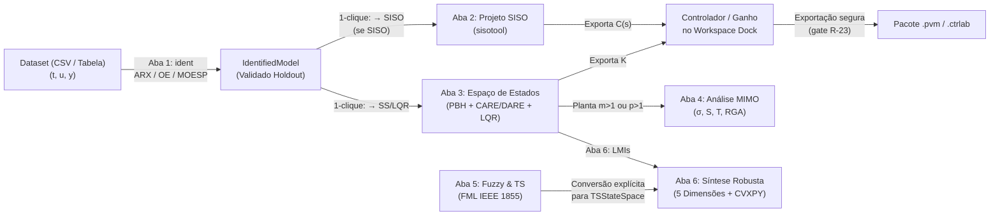

# ControlLab Web — Documento Diretor de Design, UX e Arquitetura de Interface (CL-UX-DIR-001 v1.1.0)

**Status:** Especificação Normativa de Design & UX — Revisão v1.1.0 (Fase 11: Reavaliação Integral das 7 Abas)  
**Fonte Normativa Subordinada a:** [ControlLab_Web_Documento_Diretor_v1.0.md](../../ControlLab_Web_Documento_Diretor_v1.0.md) (`CL-DIR-001 v1.0.0`) e [CL-TS-MOD-DIR-001 v1.3.0](ControlLab_Web_Modelagem_TS_qLPV_Diretor_v1.0.md)  
**Protótipo Visual Associado:** Artefato interativo `controllab_ux_mockup.html`  
**Referências de Domínio:** MATLAB System Identification App (`ident`), MATLAB Control System Designer (`sisotool`), [Laboratório Virtual Fuzzy Legado](../references/legacy_fuzzy_lab/index.html)

---

## 1. Diagnóstico da Interface Atual e Visão Alvo

### 1.1 Por que a interface atual não está satisfatória
Embora todas as funcionalidades numéricas, contratos RPC e invariantes científicos da v1.0 (`CL-DIR-001`) estejam implementados e validados pelos testes automatizados, a experiência atual no navegador sofre de quatro problemas estruturais decorrentes de implementação incremental por WorkPackage:

1. **Vazamento de terminologia interna de engenharia de software para o usuário final:** Rótulos como `core.reuse_model`, `T-ID-02`, `T-ID-03`, `Fast-Preview Transitório`, `IdentifiedModel Pendente`, `pbh_test` e `rCARE` aparecem no primeiro plano da interface, em vez de permanecerem em um inspetor técnico opcional (R-27).
2. **Ausência de hierarquia e coesão (síndrome do "tudo na mesma página"):** O arquivo [`web/app/main.ts`](../../web/app/main.ts) concentra ~2.530 linhas acopladas diretamente ao DOM, renderizando painéis de seleção tipada genéricos (`typed-workspace-panel`), logs de auditoria, campos JSON e múltiplos formulários sobrepostos no mesmo nível visual.
3. **Entrada de dados pouco ergonômica:** Estruturas matriciais, funções de transferência e séries temporais exigiram inicialmente entrada via JSON bruto ou tabelas genéricas sem fluxo guiado, quando um aluno ou pesquisador espera editores visuais diretos (`num(s)/den(s)`, grade matricial `A, B, C, D`, importação CSV com pré-visualização e presets prontos).
4. **Desconexão com o modelo mental clássico de Controle:** Quem usa ferramentas de laboratório espera o fluxo de sessão de dados/modelos do `ident`, a visão de malha fechada + 4 gráficos sincronizados do `sisotool`, e a clareza visual imediata (canvas + gráficos exportáveis) do Laboratório Fuzzy Legado.

### 1.2 Os 5 Pilares do Novo Design (atualizado pela ADR-014)

| Pilar | Regra Prática de Interface | Alinhamento com `CL-DIR-001` |
|---|---|---|
| **1. Modelo Mental de Bancada** | Cada aba espelha uma bancada clássica de controle (`ident`, `sisotool`, State-Space/LQR, MIMO, Fuzzy/TS, LMIs), com fluxo visual da esquerda para a direita ou de cima para baixo (`Entradas → Síntese → Gráficos`). | Preserva os 6 `ProjectTabId` normativos em [`web/app/tool_descriptor.ts`](../../web/app/tool_descriptor.ts). |
| **2. Divulgação Progressiva (3 Zonas)** | O workspace é dividido em: **(A) Workspace Dock** à esquerda (dados, plantas, controladores), **(B) Bancada Ativa** no centro, e **(C) Inspetor Técnico (R-27 / JSON)** recolhido por padrão à direita. | Atende R-27 (proveniência e resíduos sempre acessíveis) sem poluir o trabalho cotidiano. |
| **3. Linguagem de Engenharia** | Botões, títulos e badges usam vocabulário de sistemas de controle em português técnico claro. Schemas JSON e payloads RPC ficam em modais secundários ("Importar/Exportar JSON…") ou no Inspetor R-27. | Garante R-02 (transparência de limites e heurísticas) sem jargão de código. |
| **4. Rigor Científico Inegociável** | Separação explícita entre *Previsão 1-Passo* e *Simulação Livre*, *Atraso Exato* e *Padé*, overlays `[Heurístico]`, travamento de exportação durante arraste (`R-23`), e acessibilidade WCAG 2.2 AA (`R-26`). | 100% compatível com os contratos em [`web/app/shell.ts`](../../web/app/shell.ts). |
| **5. Definição Centralizada de Sistemas no Workspace (Workspace-First — [ADR-014](ADR-014-workspace-centralized-system-definition.md))** | Toda criação e edição de sistemas dinâmicos (`TransferFunction`, `StateSpace` Linear/Generalizada com `Bw/Dyw/Cz/Dzu/Dzw`, `polytopic_uncertain` com vértices ilimitados e `ts_measured`/`ts_partially_observed` com regras, premissas `[z_min, z_max]` e funções analíticas $h_i(z)$ ilimitadas) ocorre exclusivamente no **Workspace Dock** (`+ Novo` / `Editar`). As Abas 1–6 selecionam sistemas do Workspace e concentram estritamente parâmetros de análise e projeto, com atalhos de 1 clique (`Editar Sistema no Workspace…` / `Editar Planta no Workspace…`). | Garante fonte única de verdade (SSOT), imutabilidade por `revision`, conformidade com `state_space.schema.json` / `ts_state_space.schema.json` e persistência round-trip `.ctrlab` (R-03, R-26, R-27). |

---

## 2. Dicionário de Tradução Semântica (Interno → UX de Engenharia)

Nenhuma string técnica interna do protocolo ou da suíte de QA deve aparecer como rótulo primário na área central das abas. A tabela abaixo define a substituição obrigatória:

| Termo Atual na UI | Novo Rótulo na Bancada Principal | Onde Fica o Detalhe Técnico |
|---|---|---|
| `core.reuse_model` / `IdentifiedModel Pendente` | **"Enviar para SISO"**, **"Enviar para Espaço de Estados"** ou badge **"Pronto para projeto"** / **"Não validado em holdout"** | Inspetor R-27 (`object_ref`, `revision`, `kind`) |
| `T-ID-02` / `T-ID-03` / `B-CARE-02` | **"Sistema ARX 2ª ordem (PRBS)"**, **"Duplo Integrador (Analítico)"** | Tooltip ou sublinha discreta no seletor de exemplos |
| `Fast-Preview Transitório (R-23)` | Pill discreta **"Pré-visualizando…"** (âmbar) → **"Sincronizado"** (verde) ao soltar o slider | Bloqueio R-23 ativo nos botões de exportação com tooltip explicativo |
| `rCARE` / `sym(P)` / `scipy.linalg...` | **Status "Solução Riccati Verificada ✓"** na bancada | Inspetor R-27 (`rCARE = 1.24e-15`, backend, hashes) |
| `assertExportAllowed` / `R-23 gate` | Botão desabilitado com mensagem: *"Solte o controle deslizante para finalizar o cálculo antes de exportar."* | `ControlLabShell` / Inspetor R-27 |
| Campos de texto JSON inline | Editores visuais (matrizes, polinômios `num/den`, tabela CSV) + botão secundário **"JSON…"** que abre modal com exemplo de schema | Modal JSON e Inspetor R-27 |
| `selection.primary_plant` / `typed-workspace-panel` | **Workspace Dock** esquerdo com cartões *"Plantas & Modelos"*, *"Séries Temporais"*, *"Controladores"* | Estado interno em `TypedObjectWorkspace` |

---

## 3. Arquitetura Global do Workbench (App Shell)

### 3.1 Esqueleto Estrutural (Layout de 3 Colunas + Topo Fixo)

```text
+---------------------------------------------------------------------------------------------------+
| [∿] ControlLab Web / Motor DC — Bancada Lab 03   [● Motor Python pronto] [Salvo] [Abrir][Salvar][.pvm] |
+---------------------------------------------------------------------------------------------------+
| 1. Identificação (ident) | 2. Projeto SISO (sisotool) | 3. Estado & LQR | 4. MIMO | 5. Fuzzy | 6. LMIs |
+-------------------+-------------------------------------------------------------+-----------------+
| WORKSPACE   [+Novo]|                                                             | INSPETOR (R-27) |
|                   |                    BANCADA DA ABA ATIVA                     | (recolhido por  |
| Séries Temporais  |                                                             |  padrão; abre   |
|  ● ensaios.csv    |   [ Barra de Fluxo / Diagrama de Malha / Templates ]        |  sob demanda)   |
|  ○ degrau_fixo    |                                                             |                 |
|                   |   +-------------------------+ +-------------------------+   | rCARE: 1.2e-15  |
| Plantas & Modelos |   | Controles / Sintonia    | | Gráficos Sincronizados  |   | sym(P): 0.0e+0  |
|  ● G_planta (TF)  |   | (sliders, matrizes,     | | com Exportação:         |   | rev_projeto: 4  |
|    [→SISO][→SS]   |   |  parâmetros diretos)    | | [SVG] [PNG] [CSV] [Tab] |   |                 |
|  ○ arx221 (99.9%) |   |                         | |                         |   | Payload JSON    |
|    [→SISO][→SS]   |   +-------------------------+ +-------------------------+   | canônico {...}  |
|                   |                                                             |                 |
| Controladores     |                                                             |                 |
|  • K_lqr_v1       |                                                             |                 |
|  • C_lead         |                                                             |                 |
+-------------------+-------------------------------------------------------------+-----------------+
```

### 3.2 Regras dos Contêineres Globais

1. **Top Bar (52 px, fixa no topo):**
   - **Esquerda:** Marca `ControlLab Web` + título editável do projeto ativo (`Motor DC — Bancada Lab 03`).
   - **Direita:** Indicador compacto de prontidão do motor Python/Pyodide (`● Motor Python/Wasm pronto`), status de salvamento local (`IndexedDB`), e ações de arquivo (`.ctrlab` Abrir/Salvar e botão primário `Exportar .pvm`).
   - **Botões utilitários discretos:** Alternar visibilidade do *Workspace Dock* (útil em telas médias) e abrir/fechar *Inspetor Técnico (R-27)*.
2. **Barra de Abas (6 Workbenches):**
   - Navegação por underline limpo (inspirada em IDEs modernas e no Laboratório Fuzzy Legado), com suporte completo a teclado (`ArrowLeft`, `ArrowRight`, `Home`, `End` e `role="tablist"` em [`web/app/accessibility.ts`](../../web/app/accessibility.ts)) e persistência na URL (`#tab=...`).
3. **Workspace Dock (Coluna Esquerda, 256 px, recolhível):**
   - Substitui o atual `typed-workspace-panel` pesado no topo das telas.
   - Mantém os ativos da sessão sempre à mão, divididos em 3 grupos: **Séries Temporais (Dados)**, **Plantas & Modelos** e **Controladores Projetados**.
   - Cada item exibe representação legível (ex.: `G(s) = 1 / (s + 1)`, `FIT 99.9% • dt=0.05s`, `Politópico N vértices`, `TS N regras`, `K = [2.000, 3.000]`) e ações rápidas contextuais (`Editar`, `→ SISO`, `→ SS/LQR`, `→ MIMO`, `→ LMIs`).
   - Botão `+ Novo` (e o botão `Editar` de cada planta/sistema, conforme **Pilar 5 / ADR-014**) abre o modal unificado `#workspace-new-object-modal` para criar ou versionar (`revision + 1`):
     - `TransferFunction` (`num/den` + `dt`);
     - `StateSpace` Linear ou **Planta Generalizada** (canais `Bw, Dyw, Cz, Dzu, Dzw` em `provenance.generalized_channels`);
     - `polytopic_uncertain` com **número ilimitado de vértices** $(A_i, B_i, C_i, D_i)$ (sem teto artificial de 8 vértices) e gerador opcional $\pm\delta\%$;
     - `ts_measured` / `ts_partially_observed` com **número ilimitado de regras locais** $(A_i, B_i, C_i, D_i)$, premissas $[z_{\min}, z_{\max}]$ medidas vs. não medidas e funções analíticas de ponderação setorial $h_i(z)$ com validador convexo determinístico (sem `eval`);
     - `Dataset` (importação CSV/tabular e particionamento cronológico treino/holdout).
4. **Inspetor Técnico R-27 (Gaveta Direita, 320 px, fechada por padrão):**
   - Concentra tudo o que é auditoria científica avançada e depuração: `rCARE`, `simetria(P)`, condição numérica $\kappa$, hashes SHA-256, `project_revision`, backend utilizado (`scipy` / solver SDP nativo) e visualizador/copiador do JSON canônico.

### 3.3 Fluxo Entre Bancadas (Interoperabilidade de Objetos)



---

## 4. Especificação das 6 Bancadas de Trabalho

### 4.1 Aba 1 — Identificação de Sistemas (Estilo MATLAB `ident`)

**Objetivo de UX:** Transformar a identificação em um ciclo visual claro: **Importar Dados → Pré-processar → Estimar Múltiplos Modelos → Comparar Curvas e Resíduos → Promover para Projeto**.

```text
+---------------------------------------------------------------------------------------------+
| [1. Dados: Importar CSV / Colar]  [Pré-proc: Remover média v]  ->  [2. Estimar: ARX(2,2,1) v] |
| [ Estimação / Executar ]                                   Divisão: [70% Treino / 30% Valid] |
+---------------------------------------------------------+-----------------------------------+
| SAÍDA MEDIDA vs. MODELOS (Holdout)  [Sim. Livre v]      | MODELOS ESTIMADOS NA SESSÃO       |
|                                     [SVG][PNG][CSV]     | [x] arx221_prbs     FIT 99.9%     |
|   y(t) |     /\      /\      (y_medido vs y_hat)        |     Sim. Livre RMSE=0.0012        |
|        |____/  \____/  \____                            | [x] moesp_ord2      FIT 98.4%     |
|        +------------------------------------------> t   |     2 estados • RMSE=0.019        |
+---------------------------+-----------------------------+-----------------------------------+
| CORRELAÇÃO DE RESÍDUOS    | POLOS DISCRETOS (PLANO Z)   | [ Projetar Controlador SISO -> ]  |
| [SVG][PNG]  R_ee / R_ue   | [SVG][PNG]   círculo unit.  | [ Enviar para SS / LQR -> ]       |
|   | |                     |       .---.   x             +-----------------------------------+
| __|_|_____________________|      (  +  )                | QUALIDADE DOS DADOS & EXCITAÇÃO   |
| Bandas 95% e 99%          |       '---'   x   ρ=0.837   | Posto: 4/4 (OK) | Cond. κ: 3.82   |
+---------------------------+-----------------------------+-----------------------------------+
```

**Regras específicas de interface e rigor científico:**
- **Comparação multi-modelo no gráfico principal:** Como no `ident`, o painel direito *"Modelos Estimados na Sessão"* tem caixas de seleção que ligam/desligam múltiplas curvas simultaneamente no mesmo gráfico de saída.
- **Seletor explícito de métrica (invariante `CL-DIR-001`):** O usuário alterna explicitamente entre `Simulação Livre (Holdout)`, `Previsão 1-Passo (Holdout)` e `Dados de Treino`. O `FIT%` exibido no cartão acompanha o modo selecionado e nunca mistura os dois conceitos.
- **Alertas amigáveis de falha de hipótese:** Se o usuário selecionar o dataset `degrau_constante` para um modelo de 2ª ordem, em vez de exibir um erro críptico de SVD, exibe um banner didático: *"Excitação insuficiente (posto 2/4). Um degrau simples não excita todos os modos desta ordem — use sinal PRBS/multisseno ou reduza a ordem."*
- **Promoção para projeto com 1 clique:** Os botões *"Projetar Controlador SISO com Modelo →"* e *"Enviar para Espaço de Estados / LQR →"* registram o `IdentifiedModel` validado e já abrem a aba de destino com o modelo carregado como planta ativa.

---

### 4.2 Aba 2 — Análise e Projeto SISO na Frequência (Estilo MATLAB `sisotool`)

**Objetivo de UX:** Reunir em uma única tela a **estrutura da malha fechada**, o **sintonizador em tempo real do compensador $C(s)$** e os **4 gráficos clássicos sincronizados**.

```text
+---------------------------------------------------------------------------------------------+
| MALHA:  [ r ] -> [ Σ (r - y) v ] -> [ C(s) = 1.20*(s+1.5)/(s+4.5) ] -> [ G(s) = 1/(s+1) ] -> y |
| Margem de Fase: 74.2°  |  Margem de Ganho: ∞ dB  |  Malha Fechada: Estável  |  Sincronizado |
+---------------------------------+-----------------------------------------------------------+
| SINTONIA DO COMPENSADOR C(s)    |  +-------------------------+ +-------------------------+  |
|                                 |  | BODE (L = C·G) [SVG][PNG] | | LUGAR RAÍZES  [SVG][PNG]|  |
| Ganho K: [====●======]  1.20    |  | Mag (dB) + Marcadores   | |   [Guia ζ≥0.5 Heuríst.] |  |
| (Pré-visualiza ao arrastar;     |  | Fase (°)  ω_gc / ω_pc   | |   Ramos + Polos atuais  |  |
|  confirma no Python ao soltar)  |  +-------------------------+ +-------------------------+  |
|                                 |  +-------------------------+ +-------------------------+  |
| Dinâmica de C(s) [+ Polo/Zero]  |  | NYQUIST       [SVG][PNG]| | DEGRAU (MF)   [SVG][PNG]|  |
|  • Zero real: s = -1.50  [×]    |  | Plano Im/Re + ponto -1  | | y(t) com Mp, Tr, Ts     |  |
|  • Polo real: s = -4.50  [×]    |  +-------------------------+ +-------------------------+  |
|  [Presets: P | PI | PID | Lead] |                                                           |
|                                 |                                                           |
| Atraso & Grade de Frequência    |                                                           |
|  τ (s): [ 0.0 ] [Exato e^-jωτ v]|                                                           |
|  ω: [0.01] até [100] rad/s      |                                                           |
| [x] Guias 2ª ordem [Heurístico] |                                                           |
+---------------------------------+-----------------------------------------------------------+
```

**Regras específicas de interface e rigor científico:**
- **Diagrama de blocos clicável no cabeçalho:** Mostra $r \to \Sigma(r \mp y) \to C(s) \to G(s) \to y$ com as margens calculadas por `frequency.stability_margins` em tempo real ao lado.
- **Manipulação intuitiva de $C(s)$:** Slider contínuo de ganho $K$ (usando `pointermove` → `Fast-Preview` e `pointerup` → commit Python autoritativo), lista visual para adicionar/remover/editar polos e zeros reais ou complexos conjugados, além de presets rápidos (`Proporcional`, `PI`, `PID`, `Avanço de Fase`, `Atraso de Fase`).
- **Datatips interativos de inspeção (clique sobre a curva, estilo `sisotool`):**
  - **Diagrama de Bode:** Ao clicar na curva de magnitude ou fase, um marcador é posicionado na frequência $\omega$ mais próxima e exibe um datatip com **Frequência ($\text{rad/s}$)**, **Magnitude ($\text{dB}$)** e **Fase ($^\circ$)** sincronizados.
  - **Diagrama de Nyquist:** Ao clicar sobre o lugar geométrico, o datatip exibe **Frequência ($\text{rad/s}$)** e coordenadas **$L(j\omega) = \text{Re} + j\,\text{Im}$** correspondentes àquele ponto.
  - **Lugar das Raízes:** Ao clicar sobre qualquer ramo, o sistema resolve o ganho $K$ correspondente àquele ponto, **congela/destaca visualmente todos os polos em malha fechada** pertencentes àquele ganho $K$ sobre os respectivos ramos e lista todos eles no datatip (com opção opcional de aplicar $K$ ao compensador ou limpar o marcador).
- **Atraso de transporte explícito:** O usuário vê claramente a escolha entre `Atraso Exato e^(-jωτ)` (padrão, sem distorção de fase) e `Aproximação de Padé (Ordem 1..10)` (somente quando selecionada explicitamente).
- **Transparência sobre guias de 2ª ordem (`CL-DIR-001`):** Qualquer região de $\zeta$ ou $\omega_n$ plotada no Lugar das Raízes carrega obrigatoriamente o selo `[Heurístico]`, informando que os valores reais de sobressinal $M_p$ e acomodação $T_s$ são medidos na simulação do degrau ao lado.
- **Proteção MIMO:** Se o usuário enviar uma planta com $m > 1$ ou $p > 1$ para esta aba, a bancada exibe um cartão gentil explicando que a ferramenta é SISO (1×1) com botão direto *"Abrir na Aba 4 — Análise MIMO →"*.

---

### 4.3 Aba 3 — Espaço de Estados & Síntese LQR

**Objetivo de UX:** Eliminar o desconforto de "editar tudo em JSON", oferecendo **presets didáticos**, **grade numérica compacta de matrizes**, **diagnóstico estrutural imediato** e **comparação de experimentos**.

```text
+---------------------------------------------+-----------------------------------------------+
| PLANTA STATE-SPACE & MATRIZES               |  [Ganho K: [2.00, 3.00]] [Polos: -1,-2] [J*=6] |
| Preset: [Integrador Duplo (2x1) v] [JSON…]  |                                               |
| Dimensão: n=[2] m=[1] p=[1]  [Contínuo v]   |  +--------------------+ +-------------------+ |
|                                             |  | POLOS MA vs MF     | | ESTADOS x(t), u(t)| |
| Abas de Matriz: [ A | B | C | D ]           |  | [SVG][PNG][CSV]    | | [SVG][PNG][CSV]   | |
|   [  0.00  |  1.00  ]                       |  |   x  o             | |  x1(t), x2(t)     | |
|   [  0.00  |  0.00  ]                       |  |   x                | |  u(t)             | |
|                                             |  +--------------------+ +-------------------+ |
| [✓ Controlável (PBH)] [✓ Observável (PBH)]  |                                               |
|---------------------------------------------|  COMPARADOR DE EXPERIMENTOS                   |
| SÍNTESE LQR (u = -Kx)                       |  | Exp | Escala Q | Ganho K     | J*     |   |
| Escala Q: [====●=========] 1.0x Q           |  | #1  | 1.0x     | [2.0, 3.0]  | 6.000  |   |
| Pesos: Q₁₁=[4] Q₂₂=[5] R₁₁=[1]              |  | #2  | 4.0x     | [4.0, 4.9]  | 14.20  |   |
| [ Calcular Ganho LQR ] [Salvar Experimento] |  [ Exportar Controlador .pvm ]                |
+---------------------------------------------+-----------------------------------------------+
```

**Regras específicas de interface e rigor científico:**
- **Integração Workspace-First (ADR-014):** A barra superior `#ss-workspace-plant-bar` identifica a planta ativa do Workspace (com dimensões `n, m, p`, domínio contínuo/discreto e selo `Generalizada` quando aplicável) e oferece atalhos diretos de 1 clique **`Editar Planta no Workspace…`** (`#btn-ss-edit-plant-workspace`, abrindo o modal `#workspace-new-object-modal` pré-preenchido em modo edição) e **`+ Nova Planta`** (`#btn-ss-new-plant-workspace`). A bancada destaca os parâmetros de projeto da aba (`Q, R, x0`, método CARE/DARE, observador/LQG e comparador de experimentos).
- **Editor matricial com abas (`A | B | C | D` e `Q | R | x0`):** Em vez de despejar 6 tabelas grandes na tela, as abas alternam a matriz editada (ou mostram `A` e `B` lado a lado quando $n \le 4$), mantendo ajuste dinâmico de dimensões $(n, m, p)$ e foco nos pesos de projeto `Q | R | x0`.
- **Modal JSON opcional e documentado:** O botão `JSON…` abre um modal limpo com o formato exato esperado (`{"A": [[...]], "B": [[...]], "C": [[...]], "D": [[...]], "dt": null}`), validação imediata de dimensão e botão "Aplicar".
- **Convenção explícita de sinal (`negative` vs `positive`):** Seletor visível entre `Realimentação Negativa: u = -Kx (A - BK)` e `Positiva: u = +Kx (A + BK)`, além do método `CARE (Contínuo)` / `DARE (Discreto)`.
- **Exportação `.pvm` guiada:** Um único botão `"Exportar Controlador .pvm"` abre o modal de exportação PathView validando o bloqueio R-23 e permitindo selecionar controlador LQR estático ou dinâmico.

---

### 4.4 Aba 4 — Análise MIMO na Frequência

**Objetivo de UX:** Tornar legível o acoplamento multivariável e o condicionamento direcional sem sobrecarregar com fórmulas brutas.

```text
+---------------------------------------------------------------------------------------------+
| Planta MIMO ativa: Coluna de Destilação 2x2 (Workspace)  |  Faixa ω: [0.01]..[100] rad/s   |
| Malha: [ Saída L_o = G·K v ]  (distinção explícita vs L_i = K·G)       [ Calcular Análise ] |
+---------------------------------------------------+-----------------------------------------+
| VALORES SINGULARES σ̄ / σ̲          [SVG][PNG][CSV]| MATRIZ DE GANHO RELATIVO (RGA Λ(G(jω))) |
| [x] G(jω)  [x] Sensibilidade S  [x] T  [ ] KS     | Frequência de inspeção ω:               |
|  dB |  \   σ̄(G)                                   | [=========●===========]  ω = 1.00 rad/s |
|     |   \____                                     |                                         |
|     |     \  σ̲(G)       Identidade: ||S+T-I||=1e-15|        | u1     | u2     | Cond. κ(G):  |
|     +---------------------------------------> ω   |  y1    |  1.42  | -0.42  | 8.7 (Moderado|
|                                                   |  y2    | -0.42  |  1.42  | Diag. OK)    |
+---------------------------------------------------+-----------------------------------------+
```

**Destaques de UX:**
- **Heatmap RGA interativo por slider de frequência $\omega$:** O aluno move o slider e observa em tempo real como o pareamento entrada–saída muda entre baixa e alta frequência (com sinalização clara `"RGA indefinida — matriz singular em ω"` quando $\det(G(j\omega)) \approx 0$).
- **Toggle de curvas $\sigma(G)$, $\sigma(S)$, $\sigma(T)$ e $\sigma(KS)$** no mesmo gráfico log-log exportável em SVG/PNG/CSV.

---

### 4.5 Aba 5 — Controle Fuzzy, Takagi-Sugeno e FML (Inspirado no Lab Legado)

**Objetivo de UX:** Resgatar a ergonomia elogiada do [Laboratório Fuzzy Legado](../references/legacy_fuzzy_lab/index.html) (canvas interativo de pertinências, tabela bidimensional de regras, simulação visual e exportação de figuras), integrando ao padrão IEEE 1855-2016 FML e ao controle Takagi-Sugeno (TS).

```text
+---------------------------------------------------------------------------------------------+
| Tipo: (•) Mamdani  ( ) Takagi-Sugeno  |  [ Importar FML (XML) ] [ Exportar FML (IEEE 1855) ] |
+---------------------------------------------+-----------------------------------------------+
| FUNÇÕES DE PERTINÊNCIA (Arraste vértices)   | SUPERFÍCIE DE CONTROLE u(e, de)  [SVG][PNG]   |
| Variável: [ Erro (e) v ]  [ + Novo Termo ]  |   (Mapa de calor 2D / curvas de nível)        |
| +-----------------------------------------+ |   +---------------------------------------+   |
| |   / \     / \     / \     (Canvas 2D    | |   |  ░░░░▒▒▒▒▓▓▓▓████                     |   |
| |  /   \   /   \   /   \     interativo)  | |   |  ░░▒▒▒▒▓▓▓▓████                       |   |
| +-----------------------------------------+ |   +---------------------------------------+   |
| Tabela numérica de parâmetros (a, b, c, d)  | Métrica pontual: e=0.5, de=-0.2 -> u = 1.42   |
+---------------------------------------------+-----------------------------------------------+
| MATRIZ DE REGRAS INTERATIVA (Erro × Derivada do Erro)                     [+ Regra] [Validar]|
|        |  de: NB   |  de: Z    |  de: PB   |   Status: Cobertura 100% (sem denominador = 0)  |
|  e: NB |  [ PB v ] |  [ PM v ] |  [ Z  v ] |   Aviso científico: Aproximador estático fuzzy  |
|  e: Z  |  [ PM v ] |  [ Z  v ] |  [ NM v ] |   não equivale a TSStateSpace dinâmico.         |
+---------------------------------------------------------------------------------------------+
```

**Destaques de UX:**
- **Editor visual + numérico sincronizado:** Arrastar um vértice no canvas de pertinência atualiza os campos $(a, b, c, d)$ e vice-versa (padrão direto de `legacy_fuzzy_lab/app.js`).
- **Segurança XXE e rigor TS:** Importação XML/FML passa por parser seguro com mensagens claras de cobertura de universo ou denominador nulo em média ponderada TS.

---

### 4.6 Aba 6 — LMIs, SDPs e Síntese Robusta

**Objetivo de UX:** Unir a praticidade de **templates prontos** com a flexibilidade de um **editor de texto estilo Monaco** para escrever condições LMI personalizadas, traduzindo em tempo real o código escrito para **notação matemática legível** e mantendo transparência total das **5 dimensões do certificado** (ADR-010).

```text
+---------------------------------------------------------------------------------------------+
| [Template: Decaimento α + Estab. v] [Salvar Condição] [Carregar salva v] [Exportar/Imp .lmi]|
| [ Resolver LMI (Motor Primal-Dual Nativo) ]                    [ Exportar CVXPY / YALMIP ]  |
+-------------------------------------------------------+-------------------------------------+
| EDITOR DE CONDIÇÕES LMI (ESTILO MONACO) [Sintaxe OK]  | LEITURA MATEMÁTICA INTERPRETADA     |
|  1 | # Template inicial carregado ao abrir            | Variáveis: [var Q: sym(n)]          |
|  2 | var Q sym(n)                                     |            [var Y: rect(m, n)]      |
|  3 | var Y rect(m, n)                                 |            [param alpha = 0.5]      |
|  4 | param alpha = 0.5                                |                                     |
|  5 | Q > 0                                            | (1) Q ≻ 0                           |
|  6 | A*Q + Q*A' + B*Y + Y'*B' + 2*alpha*Q < 0         | (2) A Q + Q Aᵀ + B Y + Yᵀ Bᵀ + 2αQ≺0|
|  7 | recover K = Y * inv(Q)                           | Recuperação: K = Y Q⁻¹              |
+-------------------------------------------------------+-------------------------------------+
| CERTIFICADO DE AUDITORIA INDEPENDENTE (5 DIMENSÕES — ADR-010)                                |
| [1. Solver: optimal] [2. Auditoria: strictly_feasible] [3. Cert.: validated_dual]            |
| [4. Condicionamento κ: 4.10]  [5. Controlador K: verified ✓ (eig(A+BK) < -α)]               |
+---------------------------------------------------+-----------------------------------------+
| ESPECTRO DOS BLOCOS F_b(x*) & POLOS  [SVG][PNG]   | GANHO SINTETIZADO & AÇÕES               |
|  Autovalores mínimos das restrições LMI (λ_min)   |  K = [-2.41, -3.18]                     |
|  e alocação resultante na região D-estável        |  [ Enviar K para Workspace / .pvm ]     |
+---------------------------------------------------+-----------------------------------------+
```

**Regras específicas de UX, segurança e rigor científico:**
- **Integração Workspace-First (ADR-014):** A Aba 6 não duplica editores de sistema nem impõe tetos artificiais de vértices/regras. Em vez disso, o painel `#lmi-system-characterization-card` seleciona qualquer sistema do Workspace via **`#lmi-workspace-system-select`** (LTI, Planta Generalizada, Politópico Incerto ou Takagi-Sugeno), exibe resumo somente leitura em **`#lmi-selected-system-summary`** e fornece atalhos de 1 clique **`Editar Sistema no Workspace…`** (`#btn-lmi-edit-system-workspace`) e **`+ Novo Sistema`** (`#btn-lmi-new-system-workspace`). Permanecem na Aba 6 estritamente os controles de projeto LMI: conjuntos de índices da DSL (`i, j, k`), painel de observador TS para premissas não medidas (`#lmi-ts-unmeasured-panel` com perturbações `dA[k]`/`dC[k]`), editor DSL v2.0, compilador direto, solver SDP com cancelamento e certificado 5D.
- **Template inicial ao abrir a primeira vez:** O editor abre pré-preenchido com um template comentado (ex.: estabilização quadrática com decaimento $\alpha$), ensinando a sintaxe na prática (`var Q sym(n)`, `var Y rect(m, n)`, `bmat([[...],[...]])`, `recover K = Y * inv(Q)`). Outros templates (Quadrática, Disco $D$-estável, $H_\infty$ BRL, TS/PDC) podem ser carregados no seletor do topo.
- **Salvar e carregar condições:** O usuário pode salvar scripts nomeados na sessão local (`IndexedDB` / projeto `.ctrlab`) e exportar/importar arquivos `.lmi` passivos (texto estruturado / JSON).
- **Interpretador matemático legível (parser declarativo seguro, sem `eval`):**
  1. Um analisador léxico/sintático puro (em TypeScript na pré-visualização e compilado na camada [`control_lab/optimization/modeling/dsl.py`](../../control_lab/optimization/modeling/dsl.py) sem uso de `eval`/`exec`, preservando a política `IMPORT_UNTRUSTED_CODE`) traduz cada linha para notação matricial limpa (`A'` → `Aᵀ`, `< 0` → `≺ 0`, `bmat(...)` → grade visual de blocos).
  2. Lista variáveis e dimensões inferidas a partir do sistema selecionado no Workspace (`A`, `B`, `C`, `D`, canais generalizados `Bw/Dyw/Cz/Dzu/Dzw` e vértices/regras `A[i], B[i], C[i], D[i]`).
  3. **Detecção pedagógica de não-linearidade (BMI):** Se o usuário escrever um termo bilinear como `K*Q`, a interface sinaliza imediatamente que o termo não é afim e sugere a mudança de variáveis $Y = KQ$ com `recover K = Y * inv(Q)`.
- **Nunca mascarar resultado inconclusivo:** Se `audit_feasibility` divergir de `solver_status` (ex.: `numerical_inconclusive`), um banner de alerta sugere imediatamente reescalonamento ou o botão **"Exportar Script CVXPY / YALMIP (Python/MATLAB)"** para execução externa com MOSEK/SCS/SDPT3.
- **Limites declarados visivelmente:** Quando o problema compilado exceder o envelope do motor WebAssembly (`BROWSER_ENVELOPE`), o banner informa o limite antes do disparo e mantém a exportação offline CVXPY/YALMIP como rota principal.

---

## 5. Exportação Científica de Gráficos, Dados e Relatórios

Inspirado diretamente na função `exportOfflinePlotsPng` do [Laboratório Fuzzy Legado](../references/legacy_fuzzy_lab/app.js) e já iniciado em [`web/charts/scientific_chart.ts`](../../web/charts/scientific_chart.ts), todo gráfico da aplicação segue um contrato único de cabeçalho:

1. **Barra padrão em cada card de gráfico:** `[SVG]` (vetorial editável para LaTeX/Inkscape), `[PNG]` (raster `2×` em alta resolução com fundo branco limpo próprio para relatórios/artigos), `[CSV]` (dados tabulares numéricos com cabeçalho de unidades) e `[Tabela]` (alternância acessível WCAG 2.2 AA).
2. **Qualidade visual de relatório na exportação:**
   - Mesmo que o usuário esteja usando o tema **Alto Contraste (fundo escuro)**, a exportação `PNG` e `SVG` gera legendas legíveis, marcas de eixos com unidades (`s`, `rad/s`, `dB`, `°`) e fundo branco ou contraste garantido.
3. **Exportação composta por bancada (futuro próximo):**
   - Na Aba 2 (SISO) e Aba 1 (Identificação), oferecer opção *"Exportar Painel Completo 2×2 (PNG)"* para gerar uma prancha única pronta para entrega de relatório de laboratório (replicando o comportamento do botão `Exportar gráficos como PNG` do laboratório legado).
4. **Bloqueio R-23 transparente:**
   - Durante arraste contínuo de sliders (`Fast-Preview`), os botões de exportação exibem estado desabilitado com `aria-disabled="true"` e tooltip explicativo, sendo reabilitados automaticamente no commit autoritativo do motor Python.

---

## 6. Design System, Tokens Visuais e Acessibilidade (WCAG 2.2 AA)

Todos os tokens de cor mapeiam diretamente para [`STANDARD_AA_THEME` e `HIGH_CONTRAST_THEME`](../../web/app/accessibility.ts) para preservar 100% da conformidade de contraste ($\ge 4{,}5:1$ em texto normal e $\ge 3{,}0:1$ em componentes de UI e curvas):

| Papel Semântico | Tema Padrão (`standard_aa`) | Tema Alto Contraste (`high_contrast`) | Uso na Interface |
|---|---|---|---|
| Fundo Global (`background`) | `#F8FAFC` | `#000000` | Fundo do app shell e área de respiro |
| Superfície de Card (`surface`) | `#FFFFFF` | `#0B0F17` | Cards de gráficos, editores e Workspace Dock |
| Superfície Secundária (`surfaceAlt`) | `#EFF4F9` | `#141B29` | Barra de cabeçalho, badges, cabeçalhos de tabela |
| Texto Principal / Secundário | `#0F172A` / `#334155` | `#FFFFFF` / `#E2E8F0` | Rótulos, títulos e eixos de gráficos |
| Ação Primária (`accent`) | `#1D4ED8` (texto `#FFFFFF`) | `#93C5FD` (texto `#000000`) | Botão principal da etapa, aba ativa, seleção ativa |
| Foco de Teclado (`focusRing`) | `#0F172A` (2 px solid + offset) | `#FACC15` (2 px solid + offset) | Anel visível em todos os controles |
| Curvas Científicas | Aberta `#B45309` · Fechada `#1D4ED8` · Preview `#6D28D9` | Aberta `#FBBF24` · Fechada `#60A5FA` · Preview `#F472B6` | Distinção por cor **e** estilo de traço (sólido vs tracejado) |

### Tipografia, Alvos de Toque e Responsividade
- **Tipografia numérica:** Todos os números, matrizes, métricas (`FIT%`, `MF`, `MG`, `J*`) e tabelas usam `font-variant-numeric: tabular-nums` e fonte monoespaçada para fórmulas ($G(s)$, $C(s)$, $K$).
- **Alvos interativos ($\ge 44\text{ px}$ em ações táteis/primárias):** Preserva `MIN_TOUCH_TARGET_PX = 44` nos botões principais, abas e sliders móveis.
- **Breakpoints responsivos (sem rolagem horizontal):**
  - `≥ 1200 px` (Desktop laboratório): Top Bar + Workspace Dock (256 px) + Bancada em 2 colunas (4/8 ou 5/7) + Inspetor R-27 opcional.
  - `960 px – 1199 px` (Notebook / Tablet paisagem): Workspace Dock recolhível em gaveta sobreposta ou superior; bancada em 2 colunas adaptativas.
  - `< 960 px` (Mobile / Tela dividida): Empilhamento vertical em 1 coluna (`grid-template-columns: 1fr`), barra de abas com rolagem horizontal suave e gráficos SVG escalando fluidamente via `viewBox`.

---

## 7. Plano de Refatoração Modular (F8) e Preservação de Invariantes (F9)

A implementação deste documento diretor **não exige reescrever o motor Python (`control_lab/`) nem a ponte RPC (`web/bridge/`, `web/worker/`)**. Toda a reestruturação ocorre na camada de apresentação `web/app/` e `web/features/`, preservando o contrato existente com `ControlLabShell` e os testes normativos `T-*`.

### 7.1 Desmontagem do Monólito `web/app/main.ts`

```text
web/
  app/
    main.ts                 # Orquestrador enxuto: monta Shell, AppTopBar, WorkspaceDock, TabViews e InspectorDrawer
    shell.ts                # Intacto: máquina de estados R-23, histórico, proveniência R-27, apresentador de erros
    workspace_dock.ts       # [NOVO] Dock esquerdo (Datasets, Plantas/Modelos, Controladores) + Modal "+ Novo"
    inspector_drawer.ts     # [NOVO] Gaveta recolhível R-27 (resíduos, revisões, payload JSON canônico)
    styles.css              # Design tokens limpos, layout 3-panes, responsividade e impressão/alto contraste
  features/
    views/
      identification_view.ts # [NOVO] Bancada estilo MATLAB ident (Step bar + Multi-model board + 3 gráficos)
      siso_view.ts           # [NOVO] Bancada estilo MATLAB sisotool (Diagrama malha + Tuner C(s) + Grid 2x2)
      statespace_view.ts     # [NOVO] Bancada State-Space & LQR (Editor matricial por abas + KPIs + Comparador)
      mimo_view.ts           # [NOVO] Bancada MIMO (σ(G,S,T,KS) + Heatmap RGA com slider ω)
      fuzzy_view.ts          # [NOVO] Bancada Fuzzy/TS (Canvas de pertinência + Matriz de regras + FML)
      lmi_view.ts            # [NOVO] Bancada LMI/SDP (Editor estilo Monaco + Templates + Certificado 5D + Export CVXPY)
      lmi_dsl_parser.ts      # [NOVO] Parser declarativo seguro (sem eval) + renderização matemática + salvar/carregar .lmi
```

### 7.2 Fases Recomendadas de Execução (para aprovação do usuário)

1. **Fase UX-1 — App Shell, Workspace Dock e Inspetor R-27:** Extrair o layout global (`Top Bar`, `Workspace Dock`, `Inspector Drawer`) e limpar o jargão interno dos cabeçalhos, mantendo 100% dos IDs/atributos `data-*` ou atualizando os testes de UI F8/F9 em conjunto.
2. **Fase UX-2 — Bancadas 1, 2 e 3 (`ident`, `sisotool`, `State-Space/LQR`):** Migrar as três bancadas já em produção para a nova disposição visual, com comparador multi-modelo no `ident`, diagrama de blocos + grid 2×2 no `sisotool`, e editor matricial com modal JSON no LQR.
3. **Fase UX-3 — Bancadas 4, 5 e 6 (`MIMO`, `Fuzzy/TS`, `LMIs/SDP`) + Exportação Prancha 2×2:** Conectar os editores dedicados de MIMO, Fuzzy (baseado no Laboratório Legado) e LMIs ao motor Python, finalizando a suíte E2E no Playwright em resolução desktop e mobile.

---

## 8. Critérios de Aceite da Nova UI (Checklist de Usabilidade)

Antes de qualquer nova versão ser declarada pronta na página publicada, ela deverá passar, além dos testes funcionais `F9`, por esta verificação de experiência do usuário:

1. **Zero JSON obrigatório na tela principal:** O usuário consegue criar/editar uma planta TF, State-Space ou dataset tabular por controles diretos sem digitar JSON.
2. **Zero jargão de teste/RPC no primeiro plano:** Códigos como `T-ID-*`, `core.*` e campos crus de auditoria aparecem apenas dentro do *Inspetor Técnico (R-27)*.
3. **Fluxo entre abas em até 2 cliques:** Um modelo identificado na Aba 1 chega ao projeto SISO (Aba 2) ou LQR (Aba 3) por um único botão de ação explícita.
4. **Gráficos autoexplicativos e exportáveis:** Todo gráfico tem título claro, legenda, unidades nos eixos e botões funcionais `SVG`, `PNG` e `CSV` (respeitando o bloqueio `R-23`).
5. **Layout coeso em 1280×800 e 390×844:** Sem sobreposição de cards, sem controles órfãos e sem barra de rolagem horizontal na página.

---

## 9. Revisão v1.1.0 — Reavaliação Integral da Interface das 7 Abas (Fase 11)

Após a conclusão da Fase 10 (separação da modelagem Takagi–Sugeno/qLPV para a nova **Aba 6 — `6. Obtenção de Modelos TS (Setor, TPMT & FEMT)`** e renumeração de LMIs para a **Aba 7 — `7. LMIs, SDPs e Síntese Robusta`**), foi realizada uma reavaliação ergonômica e científica completa das **7 bancadas**. As diretrizes abaixo passam a ser normativas para a **Fase 11 (`Phase11-UX-Ergonomics-And-MultiIO`)**:

### 9.1 Princípio Transversal: Palco de Gráficos em Largura Total
Em bancadas com múltiplos gráficos científicos (especialmente **Aba 1 — Identificação**, **Aba 2 — Frequência SISO**, **Aba 3 — Espaço de Estados** e **Aba 4 — Frequência MIMO**), dividir a tela horizontalmente entre coluna de parâmetros e grade de gráficos reduz excessivamente a área útil de leitura dos eixos, curvas e marcadores.
- **Diretriz v1.1.0:** Os painéis de sintonia/parâmetros devem ser organizados em **faixa compacta acima ou abaixo** (com seções avançadas recolhíveis), liberando **100% da largura da bancada ativa** para o palco de gráficos (ex.: grade 2×2 ampla na Aba 2 e painéis lado a lado de alta legibilidade nas Abas 1, 3, 4 e 7).

### 9.2 Aba 2 — Frequência SISO: Gráficos Amplos, Nyquist Interativo e Plano $z$ Discreto
1. **Grade 2×2 em largura total:** Posicionar os controles do compensador $C(s)/C(z)$, atraso $\tau$ e grade de frequência em barra/painel compacto acima (ou abaixo) da grade 2×2, garantindo área ampla para **Bode**, **Nyquist**, **Lugar das Raízes** e **Resposta ao Degrau**.
2. **Diagrama de Nyquist interativo enriquecido:**
   - **Vetor de distância até o ponto crítico $(-1, 0)$:** Ao clicar sobre qualquer ponto $L(j\omega_0)$ da curva de Nyquist, desenhar sobre o gráfico o **segmento/vetor ligando $(-1, 0)$ a $L(j\omega_0)$** e exibir no datatip a distância euclidiana $d = |L(j\omega_0) + 1|$, a sensibilidade pontual $|S(j\omega_0)| = 1/d$ e a frequência $\omega_0$.
   - **Anotações visuais das margens de estabilidade diretamente no diagrama:**
     - **Margem de Fase (MF):** desenhar o círculo unitário $|L| = 1$, destacar o ponto de cruzamento de ganho $L(j\omega_{gc})$ e traçar o **arco angular** entre o eixo real negativo ($-180^\circ$) e $L(j\omega_{gc})$, indicando visualmente quanto o diagrama pode girar em fase antes de atingir $(-1, 0)$.
     - **Margem de Ganho (MG):** destacar o ponto de cruzamento de fase $L(j\omega_{pc}) = (-1/K_{gm}, 0)$ e traçar o **segmento sobre o eixo real negativo** até $(-1, 0)$ com rótulo do fator multiplicativo de ganho (e valor em dB) admissível antes do cruzamento com $(-1, 0)$.
3. **Lugar das Raízes no domínio discreto (`dt !== null`):**
   - **Círculo unitário $|z| = 1$ sempre visível e centralizado:** Diferente do plano $s$ contínuo (que prioriza o semi-plano esquerdo $\text{Re}(s) \le 0$), quando a planta ou compensador for discreto o gráfico **deve centralizar a origem e o círculo de raio unitário $|z| = 1$** com **razão de aspecto 1:1** (sem distorção elíptica), expandindo os limites simetricamente apenas se houver polos/zeros fora do disco unitário.
   - **Regiões heurísticas de 2ª ordem corretas no plano $z$ (`[Heurístico]`):** Em vez de reutilizar as retas/círculos do plano $s$, `web/charts/overlays.ts` e `web/charts/scientific_chart.ts` devem projetar as regiões pelo mapeamento exato $z = e^{s T_s}$ (com $T_s = \text{dt}$):
     - **Amortecimento constante ($\zeta = \text{const}$):** espirais logarítmicas $z(\theta) = \exp\!\left(-\frac{\zeta}{\sqrt{1-\zeta^2}}|\theta|\right) e^{j\theta}$ para $\theta \in [-\pi, \pi]$;
     - **Frequência natural constante ($\omega_n = \text{const}$, $\omega_n T_s \le \pi$):** arcos $z(\zeta) = \exp(-\zeta \omega_n T_s \pm j\omega_n T_s \sqrt{1-\zeta^2})$ para $\zeta \in [0, 1]$;
     - **Tempo de acomodação ($T_{\text{set}} \approx 4/\sigma_0$):** círculo concêntrico de raio espectral constante $|z| = e^{-\sigma_0 T_s}$.
     - Todas as regiões preservam obrigatoriamente o selo `[Heurístico]` e o aviso de verificação pela simulação temporal.

### 9.3 Aba 4 — Frequência MIMO: Exibição Explícita do Controlador Sintetizado na Tela
- Assim como o desacoplador de malha já exibe sua matriz de funções de transferência diretamente na interface (`formatDecouplerTransferMatrixHtml`), o resultado da síntese robusta **$\mathcal{H}_\infty$** (e demais controladores sintetizados na Aba 4) **deve ser escrito explicitamente na tela** em painel dedicado (matrizes de espaço de estados $A_k, B_k, C_k, D_k$ formatadas com precisão configurável, dimensões/polos do controlador e forma de transferência quando compacta, com ação de cópia), mantendo em paralelo o botão de registro no **Workspace Dock**.

### 9.4 Aba 5 — Renomeação para `5. Controle Fuzzy e ANFIS`, Modelo Fuzzy $N \times M$ e ANFIS via CSV
1. **Renomeação da Aba 5:** Como a derivação de modelos Takagi–Sugeno a partir de plantas qLPV possui agora a bancada dedicada **Aba 6 (`6. Obtenção de Modelos TS (Setor, TPMT & FEMT)`)**, a Aba 5 passa a chamar-se oficialmente **`5. Controle Fuzzy e ANFIS`** (`shortLabel: "Fuzzy & ANFIS"`), preservando internamente o seletor de inferência especialista **Mamdani** e **Sugeno (ordem 0/1)**.
2. **Definição livre de $N$ entradas e $M$ saídas no Modelo Fuzzy:**
   - Remover a limitação fixa de 2 entradas e 1 saída na UI: permitir ao usuário **adicionar/remover variáveis de entrada ($N \ge 1$) e de saída ($M \ge 1$)**, editar nome, universo $[u_{\min}, u_{\max}]$ e quantidade/tipo de funções de pertinência por variável;
   - **Base de regras adaptativa:** manter a matriz 2D ergonômica quando $N = 2$ e oferecer um construtor tabular estruturado `SE (x₁ é T₁) E ... ENTÃO (y₁ é S₁, ...)` para qualquer $N \ge 1, M \ge 1$;
   - **Superfície de controle configurável:** quando $N > 2$ ou $M > 1$, exibir seletores para o par de eixos $(x_a, x_b)$, valores fixos das demais entradas e variável de saída $y_k$ plotada.
3. **ANFIS com importação livre de CSV, mapeamento de colunas e MFs por entrada:**
   - Permitir upload/colagem de arquivo **`.csv`** (ou reutilização de `Dataset` do Workspace) com número arbitrário de colunas $C$;
   - Exibir pré-visualização tabular das colunas detectadas para o usuário marcar livremente **quais colunas são Entradas ($X$)** e **quais colunas são Saídas ($Y$)** (incluindo múltiplas saídas, com suporte no motor `control_lab/fuzzy/anfis.py`);
   - Permitir configurar **independentemente o número de funções de pertinência (`n_mfs[j]`) e tipo de MF** (`gaussian`, `bell`, etc.) para **cada entrada selecionada**, além de razão treino/validação, épocas e taxa de aprendizado.

### 9.5 Reavaliação de Consistência nas Abas 1, 3, 6 e 7
| Aba | Diagnóstico da Reavaliação | Melhorias Registradas para a Fase 11 |
|---|---|---|
| **Aba 1 — Identificação** | Controles laterais comprimem os gráficos de simulação livre e resíduos; importador CSV isolado do ANFIS. | Palco de gráficos em largura total (faixa superior de dados/estimação) + reaproveitamento do seletor de colunas CSV e círculo unitário centralizado nos polos discretos. |
| **Aba 2 — Frequência SISO** | Grade 2×2 comprimida; Nyquist sem vetor ao $-1$ nem arcos de MG/MF; RLocus discreto foca semi-plano esquerdo e usa guias contínuas. | Grade 2×2 em largura total; Nyquist com vetor ao $-1$ + anotações gráficas de MG/MF; RLocus discreto centrado em $|z|=1$ (1:1) com espirais $\zeta$ e curvas $\omega_n T_s$ corretas. |
| **Aba 3 — Espaço de Estados** | Mapa polo-zero discreto e layout dos gráficos podem ficar comprimidos junto às matrizes `Q/R/x0`. | Alinhar mapa polo-zero discreto com círculo unitário centralizado (1:1) + regiões discretas consistentes e palco de gráficos amplo. |
| **Aba 4 — Frequência MIMO** | Desacoplador imprime matriz na tela, mas controlador $K_\infty$ sintetizado só era inspecionável após registrar no Workspace. | Exibir explicitamente na tela o controlador $K_\infty$ $(A_k, B_k, C_k, D_k)$ (e forma compacta) + gráficos de valores singulares/RGA em maior largura. |
| **Aba 5 — Controle Fuzzy e ANFIS** | Nome ainda carrega `TS` (redundante com Aba 6); modelo fechado em 2×1; ANFIS sem upload CSV livre nem `n_mfs` por entrada. | Renomear aba para `5. Controle Fuzzy e ANFIS`; editor Fuzzy $N \times M$ livre; ANFIS com importação CSV, escolha livre de colunas $X$/$Y$ (multi-saída) e `n_mfs` individual por entrada. |
| **Aba 6 — Modelos TS** | Fluxo recém-auditado (Fase 10) e bem resolvido. | Atualizar referências cruzadas ao novo nome da Aba 5 e manter coerência visual dos gráficos com a largura total da bancada. |
| **Aba 7 — LMIs & SDPs** | Fluxo TS→PDC→PathSim funcional; exibição dos ganhos/variáveis recuperadas pode ficar mais legível e estruturada. | Exibir matrizes recuperadas ($K$, $K_r$, $P$, $Q$) em blocos matriciais formatados e copiáveis na tela + espectro $\lambda_{\min}$ em largura ampla. |

### 9.6 Mapa de WorkPackages da Fase 11 (`Phase11-UX-Ergonomics-And-MultiIO`)
1. `WP-UX11-01-F5-FUZZY-ANFIS-MULTIIO` (**F5**): suporte multi-saída ($M \ge 1$) e `n_mfs` heterogêneo por entrada em `control_lab/fuzzy/anfis.py`, mais validação $N \times M$ em `inference.py`/`fml.py`.
2. `WP-UX11-02-F7-FUZZY-ANFIS-CSV-BRIDGE` (**F7**): contrato RPC em `pyodide_worker.py` e `mock_worker.ts` para `fuzzy.fit_anfis` multi-I/O (`n_mfs` por entrada, `output_names`) e `fuzzy.evaluate_surface` em fatias 2D de sistemas $N \times M$.
3. `WP-UX11-03-F8-SISO-CHARTS-NYQUIST-DISCRETE-RLOCUS` (**F8**): layout de gráficos largos na Aba 2, Nyquist com vetor até $(-1, 0)$ e margens MG/MF desenhadas, e Lugar das Raízes / Mapa Polo-Zero discreto centrado no círculo unitário com regiões de 2ª ordem corretas no plano $z$.
4. `WP-UX11-04-F8-MIMO-CONTROLLER-DISPLAY-AND-LAYOUT` (**F8**): exibição explícita na tela do controlador $K_\infty$ na Aba 4, harmonização de palco de gráficos amplo nas Abas 1, 3, 4 e 7, e exibição matricial limpa dos ganhos/variáveis recuperadas na Aba 7.
5. `WP-UX11-05-F8-FUZZY-ANFIS-MULTIIO-UI` (**F8**): renomeação da Aba 5 para `5. Controle Fuzzy e ANFIS`, editor Fuzzy $N \times M$ livre e fluxo ANFIS completo via CSV (mapeamento livre de colunas $X$/$Y$ e `n_mfs` por entrada).
6. `WP-UX11-06-F9-PHASE11-UX-MULTIIO-AUDIT` (**F9**): oráculos matemáticos do plano $z$ discreto e ANFIS multi-saída, além de suíte E2E Playwright cobrindo todas as melhorias da Fase 11.

