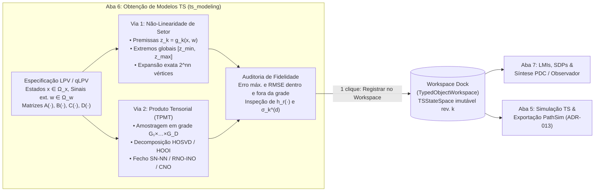

# Documento Diretor da Bancada de Obtenção de Modelos Fuzzy Takagi–Sugeno a partir de Sistemas LPV/qLPV (`CL-TS-MOD-DIR-001 v1.0.0`)

**Identificador Documental:** `CL-TS-MOD-DIR-001`  
**Versão:** `1.0.0`  
**Status:** `ACCEPTED` (Aprovado pelo Coordenador do Projeto em `2026-11-24`)  
**Subordinação Normativa:** Subordinado ao [`ControlLab_Web_Documento_Diretor_v1.0.md`](../../ControlLab_Web_Documento_Diretor_v1.0.md) (`CL-DIR-001 v1.0.0`), ao [`ControlLab_Web_Design_Diretor_v1.0.md`](ControlLab_Web_Design_Diretor_v1.0.md) (`CL-UX-DIR-001 v1.0.0`), ao [`ControlLab_Web_LMI_DSL_Design_Diretor_v1.0.md`](ControlLab_Web_LMI_DSL_Design_Diretor_v1.0.md) (`CL-LMI-DSL-DIR-001 v1.0.0`) e às decisões arquiteturais [`ADR-006`](../../ControlLab_Web_Documento_Diretor_v1.0.md), [`ADR-009`](ADR-009-personal-account-governance.md), [`ADR-010`](ADR-010-native-sdp-and-offline-exports.md), [`ADR-013`](ADR-013-pvm-nonlinear-boundary-and-pathsim-export.md) e [`ADR-014`](ADR-014-workspace-centralized-system-definition.md).  
**Implementação de Referência Científica no Repositório:** [`docs/references/tpmt_matlab/`](../references/tpmt_matlab/) (17 rotinas MATLAB de referência para álgebra tensorial em modo-$n$, HOSVD, HOOI e transformações de fecho convexo `SN-NN`, `RNO-INO`, `CNO` e `MGK`).

---

## 1. Motivação Científica, Escopo e Posicionamento na Bancada

### 1.1 O Gargalo Prático na Modelagem Takagi–Sugeno (TS) Manual
Na literatura moderna de controle não linear convexo e sistemas Lineares com Parâmetros Variantes / Quase-Lineares com Parâmetros Variantes (*LPV / qLPV*), o projeto sistemático de reguladores via Compensação Paralela Distribuída (*PDC*), observadores TS e controladores robustos $\mathcal{H}_2 / \mathcal{H}_\infty$ apoia-se em duas etapas encadeadas:

1. **Obtenção sistemática do modelo politópico/TS convexo** $\dot{x}(t) = \sum_{r=1}^{N_r} h_r(z(t))\big(A_r x(t) + B_r u(t)\big)$ (ou equivalente discreto) sobre uma região compacta de operação $\Omega$, garantindo a propriedade de soma convexa (*partição de Ruspini*):
   $$h_r(z) \ge 0 \quad (\forall r \in \{1,\dots,N_r\}), \qquad \sum_{r=1}^{N_r} h_r(z) = 1, \qquad \forall z \in \Omega_z;$$
2. **Síntese convexa via Desigualdades Matriciais Lineares (LMIs / SDPs)** sobre as matrizes vértices $(A_r, B_r, C_r, D_r)$ (com condições clássicas ou relaxadas de Tanaka/Tuan/ Sala, funções de Lyapunov comuns ou dependentes de parâmetros/particionadas).

Embora o **Workspace Dock** (`ADR-014`) já suporte o registro e a edição de modelos canônicos `TSStateSpace` com número arbitrário de regras, digitar manualmente um modelo TS realista é lento e altamente sujeito a erros algébricos: um sistema com apenas $n_n = 4$ não-linearidades setoriais (como um pêndulo invertido de 4 estados) exige calcular manualmente os extremos $[z_{k,\min}, z_{k,\max}]$ de 4 funções não-lineares, avaliar $2^4 = 16$ matrizes vértices $(A_r, B_r, C_r, D_r)$ e redigir 16 produtos analíticos de funções de pertinência $h_r(z)$. Além disso, quando o número de termos não-lineares cresce ou quando o fecho convexo setorial é excessivamente conservador para a factibilidade das LMIs, o engenheiro precisa recorrer à **Transformação do Produto Tensorial (*TP Model Transformation — TPMT*)** para inspecionar o espectro de valores singulares de alta ordem, reduzir o número de regras com erro controlado e manipular geometricamente o fecho convexo (`SN-NN`, `RNO-INO`, `CNO`).

### 1.2 Posicionamento na Navegação Global (Expansão de 6 para 7 Abas de Projeto)
Para refletir a sequência natural de engenharia entre modelagem nebulosa, derivação formal de modelos TS e síntese LMI, a barra de navegação de projeto (`PROJECT_TAB_IDS` em [`web/app/tool_descriptor.ts`](../../web/app/tool_descriptor.ts)) passa a contar com **7 abas**, inserindo a nova bancada imediatamente **após** `Controle Fuzzy, TS e ANFIS` e **antes** de `LMIs, SDPs e Síntese Robusta`:

| Ordem | ID Canônico (`ProjectTabId`) | Rótulo na UI | Papel na Jornada de Engenharia |
| :---: | :--- | :--- | :--- |
| **1** | `identification` | `1. Identificação de Sistemas` | Derivação orientada a dados (`Dataset` $\to$ `IdentifiedModel` no Workspace) |
| **2** | `siso_frequency` | `2. Controle Clássico SISO` | Bode, Nyquist, Lugar das Raízes e compensadores SISO |
| **3** | `statespace` | `3. Espaço de Estados & LQR` | Controlabilidade/observabilidade PBH, alocação, CARE/DARE e LQR/LQG |
| **4** | `mimo_frequency` | `4. Frequência MIMO & Robustez` | Valores singulares $\sigma(G)$, RGA e síntese robusta $\mathcal{H}_\infty$ |
| **5** | `fuzzy_ts` | `5. Controle Fuzzy, TS e ANFIS` | Inferência Mamdani/TS, IEEE 1855 FML, ajuste ANFIS e malha fechada não linear |
| **6** | **`ts_modeling`** *(NOVA)* | **`6. Obtenção de Modelos TS (Setor & TPMT)`** | **Derivação analítica/numérica LPV/qLPV $\to$ `TSStateSpace` via Não-Linearidade de Setor ou Produto Tensorial (HOSVD/HOOI + Fechos Convexos)** |
| **7** | `optimization_lmi` | `7. LMIs, SDPs e Síntese Robusta` | DSL v2.0 (`forall`), síntese PDC/observador/robusta sobre sistemas do Workspace e exportação CVXPY/YALMIP |

### 1.3 Harmonia Estrita com o Princípio Workspace-First (`ADR-014`)
A introdução da **Aba 6 (`ts_modeling`)** preserva integralmente a fonte única de verdade (`SSOT`) estabelecida no [`ADR-014`](ADR-014-workspace-centralized-system-definition.md):



1. **Analogia direta com a Aba 1 (`Identificação`):** assim como a Aba 1 não substitui o editor de `StateSpace` do Workspace Dock, mas **deriva** um modelo linear a partir de dados experimentais e o registra no Workspace, a Aba 6 **deriva** um objeto canônico `TSStateSpace` (`ts_measured` ou `ts_partially_observed`) a partir de uma descrição LPV/qLPV e o promove ao `TypedObjectWorkspace` como uma revisão imutável auditada (`R-27`).
2. **Rastreabilidade de Proveniência (`provenance.ts_derivation`):** o objeto `TSStateSpace` registrado carrega em `provenance.ts_derivation` toda a receita matemática usada na sua geração (equações qLPV, limites de domínio, método `sector_nonlinearity` ou `tpmt`, tolerâncias de truncamento, tipo de fecho convexo e métricas de erro), permitindo reabrir a receita na Aba 6 (`Carregar Receita do Modelo…`) para refinar a grade, trocar o fecho convexo (`SN-NN` $\to$ `CNO`) ou reduzir o posto multilinear gerando uma nova revisão `revision + 1`.

---

## 2. Arquitetura Visual e Fluxo Guiado da Aba 6 (`ts_modeling`)

Seguindo os Cinco Pilares de [`CL-UX-DIR-001`](ControlLab_Web_Design_Diretor_v1.0.md) ( Bancada Científica Clara, Divulgação Progressiva, Honestidade Visual de Verificação e Acessibilidade WCAG AA), a Aba 6 organiza-se em um fluxo guiado de **4 zonas**:

```
┌─────────────────────────────────────────────────────────────────────────────────────────────┐
│ ZONA 1: Barra de Método, Exemplos Canônicos & Promoção ao Workspace                         │
│  Método: [ (•) Via 1: Não-Linearidade de Setor  |  ( ) Via 2: Produto Tensorial (TPMT) ]    │
│  Preset: [ Pêndulo Invertido (4 est.) ▾ ] [ Validar & Gerar TS ] [ Registrar no Workspace ] │
│          [ Registrar e Abrir em LMIs → ] [ Exportar Script Python / MATLAB ]                │
├─────────────────────────────────────────────────────────────────────────────────────────────┤
│ ZONA 2: Variáveis do Sistema, Domínio Compacto Ω e Estrutura de Canais                      │
│  • Domínio de Tempo: (•) Contínuo ẋ = A(·)x + B(·)u   ( ) Discreto x[k+1] (dt = [ 0.01 ])  │
│  • Dimensões: Estados n=[4], Entradas m=[1], Saídas p=[2]  [ ] Canais Generalizados (Bw,Cz) │
│  ┌─────────────────────────────────────────┬──────────────────────────────────────────────┐ │
│  │ Estados x_i e Limites [x_min, x_max]    │ Sinais Externos / Parâmetros w_ext (Opcional)│ │
│  │ x1: [-2.0,  2.0] [x] Medido             │ theta1: [ 0.5, 1.5] [x] Medido em tempo real │ │
│  │ x2: [-3.0,  3.0] [x] Medido             │ (+ Adicionar sinal externo)                  │ │
│  │ x3: [-0.6,  0.6] [x] Medido  (rad)      │                                              │ │
│  │ x4: [-2.0,  2.0] [ ] Não medido (est.)  │ Classificação inferida: ts_partially_observed│ │
│  └─────────────────────────────────────────┴──────────────────────────────────────────────┘ │
├─────────────────────────────────────────────────────────────────────────────────────────────┤
│ ZONA 3: Especificação qLPV e Parametrização da Transformação (Dinâmica conforme Via 1 ou 2) │
│                                                                                             │
│  [SE VIA 1 — NÃO-LINEARIDADE DE SETOR]                                                      │
│   Passo 1A — Variáveis Premissas z_k = g_k(x, w_ext) e Extremos Certificados em Ω:          │
│     z1 = cos(x3)              │ Ativas: {x3}    │ Min: 0.825336  Max: 1.000000 │ [Medida]   │
│     z2 = sinc_rad(x3)         │ Ativas: {x3}    │ Min: 0.941071  Max: 1.000000 │ [Medida]   │
│     z3 = x4 * sin(x3)         │ Ativas: {x3,x4} │ Min: -1.12928  Max: 1.12928  │ [Não Med.] │
│     [Calcular Extremos Globais]  (Resultado: nn = 3 premissas ⇒ 2³ = 8 regras exatas)       │
│   Passo 1B — Matrizes qLPV Afins em z = (z1, …, z_nn):                                      │
│     Editor matricial simbólico A(z), B(z), C(z), D(z) + Verificador de Afinidade em z       │
│                                                                                             │
│  [SE VIA 2 — TRANSFORMAÇÃO DO PRODUTO TENSORIAL (TPMT)]                                     │
│   Passo 2A — Matrizes qLPV Diretas S(x, w_ext) = [A(·) B(·); C(·) D(·)]:                    │
│     Editor matricial simbólico em (x, w_ext) ⇒ Variáveis não-lineares detectadas: p=(x3,x4) │
│   Passo 2B — Discretização do Grid (G₁ × … × G_D) e Decomposição:                          │
│     Eixo d=1 (x3 ∈ [-0.6, 0.6]): G₁ = [ 101 ] pts │ Posto R₁: [ Auto (tol) / Manual: 2 ]   │
│     Eixo d=2 (x4 ∈ [-2.0, 2.0]): G₂ = [ 101 ] pts │ Posto R₂: [ Auto (tol) / Manual: 2 ]   │
│     Decomposição: (•) HOSVD  ( ) HOOI (refinamento ortogonal) │ Tol SVD: [ 1e-6 ]          │
│     Fecho Convexo por eixo: [ CNO (Volume Mínimo) ▾ ] (Opções: SN-NN | RNO-INO | CNO | MGK) │
│     [ ] Reamostrar bases em grade fina pós-SVD: [ 501 ] pts/eixo                            │
├────────────────────────────────────────────┬────────────────────────────────────────────────┤
│ ZONA 4A: Inspeção Científica & Espectro    │ ZONA 4B: Gráficos de Pertinência & Erro        │
│  • Selo de Fidelidade: EXATO / APROXIMADO  │  • Abas de gráfico Plotly/Canvas:              │
│  • Nº final de regras N_r, status SN / NN  │    1. Funções de Pertinência 1D w_{d,j}(p_d)   │
│  • Erro máx. na grade e FORA da grade      │    2. Bases HOSVD U^(d) vs. Transformadas W^(d)│
│  • (Via 2) Tabela de valores singulares    │    3. Espectro de Valores Singulares σ_k^(d)   │
│    σ_k^(d) por dimensão e cota de erro     │    4. Mapa de Calor ||S(p) - Ŝ_TS(p)||_F em Ω  │
│  • Inspetor de Matrizes Vértices (A_r,B_r) │                                                │
└────────────────────────────────────────────┴────────────────────────────────────────────────┘
```

---

## 3. Especificação Matemática e Algorítmica — Via 1: Não-Linearidade de Setor

Referências fundamentais: Tanaka & Wang (2001), Taniguchi, Tanaka, Ohtake & Wang (2001).

### 3.1 Representação qLPV Afim/Multilinear nas Variáveis Premissas
Seja $x \in \Omega_x = [\underline{x}_1, \overline{x}_1] \times \dots \times [\underline{x}_n, \overline{x}_n] \subset \mathbb{R}^n$ o vetor de estados limitado na região compacta de interesse operacional e $w_{\text{ext}} \in \Omega_w = [\underline{\theta}_1, \overline{\theta}_1] \times \dots \times [\underline{\theta}_{n_e}, \overline{\theta}_{n_e}] \subset \mathbb{R}^{n_e}$ um vetor opcional de sinais externos ou parâmetros variantes limitados. Seja $\Omega := \Omega_x \times \Omega_w$.

1. O usuário define $n_n \ge 1$ **variáveis premissas escalares** como funções contínuas em $\Omega$:
   $$z_k = g_k(x, w_{\text{ext}}), \qquad k = 1, \dots, n_n.$$
2. O usuário escreve a matriz de sistema empacotada dependente de $z = [z_1, \dots, z_{n_n}]^T$:
   $$S(z) = \begin{bmatrix} A(z) & B(z) \\ C(z) & D(z) \end{bmatrix} \in \mathbb{R}^{(n+p) \times (n+m)}$$
   (estendida com $B_w(z), D_{yw}(z), C_z(z), D_{zu}(z), D_{zw}(z)$ quando canais generalizados estiverem habilitados), onde cada entrada matricial $S_{ij}(z)$ é **afim ou multilinear** em $(z_1, \dots, z_{n_n})$ — isto é, para cada $k \in \{1, \dots, n_n\}$ fixando $z_{-k}$, a função $z_k \mapsto S(z)$ é afim ($\frac{\partial^2 S}{\partial z_k^2} \equiv 0$).

> [!IMPORTANT]
> **Validação Estrutural de Afinidade em $z$ (Prevenção de Erro Conceitual):**
> Um erro clássico de estudantes ao aplicar não-linearidade de setor é definir $z_1 = x_3$ e escrever $\sin(z_1)$ ou $z_1^2$ diretamente dentro da matriz $A(z)$, ou esquecer um estado $x_i$ explícito dentro de $A(z)$ que não foi absorvido em nenhuma variável premissa $z_k$. O backend científico (`control_lab/fuzzy/sector_nonlinearity.py`) DEVE verificar:
> 1. **Isolamento de variáveis:** as expressões de $A(z), B(z), C(z), D(z)$ na Via 1 podem referenciar **apenas** constantes numéricas e os identificadores declarados $\{z_1, \dots, z_{n_n}\}$ (qualquer referência residual a $x_i$ ou $w_{\text{ext}}$ gera diagnóstico claro orientando o usuário a criar uma premissa $z_{n_n+1} = x_i$ ou usar a Via 2);
> 2. **Multilinearidade exata:** para cada $k \in \{1,\dots,n_n\}$, avalia-se o desvio de colinearidade em pontos de teste aleatórios/determinísticos:
>    $$\Delta_{\text{aff}, k} = \left\| S(z_k = \tfrac{z_{k,\min} + z_{k,\max}}{2}, z_{-k}) - \tfrac{1}{2}\big(S(z_{k,\min}, z_{-k}) + S(z_{k,\max}, z_{-k})\big) \right\|_F.$$
>    Se $\Delta_{\text{aff}, k} > 10^{-11} (1 + \|S\|_F)$, a ferramenta bloqueia o selo de exatidão e aponta exatamente qual entrada $(i, j)$ de $A, B, C, D$ depende não-linearmente de $z_k$ (ex.: $z_1 \cdot z_1$ ou $1/z_1$).

### 3.2 Estratégia Híbrida Determinística em 3 Estágios para Cálculo Global de $[z_{k,\min}, z_{k,\max}]$
Encontrar $\underline{z}_k = \min_{(x, w) \in \Omega} g_k(x, w)$ e $\overline{z}_k = \max_{(x, w) \in \Omega} g_k(x, w)$ é uma etapa crítica:
- **Otimização não-linear local pura falha** porque funções trigonométricas/racionais em modelos mecânicos e elétricos possuem múltiplos ótimos locais;
- **Varredura em grade bruta sobre todo $\mathbb{R}^{n+n_e}$ falha por explosão exponencial** quando $n \ge 5$, além de poder subestimar um pico suave localizado *entre* dois nós da grade por $O(\Delta x^2)$ — o que faria $w_{k,0}(z_k) < 0$ no pico real e violaria a não-negatividade da função de pertinência!

Para unir garantia global, rapidez em WebAssembly e precisão de ponto flutuante (`1e-13`) nos extremos interiores, adota-se obrigatoriamente o **Pipeline Híbrido Determinístico em 3 Estágios**:

1. **Estágio 1 — Projeção no Subespaço Ativo $\Omega_k$ e Aritmética Intervalar Natural (IA):**
   - Extrai-se da árvore sintática (AST) de $g_k$ o subconjunto efetivo de variáveis $V_k = \operatorname{vars}(g_k) \subseteq \{x_1,\dots,x_n,\theta_1,\dots,\theta_{n_e}\}$ de cardinalidade $d_k = |V_k|$. Na quase totalidade dos modelos físicos (ex.: pêndulo invertido, robôs manipuladores, veículos), mesmo que $n = 6$, cada não-linearidade individual depende de apenas $d_k \in \{1, 2, 3\}$ variáveis!
   - Caso $g_k$ seja uma **Expressão de Uso Único (*Single-Use Expression — SUE*)** (cada variável de $V_k$ ocorre no máximo uma vez na AST, ex.: $\cos(x_3)$, $1 / (M + m \sin^2(x_3))$, $x_4^2 + \theta_1$), avalia-se $g_k$ por **Aritmética Intervalar exata** (tratando monotonicidade por partes de `sin`, `cos`, `sqr`, `abs`, `sinc_rad`). Pelo Teorema Fundamental da Aritmética Intervalar (Moore), quando não há repetição de variáveis, o intervalo resultante $[z_{k,\min}^{\text{IA}}, z_{k,\max}^{\text{IA}}]$ é **analiticamente exato** em tempo $O(1)$!
2. **Estágio 2 — Varredura Vetorizada Densa sobre $\Omega_k$ + Injeção Explícita de Vértices e Pontos Críticos:**
   - Avalia-se $g_k$ de forma 100% vetorizada em NumPy sobre o subdomínio efetivo $\Omega_k \subset \mathbb{R}^{d_k}$ com densidade adaptativa à dimensão ativa $d_k$:
     - $d_k = 1$: grade uniforme de $4\,097$ pontos + zero ($0$, se $0 \in \Omega_k$);
     - $d_k = 2$: malha tensorial $257 \times 257 = 66\,049$ pontos + eixos coordenados;
     - $d_k = 3$: malha $65 \times 65 \times 65 = 274\,625$ pontos + faces/arestas;
     - $d_k \ge 4$: todos os $2^{d_k}$ vértices do hiper-retângulo (para $d_k \le 10$) + grade regular grossa ($\lfloor 200\,000^{1/d_k} \rfloor$ por eixo) + sequência determinística quase-Monte Carlo de **Sobol** (`scipy.stats.qmc.Sobol`, semente fixa) com $65\,536$ amostras cobrindo uniformemente o interior.
3. **Estágio 3 — Refinamento Contínuo Multi-Start Restrito à Caixa (`Brent` / `L-BFGS-B`):**
   - Selecionam-se os $M = 8$ menores candidatos distintos e os $M = 8$ maiores candidatos distintos encontrados no Estágio 2 e dispara-se otimização contínua restrita aos limites da caixa $\Omega_k$ (`scipy.optimize.minimize_scalar(..., method="bounded")` se $d_k = 1$; `scipy.optimize.minimize(..., method="L-BFGS-B", bounds=...)` com fallback `Powell` se $d_k \ge 2$) para minimizar $g_k$ e $-g_k$.
   - Toma-se $z_{k,\min} = \min(\text{grade}, \text{polimento})$ e $z_{k,\max} = \max(\text{grade}, \text{polimento})$, registrando também os pontos testemunhas $(x_k^{\arg\min}, w_k^{\arg\min})$ e $(x_k^{\arg\max}, w_k^{\arg\max})$ para exibição didática na UI.
   - **Override Manual Seguro:** o usuário pode editar manualmente $[\underline{z}_k^{\text{user}}, \overline{z}_k^{\text{user}}]$ (por exemplo, para arredondar $0.8253356 \to 0.8253$ a fim de bater com um artigo publicado), **desde que** $\underline{z}_k^{\text{user}} \le z_{k,\min} + 10^{-12}$ e $\overline{z}_k^{\text{user}} \ge z_{k,\max} - 10^{-12}$. Se o usuário tentar estreitar o intervalo deixando parte de $g_k(\Omega)$ para fora do setor, a UI exibe alerta explícito de violação de positividade ($w_{k,j} < 0$).
   - **Detecção de Premissa Degenerada:** se $z_{k,\max} - z_{k,\min} \le 10^{-12}$, a variável $z_k$ é constante em $\Omega$; o sistema alerta o usuário e sugere substituí-la pelo valor escalar constante, economizando metade das regras!

### 3.3 Construção Exata dos $2^{n_n}$ Vértices e das Funções de Pertinência Normalizadas
Com $[z_{k,\min}, z_{k,\max}]$ determinados ($z_{k,\max} > z_{k,\min}$) para $k = 1, \dots, n_n$:

1. Cada variável premissa é decomposta exatamente como combinação convexa de seus extremos:
   $$z_k = w_{k,0}(z_k)\, z_{k,\max} + w_{k,1}(z_k)\, z_{k,\min},$$
   onde as funções de ponderação elementares de setor são:
   $$w_{k,0}(z_k) = \frac{z_k - z_{k,\min}}{z_{k,\max} - z_{k,\min}}, \qquad w_{k,1}(z_k) = \frac{z_{k,\max} - z_k}{z_{k,\max} - z_{k,\min}} = 1 - w_{k,0}(z_k).$$
2. Enumeram-se as $N_r = 2^{n_n}$ regras em ordem lexicográfica binária determinística $r \in \{1, \dots, 2^{n_n}\}$, associando a $r$-ésima regra (índice base zero $r - 1 \in \{0, \dots, 2^{n_n}-1\}$) à palavra binária $(b_{r,1}, \dots, b_{r,n_n}) \in \{0, 1\}^{n_n}$, onde $b_{r,k} = 0$ seleciona $z_{k,\max}$ ($w_{k,0}$) e $b_{r,k} = 1$ seleciona $z_{k,\min}$ ($w_{k,1}$):
   - **Vértice de premissa:** $z^{(r)} = \big[z_{1}^{(b_{r,1})}, \dots, z_{n_n}^{(b_{r,n_n})}\big]^T$, com $z_k^{(0)} := z_{k,\max}$ e $z_k^{(1)} := z_{k,\min}$;
   - **Matrizes vértices da regra $r$:** $(A_r, B_r, C_r, D_r) := \big(A(z^{(r)}), B(z^{(r)}), C(z^{(r)}), D(z^{(r)})\big)$;
   - **Função de pertinência normalizada da regra $r$:**
     $$h_r(z) = \prod_{k=1}^{n_n} w_{k, b_{r,k}}(z_k).$$
3. Por construção algébrica e multilinearidade de $S(z)$, valem identicamente em todo $(x, w_{\text{ext}}) \in \Omega$:
   $$h_r(z) \ge 0, \qquad \sum_{r=1}^{2^{n_n}} h_r(z) = \prod_{k=1}^{n_n} \big(w_{k,0}(z_k) + w_{k,1}(z_k)\big) = 1, \qquad \sum_{r=1}^{2^{n_n}} h_r\big(g(x, w_{\text{ext}})\big) S_r = S\big(g(x, w_{\text{ext}})\big).$$

### 3.4 Gramática de Expressões Simbólicas Seguras (Zero `eval`) e Primitivas Numéricas Estáveis
Tanto no Python (`control_lab/fuzzy/symbolic_qlpv.py`) quanto no TypeScript (`web/features/ts_modeling/`), todas as expressões $g_k(x, w_{\text{ext}})$ e entradas matriciais $S_{ij}(\cdot)$ são analisadas por um **parser recursivo descendente determinístico sobre AST tipada** (proibição absoluta de `eval`, `exec` ou `new Function`, conforme `R-21`):

- **Operadores suportados:** `+`, `-` (unário e binário), `*`, `/`, `^` (ou `**`, restrito a expoentes escalares reais finitos).
- **Constantes reservadas:** `pi`, `e`.
- **Funções matemáticas elementares:** `sin`, `cos`, `tan`, `asin`, `acos`, `atan`, `sinh`, `cosh`, `tanh`, `exp`, `log`, `sqrt`, `abs`, `sign`.
- **Primitiva especial para singularidade removível (`sinc_rad`):** em sistemas mecânicos pendulares e robóticos aparece universalmente o termo $\frac{\sin(x_i)}{x_i}$, cuja avaliação ingênua divide `0/0 = NaN` em $x_i = 0$! O avaliador fornece nativamente **`sinc_rad(u)`** definida de forma suave $C^\infty$ por expansão de Taylor em torno da origem:
  $$\operatorname{sinc\_rad}(u) := \begin{cases} 1 - \dfrac{u^2}{6} + \dfrac{u^4}{120}, & |u| < 10^{-4}, \\[6pt] \dfrac{\sin(u)}{u}, & |u| \ge 10^{-4}, \end{cases}$$
  (bem como `cos1m_div_u(u)` $= \frac{1 - \cos(u)}{u}$ com série $\frac{u}{2} - \frac{u^3}{24}$ perto de $0$). Além disso, se o usuário escrever literalmente `sin(x3)/x3`, o simplificador de AST detecta o padrão `sin(E)/(E)` e sugere/converte automaticamente para `sinc_rad(E)` com aviso amigável!

---

## 4. Especificação Matemática e Algorítmica — Via 2: Transformação do Produto Tensorial (TPMT)

Referências fundamentais: Baranyi, Tikk, Yam & Patton (2003); Baranyi (2004, 2024a, 2024b); De Lathauwer, De Moor & Vandewalle (2000a, 2000b); Yam, Baranyi & Yang (1999); Várkonyi, Tikk, Korondi & Baranyi (2005); Matszangosz, Nagy & Baranyi (2008); Nagy, Petres, Baranyi & Hashimoto (2009); Campos, Souza, Tôrres & Palhares (2013); Campos, Tôrres & Palhares (2015); Campos (Tese PPGEE/UFMG `198D`); e código de referência [`docs/references/tpmt_matlab/`](../references/tpmt_matlab/).

### 4.1 Interpretação Estrutural: Bases de Interpolação $\to$ Funções de Pertinência Convexas
Seguindo a formulação e interpretação consolidadas em Campos, Tôrres & Palhares ([*Asian Journal of Control*, 2015](https://doi.org/10.1002/asjc.866)) e nas rotinas de [`docs/references/tpmt_matlab/`](../references/tpmt_matlab/), a TPMT desacopla nitidamente **aproximação funcional multilinear** e **estruturação convexa para LMIs**:

1. **Extração das Variáveis Não-Lineares Ativas $p \in \Omega_p \subset \mathbb{R}^D$:**
   - Dada a matriz de sistema qLPV $S(x, w_{\text{ext}}) = \begin{bmatrix} A(x, w_{\text{ext}}) & B(x, w_{\text{ext}}) \\ C(x, w_{\text{ext}}) & D(x, w_{\text{ext}}) \end{bmatrix} \in \mathbb{R}^{M_1 \times M_2}$ (com $M_1 = n + p_{\text{out}}$, $M_2 = n + m$, ou maior se canais generalizados estiverem ativos), inspecionam-se todas as entradas $S_{ij}$ para extrair o vetor mínimo de parâmetros/estados ativos:
     $$p = [p_1, \dots, p_D]^T \in \Omega_p = [\underline{p}_1, \overline{p}_1] \times \dots \times [\underline{p}_D, \overline{p}_D] \subset \mathbb{R}^D.$$
   - Estados que entram apenas linearmente na dinâmica $\dot{x} = A(p)x + B(p)u$ **não** aparecem dentro de $A(p), B(p), C(p), D(p)$ e, portanto, **não aumentam a ordem $D$ do tensor** (mitigando a explosão dimensional, em linha com Nagy et al., 2009).

2. **Amostragem Discretizada no Tensor $\mathcal{S}^D$:**
   - Define-se para cada eixo $d \in \{1, \dots, D\}$ uma grade estritamente crescente $g^{(d)} = [g^{(d)}_1, \dots, g^{(d)}_{G_d}]^T$ com $g^{(d)}_1 = \underline{p}_d$ e $g^{(d)}_{G_d} = \overline{p}_d$ ($G_d \ge 3$).
   - Avalia-se $S(p)$ de forma vetorizada sobre o produto cartesiano $g^{(1)} \times \dots \times g^{(D)}$, armazenando um tensor de ordem $(D + 2)$:
     $$\mathcal{S}^D \in \mathbb{R}^{G_1 \times \dots \times G_D \times M_1 \times M_2}, \qquad \mathcal{S}^D_{k_1, \dots, k_D, :, :} = S\big(g^{(1)}_{k_1}, \dots, g^{(D)}_{k_D}\big).$$
   - Os primeiros $D$ modos correspondem às direções paramétricas/estaduais, enquanto os **2 últimos modos (`ord_func = 2`)** representam as linhas e colunas da matriz de espaço de estados e **permanecem intocados** durante a decomposição (exatamente como em [`hosvd_sampled_func.m`](../references/tpmt_matlab/hosvd_sampled_func.m) e [`hooi_sampled_func.m`](../references/tpmt_matlab/hooi_sampled_func.m)).

### 4.2 Álgebra Tensorial Vetorizada e Decomposições HOSVD e HOOI (Sem `np.linalg.inv`)

1. **Desdobramento em Modo-$d$ (*Mode-$d$ Unfolding*) e Produto em Modo-$d$:**
   - Substituindo os laços escalares de [`n_mode.m`](../references/tpmt_matlab/n_mode.m) e [`n_mode2tensor.m`](../references/tpmt_matlab/n_mode2tensor.m) por operações C/BLAS nativas do NumPy (`np.moveaxis` + `reshape`), o desdobramento $\mathcal{A}_{(d)} \in \mathbb{R}^{I_d \times \prod_{l \ne d} I_l}$ move o eixo $d$ para a frente preservando a ordem determinística dos demais eixos, satisfazendo a bijeção exata `fold_mode_d(unfold_mode_d(A, d), d, A.shape) == A`.
   - O produto em modo-$d$ $\mathcal{B} = \mathcal{A} \times_d M$ ($M \in \mathbb{R}^{J \times I_d}$) é calculado via `np.tensordot(M, A, axes=([1], [d]))` + `np.moveaxis(..., 0, d)`.

2. **Opção A — HOSVD Compacta/Truncada (`hosvd_sampled_func`):**
   - Para cada modo paramétrico $d = 1, \dots, D$:
     1. Calcula-se a SVD econômica de $\mathcal{S}^D_{(d)} = \tilde{U}^{(d)} \Sigma^{(d)} (V^{(d)})^T$ com valores singulares de modo-$d$ $\sigma^{(d)}_1 \ge \sigma^{(d)}_2 \ge \dots \ge \sigma^{(d)}_{r_{\max, d}} \ge 0$;
     2. Determina-se o posto $R_d \in \{1, \dots, r_{\max, d}\}$:
        - **Modo Automático por Tolerância (`tol`):** mantém todos os $k$ tais que $\sigma^{(d)}_k / \sigma^{(d)}_1 > \text{tol}$ (ou $\sigma^{(d)}_k > \text{tol}_{\text{abs}}$ se $\sigma^{(d)}_1 = 0$), garantindo pelo menos $R_d \ge 1$;
        - **Modo Manual por Posto $(R_1, \dots, R_D)$:** selecionado interativamente pelo usuário após visualizar a queda dos valores singulares na UI!
     3. Retém-se a matriz de funções de base ortonormais $U^{(d)} = \tilde{U}^{(d)}_{:, 1:R_d} \in \mathbb{R}^{G_d \times R_d}$.
   - O tensor de núcleo inicial é obtido por contrações sucessivas:
     $$\mathcal{S}_0 = \mathcal{S}^D \times_1 (U^{(1)})^T \times_2 \dots \times_D (U^{(D)})^T \in \mathbb{R}^{R_1 \times \dots \times R_D \times M_1 \times M_2},$$
     satisfazendo a cota clássica de erro de truncamento de De Lathauwer et al. (2000a):
     $$\left\| \mathcal{S}^D - \mathcal{S}_0 \times_{d=1}^D U^{(d)} \right\|_F^2 \le \sum_{d=1}^D \sum_{k = R_d + 1}^{r_{\max, d}} \big(\sigma^{(d)}_k\big)^2.$$

3. **Opção B — HOOI (*Higher-Order Orthogonal Iteration*, `hooi_sampled_func`):**
   - Quando o usuário opta por **redução de regras** ($R_d < \operatorname{rank}(\mathcal{S}^D_{(d)})$), a HOSVD truncada é quase-ótima mas não necessariamente ótima em norma de Frobenius. A HOOI (De Lathauwer et al., 2000b; [`hooi_sampled_func.m`](../references/tpmt_matlab/hooi_sampled_func.m)) refina iterativamente as bases ortonormais $U^{(1)}, \dots, U^{(D)}$ inicializadas pela HOSVD:
     - Em cada varredura $t = 1, \dots, k_{\max}$ (padrão $k_{\max} = 50$, parada antecipada quando $\max_d \|U^{(d)}_{(t)} (U^{(d)}_{(t)})^T - U^{(d)}_{(t-1)} (U^{(d)}_{(t-1)})^T\|_F \le \varepsilon_{\text{hooi}} = 10^{-9}$):
     - Para $d = 1, \dots, D$: contrai-se $\mathcal{Y}^{(d)} = \mathcal{S}^D \bigtimes_{l \in \{1,\dots,D\} \setminus \{d\}} (U^{(l)})^T$ **por produtos em modo-$l$ sequenciais** (nunca materializando o produto de Kronecker explícito $\bigotimes_{l \ne d} U^{(l)}$, o que economiza ordens de grandeza em RAM no WebAssembly!), desdobra-se $\mathcal{Y}^{(d)}_{(d)}$ e atualiza-se $U^{(d)}$ com os $R_d$ primeiros vetores singulares esquerdos de $\mathcal{Y}^{(d)}_{(d)}$.
     - Ao convergir, calcula-se $\mathcal{S}_0 = \mathcal{S}^D \bigtimes_{d=1}^D (U^{(d)})^T$. A convergência monotônica não-crescente do erro $\|\mathcal{S}^D - \hat{\mathcal{S}}^D\|_F$ é garantida e auditada.

4. **Reamostragem Opcional das Bases de Interpolação em Grade Fina:**
   - Conforme demonstrado no Passo 3 de [`test_uni.m`](../references/tpmt_matlab/test_uni.m) e em Campos, Tôrres & Palhares (2015), como as colunas de $U^{(d)} \in \mathbb{R}^{G_d \times R_d}$ representam amostras 1D das funções de base de interpolação sobre $g^{(d)}$, o usuário pode opcionalmente reinterpolá-las sobre uma grade densa $\tilde{g}^{(d)}$ ($G^{\text{fino}}_d > G_d$, via interpolação linear por partes ou spline cúbica Hermite PCHIP que preserva monotonicidade) **antes** de calcular a matriz de transformação de fecho convexo $T_d$, garantindo não-negatividade mais rigorosa entre nós grosseiros sem pagar o custo de amostrar o tensor multidimensional inteiro na grade fina!

### 4.3 Transformações das Funções de Base em Funções de Pertinência Convexas

Para converter a decomposição de Tucker parcial $\hat{\mathcal{S}}^D = \mathcal{S}_0 \bigtimes_{d=1}^D U^{(d)}$ em um modelo Takagi–Sugeno convexo sem alterar a representação interpolada, busca-se para cada modo $d \in \{1, \dots, D\}$ uma matriz de transformação $W^{(d)}$ e o contra-ajuste correspondente do tensor de núcleo tais que:
1. **SN (*Sum Normalization*):** $W^{(d)} \mathbf{1}_{R'_d} = \mathbf{1}_{G_d}$ (soma 1 em todos os pontos da grade);
2. **NN (*Non-Negativity*):** $W^{(d)}_{k, j} \ge 0$ para todo $k \in \{1, \dots, G_d\}$ e $j \in \{1, \dots, R'_d\}$.

> [!CAUTION]
> **Proibição Normativa de `np.linalg.inv` (`CL-DIR-001`):**
> Onde os scripts MATLAB de referência escrevem `ls_sol = inv(U'*U)*U'*ones(...)` e `Sd = n_mode_product(Sd, inv(T), d)`, a implementação em Python (`control_lab/fuzzy/tpmt.py`) **JAMAIS** invoca `linalg.inv`. Utiliza-se obrigatoriamente:
> - `scipy.linalg.lstsq(U, np.ones(G_d))` para a projeção de soma unitária;
> - `scipy.linalg.solve(T_d.T, S_unfolded.T).T` (ou `scipy.linalg.lu_factor` / `lu_solve` com auditoria de `np.linalg.cond(T_d)`) para aplicar $\mathcal{S} \leftarrow \mathcal{S} \times_d T_d^{-1}$!

Suportam-se **4 transformações canônicas** selecionáveis por dimensão $d \in \{1, \dots, D\}$:

#### 4.3.1 Etapa Base `SN-NN` (Soma Normalizada e Não-Negativa — [`sn_nn_matrix.m`](../references/tpmt_matlab/sn_nn_matrix.m))
Dada $U^{(d)} \in \mathbb{R}^{G_d \times R_d}$:
1. **Normalização de Soma (SN):** resolve-se $\min_\alpha \|U^{(d)} \alpha - \mathbf{1}_{G_d}\|_\infty$ (via `lstsq`).
   - Se $\|U^{(d)} \alpha - \mathbf{1}_{G_d}\|_\infty \le \varepsilon_{\text{sn}}$ (padrão $10^{-6}$, significando $\mathbf{1}_{G_d} \in \operatorname{col}(U^{(d)})$): completa-se $\alpha$ em uma matriz não-singular $T_{\text{SN}} \in \mathbb{R}^{R_d \times R_d}$ (substituindo uma coluna $j^*$ com $|\alpha_{j^*}| = \max_j |\alpha_j| > 0$ por $\mathbf{1} - \sum_{j \ne j^*} u_j$, ou via QR com coluna líder $\alpha$), obtendo $U_{\text{SN}} = U^{(d)} T_{\text{SN}}$ com $R'_d = R_d$ e atualizando $\mathcal{S} \leftarrow \mathcal{S} \times_d T_{\text{SN}}^{-1}$ via `linalg.solve`.
   - Se $\|U^{(d)} \alpha - \mathbf{1}_{G_d}\|_\infty > \varepsilon_{\text{sn}}$ ($\mathbf{1}_{G_d} \notin \operatorname{col}(U^{(d)})$): acrescenta-se uma $(R_d + 1)$-ésima coluna $u_{R_d+1} = \mathbf{1}_{G_d} - \sum_{j=1}^{R_d} U^{(d)}_{:, j}$ (de modo que $R'_d = R_d + 1$ e $\sum_{j=1}^{R'_d} u_j = \mathbf{1}_{G_d}$) e anexa-se uma **fatia nula** ao tensor de núcleo no modo $d$, preservando exatamente $\mathcal{S}_0 \times_d U^{(d)} = \mathcal{S}_{\text{ext}} \times_d U_{\text{SN}}$!
2. **Não-Negatividade (NN):** seja $\mu_j = \min_{1 \le k \le G_d} (U_{\text{SN}})_{k, j}$ e $\gamma_j = \min(0, \mu_j) \le 0$. Define-se a transformação afim inversível:
   $$T_{\text{NN}} = \frac{1}{1 - \sum_{l=1}^{R'_d} \gamma_l} \Big( I_{R'_d} - \mathbf{1}_{R'_d} \gamma^T \Big), \qquad W^{(d)}_{\text{SN-NN}} = U_{\text{SN}} T_{\text{NN}},$$
   atualizando $\mathcal{S} \leftarrow \mathcal{S} \times_d T_{\text{NN}}^{-1}$ via `linalg.solve` (ou pela identidade fechada de Sherman–Morrison $T_{\text{NN}}^{-1} = (1 - \sum_l \gamma_l) I_{R'_d} + \mathbf{1}_{R'_d} \gamma^T$, que é exata, sem divisão instável!).

#### 4.3.2 Transformação `RNO-INO` (*Relaxed Normalized – Inverse Normalized* — [`rno_ino_matrix.m`](../references/tpmt_matlab/rno_ino_matrix.m))
Partindo de $U_{\text{in}} = W^{(d)}_{\text{SN-NN}} \in \mathbb{R}^{G_d \times r}$ ($r := R'_d$, já SN e NN):
- Para $r = 1$: trivial ($W = \mathbf{1}$). Para $r = 2$: reescalonamento direto exato llevando o mínimo de cada coluna a $0$ e o máximo a $1$ (`INO = RNO`).
- Para $r \ge 3$: executa-se a decomposição recursiva de Várkonyi, Tikk, Korondi & Baranyi (2005) implementada em [`rno_ino_matrix.m`](../references/tpmt_matlab/rno_ino_matrix.m) (`Ta`, projeção da última coluna ao zero mínimo; subproblema recursivo de dimensão $r-1$ gerando `Tb`; equalização dos mínimos secundários `Tc`; e **busca determinística por bisseção em $\phi \in [0, 1]$** para `Td` até tolerância $10^{-11}$ maximizando os picos das funções de pertinência sem violar $W \ge 0$), compondo $T_{\text{RNO-INO}} = T_a T_b T_c T_d$ e atualizando $\mathcal{S} \leftarrow \mathcal{S} \times_d T_{\text{RNO-INO}}^{-1}$ via `linalg.solve`.

#### 4.3.3 Transformação `CNO` (*Close to Normalized* / Simplex de Volume Mínimo — [`cno_matrix.m`](../references/tpmt_matlab/cno_matrix.m))
O fecho `CNO` produz o simplex de volume mínimo contendo a trajetória da curva base $U_{\text{in}} = W^{(d)}_{\text{SN-NN}} \in \mathbb{R}^{G_d \times r}$, encaixando os vértices $(A_r, B_r)$ o mais próximo possível da imagem verdadeira de $S(p)$ — crucial para viabilizar LMIs com menor conservadorismo:
1. **Redução Geométrica de Restrições via Fecho Convexo (`ConvexHull`):** como $U_{\text{in}} \mathbf{1}_r = \mathbf{1}_{G_d}$, a nuvem de $G_d$ linhas mora no hiperplano afim de dimensão $r - 1$. Extrai-se o subconjunto de índices dos vértices extremos $\mathcal{H} \subseteq \{1, \dots, G_d\}$ de $U_{\text{in}}(:, 1:r-1)$ usando `scipy.spatial.ConvexHull` (com fallback automático para todas as linhas únicas quando $r \le 2$ ou em subespaço degenerado `QhullError`). Isso reduz $G_d = 500$ restrições para tipicamente $|\mathcal{H}| \in [3, 25]$ vértices!
2. **Otimização Determinística sem YALMIP no Browser:** como tipicamente $r \in \{2, 3, 4, 5\}$ ($r^2 \le 25$ variáveis escalares!) e $T_0 = I_r$ já é um ponto inicial viável ($U_{\mathcal{H}} I_r \ge 0$, $U_{\mathcal{H}} I_r \mathbf{1}_r = \mathbf{1}_{|\mathcal{H}|}$), resolve-se o problema convexo em $T \in \mathbb{R}^{r \times r}$ parametrizando automaticamente a restrição de igualdade afim $T \mathbf{1}_r = \mathbf{1}_r$ (eliminando a última coluna $T_{:, r} = \mathbf{1}_r - \sum_{j=1}^{r-1} T_{:, j}$, de modo que **SN é satisfeita identicamente por construção**!):
   $$\min_{T_{:, 1:r-1} \in \mathbb{R}^{r \times (r-1)}} -\log |\det T| \qquad \text{sujeito a} \quad U_{\mathcal{H}}\, T \ge 0.$$
   - Para $r = 2$: a solução analítica fechada coincide exatamente com o aperto afim de fronteira em $O(G_d)$ operações (zero iterações!).
   - Para $r \ge 3$: resolve-se via `scipy.optimize.minimize(..., method="SLSQP")` com gradiente analítico $\nabla_T (-\log|\det T|) = -T^{-T}$ (calculado via `linalg.solve`) inicializado em $T_0 = I_r$ (com perturbação interior estrita se necessário) e projeção final de pós-verificação garantindo $\min(U^{(d)} T) \ge -10^{-12}$ (clamping de ruído numérico sub-`1e-12` + renormalização exata de linha). Caso o problema seja mal-condicionado ($\operatorname{cond}(T) > 10^{10}$), emite-se aviso diagnóstico e aplica-se fallback seguro para `RNO-INO`.

#### 4.3.4 Transformação `MGK` (Opcional Avançada — [`mgk_matrix.m`](../references/tpmt_matlab/mgk_matrix.m))
Disponibilizada como opção avançada para reprodução direta de experimentos acadêmicos baseados em [`mgk_matrix.m`](../references/tpmt_matlab/mgk_matrix.m), acompanhada de verificação explícita pós-transformação: se para uma dada geometria de $U^{(d)}$ a heurística `MGK` não atingir $W^{(d)} \ge -10^{-9}$, a interface sinaliza `NN_VIOLATED` e recomenda `RNO-INO` ou `CNO`.

### 4.4 Extração dos Vértices $(A_r, B_r, C_r, D_r)$ e Interpolação Contínua entre Nós da Grade
Ao término das transformações em todos os modos $d = 1, \dots, D$, tem-se o tensor de núcleo transformado $\mathcal{S} \in \mathbb{R}^{R'_1 \times \dots \times R'_D \times M_1 \times M_2}$ e as matrizes de pertinência discretizadas $W^{(d)} \in \mathbb{R}^{G_d \times R'_d}$ sobre as grades $g^{(d)}$:

1. **Enumeração Canônica de Regras:** enumeram-se os multi-índices $\mathbf{i}_r = (i_{r,1}, \dots, i_{r,D}) \in \{1,\dots,R'_1\} \times \dots \times \{1,\dots,R'_D\}$ em ordem lexicográfica ($r = 1, \dots, N_r$, onde $N_r = \prod_{d=1}^D R'_d$). Cada fatia matricial $\mathcal{S}_{i_{r,1}, \dots, i_{r,D}, :, :} \in \mathbb{R}^{M_1 \times M_2}$ é desempacotada nos blocos $(A_r, B_r, C_r, D_r)$ (e canais generalizados opcionais).
2. **Avaliação Contínua de $h_r(p)$ em Qualquer Ponto $p \in \Omega_p$ (Preservação Exata de SN e NN):**
   - Para avaliar o modelo TS em simulação contínua no tempo (Aba 5 ou PathSim) ou em pontos fora da grade $g^{(d)}$, define-se cada função de pertinência unidimensional contínua $w_{d, j}(p_d)$ por **interpolação linear por partes (`np.interp`) com saturação nos extremos de $[\underline{p}_d, \overline{p}_d]$**:
     $$w_{d, j}(p_d) = (1 - \lambda)\, W^{(d)}_{k, j} + \lambda\, W^{(d)}_{k+1, j}, \qquad \lambda = \frac{\operatorname{clip}(p_d, \underline{p}_d, \overline{p}_d) - g^{(d)}_k}{g^{(d)}_{k+1} - g^{(d)}_k} \in [0, 1].$$
   - **Propriedade Fundamental:** como a interpolação linear é uma combinação convexa de duas linhas consecutivas $W^{(d)}_{k, :}$ e $W^{(d)}_{k+1, :}$ que já satisfazem SN e NN, o vetor interpolado $w_d(p_d)$ **preserva matematicamente $w_{d, j}(p_d) \ge 0$ e $\sum_{j=1}^{R'_d} w_{d, j}(p_d) = 1$ em TODO ponto contínuo $p_d \in \mathbb{R}$**, e o produto tensorial:
     $$h_r(p) = \prod_{d=1}^D w_{d, i_{r, d}}(p_d)$$
     satisfaz $h_r(p) \ge 0$ e $\sum_{r=1}^{N_r} h_r(p) = 1$ identicamente em todo o domínio contínuo!

### 4.5 Envelope Computacional Seguro em WebAssembly (`Pyodide wasm32`)
Para proteger a responsividade e o heap do Worker Pyodide no navegador, a Via 2 aplica os seguintes limites normativos (com exportação de script Python/MATLAB offline caso o usuário deseje grades maiores, em harmonia com `ADR-010`):

| Parâmetro de Envelope (TPMT Browser) | Limite Recomendado (Interativo `< 2 s`) | Teto Máximo no Worker Wasm | Ação acima do Teto |
| :--- | :---: | :---: | :--- |
| Dimensões não-lineares ativas $D$ | $D \le 3$ | $D \le 5$ | Bloqueio preventivo + geração de script Python/MATLAB offline |
| Total de nós da grade $\prod_{d=1}^D G_d$ | $\le 50\,000$ | $\le 250\,000$ | Aviso de memória + sugestão de redução por eixo ou script offline |
| Elementos escalares totais do tensor $\mathcal{S}^D$ | $\le 2 \times 10^6$ (`~16 MB`) | $\le 10^7$ (`~80 MB`) | Recusa determinística antes de alocar `np.empty` |
| Nº resultante de regras $N_r = \prod_d R'_d$ | $N_r \le 32$ | $N_r \le 256$ (registro Workspace) | Alerta na promoção para LMIs sobre custo $\binom{N_r}{2}$ no browser |

---

## 5. Certificado Independente de Fidelidade e Integração Ponta a Ponta nos Contratos

### 5.1 Auditoria de Fidelidade Fora da Grade (`ModelFidelityCertificate`)
Todo modelo derivado na Aba 6 (seja por Setor ou por TPMT) passa automaticamente por um verificador numérico independente antes de poder ser promovido ao Workspace:

1. **Erro nos Nós da Grade ($\varepsilon_{\text{grid}}$ — TPMT):** mede exclusivamente o erro de truncamento SVD/HOOI + condicionamento de $T_d$:
   $$\varepsilon_{\text{grid, max}} = \max_{k_1,\dots,k_D} \left\| \mathcal{S}^D_{k_1,\dots,k_D,:,:} - \sum_{r=1}^{N_r} h_r(g_{\mathbf{k}}) S_r \right\|_F.$$
2. **Erro de Validação Contínua Fora da Grade ($\varepsilon_{\text{val}}$ — Setor e TPMT):** avalia a expressão analítica original $S(x, w_{\text{ext}})$ contra o modelo TS interpolado $\hat{S}_{\text{TS}}(x, w_{\text{ext}}) = \sum_{r=1}^{N_r} h_r(\cdot) S_r$ em $N_{\text{val}} = 2\,048$ pontos contínuos fora da grade de amostragem (pontos médios das células + sequência de Sobol em $\Omega$):
   $$\varepsilon_{\text{val, max}} = \max_{q=1,\dots,N_{\text{val}}} \left\| S(\xi^{(q)}) - \hat{S}_{\text{TS}}(\xi^{(q)}) \right\|_F, \qquad \varepsilon_{\text{val, rel}} = \frac{\sqrt{\sum_q \|S(\xi^{(q)}) - \hat{S}_{\text{TS}}(\xi^{(q)})\|_F^2}}{\sqrt{\sum_q \|S(\xi^{(q)})\|_F^2} + 10^{-15}}.$$
3. **Classificação Honesta de Verificação (`ResultVerificationIndicator` de `CL-UX-DIR-001`):**
   - `EXACT_ANALYTICAL_SECTOR` (Verde — `numeric_verified`): Via 1 com afinidade verificada e $\varepsilon_{\text{val, rel}} \le 10^{-12}$;
   - `EXACT_ON_GRID_TPMT` (Verde/Azul — `numeric_verified`): Via 2 sem truncamento significativo ($\varepsilon_{\text{grid, rel}} \le 10^{-9}$) e erro entre nós $\varepsilon_{\text{val, rel}} \le 10^{-4}$ (controlado pela densidade $G_d$);
   - `APPROXIMATE_REDUCED_TPMT` (Âmbar — `approximate`): Via 2 com truncamento de posto deliberado ($R_d$ reduzido pelo usuário) ou malha grossa ($\varepsilon_{\text{val, rel}} > 10^{-4}$), exibindo claramente o trade-off **Nº de regras $N_r$ vs. Erro máximo $\| \Delta S \|_F$** (útil para síntese LMI robusta adicionando incerteza limitada por norma $\Delta A, \Delta B$ na Aba 7!).

### 5.2 Extensão Compatível de `TSStateSpace.membership_spec` (Zero Quebra de Schema v1.0.0)
O schema canônico [`contracts/schemas/ts_state_space.schema.json`](../../contracts/schemas/ts_state_space.schema.json) já declara `membership_spec` com `"additionalProperties": true` e exige apenas `["version", "premise_variables", "sum_to_one_domain"]`. Padronizam-se dois descritores discriminados por `membership_spec.representation_kind` totalmente retrocompatíveis:

1. **Modelo Obtido via Setor (`representation_kind: "sector_nonlinearity"`):**
   ```json
   {
     "version": "1.0.0",
     "representation_kind": "sector_nonlinearity",
     "premise_variables": ["z1", "z2"],
     "sum_to_one_domain": true,
     "sector_premises": [
       {
         "name": "z1",
         "expression": "cos(x3)",
         "active_variables": ["x3"],
         "min": 0.8253356149096783,
         "max": 1.0,
         "measured": true
       },
       {
         "name": "z2",
         "expression": "sinc_rad(x3)",
         "active_variables": ["x3"],
         "min": 0.9410707889917257,
         "max": 1.0,
         "measured": true
       }
     ],
     "functions": [
       { "id": "h_1", "vertex_id": "rule_1", "bits": [0, 0], "expression": "((z1 - 0.8253356149096783)/(0.1746643850903217)) * ((z2 - 0.9410707889917257)/(0.0589292110082743))" }
     ]
   }
   ```

2. **Modelo Obtido via Produto Tensorial (`representation_kind: "tpmt_interpolated"`):**
   ```json
   {
     "version": "1.0.0",
     "representation_kind": "tpmt_interpolated",
     "premise_variables": ["x3", "x4"],
     "sum_to_one_domain": true,
     "tpmt_axes": [
       {
         "axis_index": 1,
         "variable": "x3",
         "expression": "x3",
         "bounds": [-0.6, 0.6],
         "hull_type": "CNO",
         "rank": 2,
         "grid": [-0.6, -0.588, "..."],
         "weights_table": [[1.0, 0.0], [0.998, 0.002], "..."]
       }
     ],
     "functions": [
       { "id": "h_1", "vertex_id": "rule_1", "axis_basis_indices": [0, 0], "expression": "w_1_1(x3) * w_2_1(x4)" }
     ]
   }
   ```

### 5.3 Fechamento do Ciclo Completo: Aba 6 $\to$ Aba 7 (LMIs) $\to$ Aba 5 & PathSim (`ADR-013`)
Para que o modelo gerado na Aba 6 funcione sem fricção em todas as bancadas subsequentes, esta especificação determina a unificação do avaliador de pertinências:
1. **Em [`control_lab/fuzzy/ts_bridge.py`](../../control_lab/fuzzy/ts_bridge.py) (`evaluate_ts_premise_weights`):** além das cláusulas nebulosas clássicas, passa a avaliar nativamente `representation_kind == "sector_nonlinearity"` (calculando $z_k = g_k(x, w)$ pela AST segura e os produtos $w_{k, b}$) e `representation_kind == "tpmt_interpolated"` (calculando `np.interp` em cada eixo `tpmt_axes` e o produto tensorial pelos `axis_basis_indices`).
2. **Em [`control_lab/io/pvm.py`](../../control_lab/io/pvm.py) (`_emit_ts_pdc_pathsim_script`, `ADR-013`):** substitui o stub uniforme `1.0 / N_VERTICES` pela geração automática da função Python pura `h_fn(x)` contendo as expressões analíticas de setor ou as tabelas `np.interp` das bases TPMT! Assim, após projetar os ganhos PDC $K_r$ na Aba 7 (LMIs), o usuário pode simular a malha fechada não linear real com as pertinências exatas tanto no navegador quanto em um script PathSim standalone.
3. **Exportação Científica Offline (`Exportar Script Python / MATLAB`):** na própria Aba 6, o usuário pode baixar um script autocontido em **Python (NumPy/SciPy)** ou **MATLAB** (compatível com as assinaturas de `hosvd_sampled_func` / `rno_ino_matrix` / `cno_matrix` de [`docs/references/tpmt_matlab/`](../references/tpmt_matlab/)) que reproduz offline a obtenção do modelo TS e salva as matrizes vértices $(A_r, B_r, C_r, D_r)$.

---

## 6. Governança Multiagente, Contratos RPC e Plano Proposto de WorkPackages

### 6.1 Isolamento de Propriedade por Frente (`AGENTS.md` Seção 2)
- **`F5 (f5-fuzzy-ts)` — Núcleo Científico (`control_lab/fuzzy/`, `tests/unit/f5/`):**
  - `control_lab/fuzzy/symbolic_qlpv.py`: parser AST determinístico sem `eval`, detecção de variáveis ativas, `sinc_rad`, verificador de afinidade multilinear e pipeline híbrido de 3 estágios (IA + grade adaptativa/Sobol + `L-BFGS-B`/`Brent` multi-start) para extremos globais $[z_{k,\min}, z_{k,\max}]$;
  - `control_lab/fuzzy/sector_nonlinearity.py`: expansão exata dos $2^{n_n}$ vértices, geração de `TSStateSpace` e auditoria `ModelFidelityCertificate`;
  - `control_lab/fuzzy/tpmt.py`: álgebra tensorial vetorizada (`unfold_mode`, `fold_mode`, `mode_product`), `hosvd_sampled_func`, `hooi_sampled_func`, transformações de fecho convexo `sn_nn_matrix`, `rno_ino_matrix`, `cno_matrix` (com `ConvexHull` + `SLSQP` sem YALMIP e zero `linalg.inv`) e `mgk_matrix`, reamostragem 1D e interpolador contínuo;
  - Extensão de `evaluate_ts_premise_weights` em `control_lab/fuzzy/ts_bridge.py`.
- **`F1 (f1-core-io)` — Serialização e Exportadores (`control_lab/core/`, `control_lab/io/`, `tests/unit/f1/`):**
  - Registro das operações RPC no catálogo canônico (`fuzzy.analyze_sector_premises`, `fuzzy.derive_ts_sector`, `fuzzy.derive_ts_tpmt`, `fuzzy.export_ts_derivation_script`);
  - Geração real de `h_fn(x)` analítica/interpolada em `_emit_ts_pdc_pathsim_script` (`control_lab/io/pvm.py`) e preservação round-trip `.ctrlab` de `provenance.ts_derivation`.
- **`F7 (f7-worker-bridge)` — Ponte RPC e Worker Pyodide (`web/bridge/`, `web/worker/`, `tests/unit/f7/`):**
  - Roteamento assíncrono com suporte a progresso/cancelamento cooperativo (`ComputeRunControl`) e envelope de memória para amostragem tensorial e `CNO`/`HOOI`, mais adaptadores determinísticos em `MockWorkerAdapter`.
- **`F8 (f8-ui-charts)` — Nova Aba 6 e Visualizações (`web/features/ts_modeling/`, `web/charts/`, `web/app/`, `tests/unit/f8/`):**
  - Inserção da aba `ts_modeling` (`6. Obtenção de Modelos TS (Setor & TPMT)`, deslocando `optimization_lmi` para `7.`);
  - Assistente guiado para Via 1 (Setor) e Via 2 (TPMT), gráficos de pertinência 1D, comparador `U^(d)` vs `W^(d)`, scree plot de valores singulares $\sigma_k^{(d)}$, mapa de calor de erro $\|S(p) - \hat{S}(p)\|_F$ e promoção em 1 clique para o `Workspace Dock` e para a Aba 7 (`LMIs`).
- **`F9 (f9-integration-qa)` — Oráculos Independentes, Fixtures Ouro e Testes E2E (`tests/oracles/`, `tests/metamorphic/`, `tests/wasm/`, `tests/e2e/`):**
  - Validação analítica independente (sem circularidade!) contra o pêndulo invertido de 4 premissas / 16 regras e benchmarks analíticos 1D/2D/3D das rotinas de referência em [`docs/references/tpmt_matlab/`](../references/tpmt_matlab/).

### 6.2 Matriz de Testes Normativos (`T-TSMOD-*`)

| ID do Teste | Escopo Normativo | Critério Objetivo de Aceite |
| :--- | :--- | :--- |
| **`T-TSMOD-01`** | **Segurança AST (`R-21`) & `sinc_rad`** | Rejeição determinística de atributos/imports maliciosos; zero `eval`/`exec`; continuidade $C^\infty$ de `sinc_rad(x)` em $x = 0$ e $|x| = 10^{-8}$ com erro $< 10^{-15}$. |
| **`T-TSMOD-02`** | **Extremos Globais Híbridos** | Recuperação com precisão $\le 10^{-12}$ do mínimo/máximo global de funções multimodais com ótimos no interior da caixa (onde grade pura teria erro $O(h^2)$ e `L-BFGS-B` local único cairia em mínimo local). |
| **`T-TSMOD-03`** | **Exatidão de Setor ($2^{n_n}$ Regras)** | Para o pêndulo invertido de 4 estados / 4 premissas ($16$ regras) e modelos qLPV multilinearmente afins: $\max_{\xi \in \Omega} \|S(\xi) - \sum_{r=1}^{2^{n_n}} h_r(g(\xi)) S_r\|_F \le 10^{-13}$, $h_r \ge -10^{-15}$ e $|\sum_r h_r - 1| \le 10^{-14}$. |
| **`T-TSMOD-04`** | **Invariantes Tensoriais HOSVD & HOOI** | Identidade `fold(unfold(A, d), d) == A`; ortonormalidade $\|(U^{(d)})^T U^{(d)} - I\|_F \le 10^{-13}$; satisfação da cota de De Lathauwer na HOSVD truncada e redução monotônica do resíduo de Frobenius na HOOI. |
| **`T-TSMOD-05`** | **Fechos Convexos (`SN-NN`, `RNO-INO`, `CNO`)** | Em todos os modos $d$: $\|W^{(d)} \mathbf{1} - \mathbf{1}\|_\infty \le 10^{-11}$, $\min W^{(d)} \ge -10^{-11}$, invariância exata do tensor reconstruído $\|\mathcal{S}_0 \bigtimes_d U^{(d)} - \mathcal{S} \bigtimes_d W^{(d)}\|_F \le 10^{-10} (1 + \|\mathcal{S}^D\|_F)$ e zero chamadas a `linalg.inv` (AST gate). |
| **`T-TSMOD-06`** | **Aperto Geométrico `CNO` vs. `SN-NN`** | Em sistemas de referência (`test_uni.m` / `test_uni2.m`), o volume simplicial $|\det T_{\text{CNO}}|^{-1}$ (ou dispersão dos vértices) sob `CNO` / `RNO-INO` é menor ou igual ao de `SN-NN`, viabilizando síntese LMI PDC menos conservadora. |
| **`T-TSMOD-07`** | **Ciclo Completo Workspace $\to$ LMI $\to$ PathSim** | Modelo derivado na Aba 6 promove `TSStateSpace` válido contra `ts_state_space.schema.json`, resolve síntese PDC relaxada na Aba 7, avalia $h_r(x)$ em `ts_bridge.py` e exporta script PathSim funcional + round-trip `.ctrlab` íntegro. |

### 6.3 Sequenciamento de WorkPackages Registrados (Fase 10 — `Phase10-TS-qLPV-Modeling`)
1. **`WP-TSMOD-01-F5-SECTOR-NONLINEARITY` (`f5-fuzzy-ts`) — Motor Simbólico qLPV, Buscador Híbrido de Extremos e Não-Linearidade de Setor:** implementa `symbolic_qlpv.py`, `sector_nonlinearity.py` e atualização de `ts_bridge.py` para `sector_nonlinearity`, cobrindo `T-TSMOD-01`..`03`.
2. **`WP-TSMOD-02-F5-TPMT-ENGINE` (`f5-fuzzy-ts`) — Motor de Transformação do Produto Tensorial (HOSVD, HOOI e Fechos `SN-NN`, `RNO-INO`, `CNO`, `MGK`):** implementa `tpmt.py` em NumPy/SciPy puro (zero `linalg.inv`, compatível `wasm32`) e interpolador contínuo em `ts_bridge.py`, cobrindo `T-TSMOD-04`..`06`.
3. **`WP-TSMOD-03A-F1-RPC-PATHSIM-SCRIPTS` (`f1-core-io`) — Contratos RPC, Exportador PathSim com `h_fn(x)` Real e Scripts Offline Python/MATLAB:** registra as operações RPC no catálogo canônico, atualiza `_emit_ts_pdc_pathsim_script` em `pvm.py` para emitir `h_fn(x)` analítica/interpolada real e preserva `provenance.ts_derivation` em `.ctrlab`.
4. **`WP-TSMOD-03B-F7-WORKER-BRIDGE` (`f7-worker-bridge`) — Worker Pyodide, Guarda de Memória/Cancelamento e MockWorkerAdapter:** integra os novos endpoints RPC no Worker Pyodide e na ponte TypeScript com envelope de memória Wasm e cancelamento cooperativo.
5. **`WP-TSMOD-04-F8-TS-MODELING-TAB-UI` (`f8-ui-charts`) — Nova Aba 6 (`ts_modeling`), Gráficos de Bases/Pertinências/Valores Singulares e Promoção ao Workspace/LMIs:** expande a navegação para 7 abas (`6. Obtenção de Modelos TS (Setor & TPMT)`, deslocando `LMIs` para `7.`), constrói a UI guiada das Vias 1 e 2, presets didáticos (incluindo pêndulo invertido de 4 premissas / 16 regras) e promoção em 1 clique ao Workspace Dock (`ADR-014`).
6. **`WP-TSMOD-05-F9-TS-MODELING-AUDIT-ORACLES` (`f9-integration-qa`) — Oráculos Analíticos/Tensoriais Independentes, Wasm Pyodide Smoke e E2E Playwright Ponta a Ponta:** audita todos os invariantes matemáticos `T-TSMOD-01`..`07` em Python, Pyodide Wasm e navegador real.

---

## 7. Referências Científicas e Técnicas Normativas

1. **Tanaka, K.; Wang, H. O.** (2001). *Fuzzy Control Systems Design and Analysis: A Linear Matrix Inequality Approach*. John Wiley & Sons. *(Formulação canônica de Não-Linearidade de Setor exata e síntese PDC via LMIs).*
2. **Taniguchi, T.; Tanaka, K.; Ohtake, H.; Wang, H. O.** (2001). Model construction, rule reduction, and robust compensation for generalized form of Takagi–Sugeno fuzzy systems. *IEEE Transactions on Fuzzy Systems*, 9(4), 525–538.
3. **Yam, Y.; Baranyi, P.; Yang, C.-T.** (1999). Reduction of fuzzy rule base via singular value decomposition. *IEEE Transactions on Fuzzy Systems*, 7(2), 120–132. DOI: [10.1109/91.755394](https://doi.org/10.1109/91.755394).
4. **De Lathauwer, L.; De Moor, B.; Vandewalle, J.** (2000a). A Multilinear Singular Value Decomposition. *SIAM Journal on Matrix Analysis and Applications*, 21(4), 1253–1278. DOI: [10.1137/S0895479896305696](https://doi.org/10.1137/S0895479896305696). *(Fundamentação algébrica da HOSVD e cota de erro de truncamento em norma de Frobenius).*
5. **De Lathauwer, L.; De Moor, B.; Vandewalle, J.** (2000b). On the Best Rank-1 and Rank-$(R_1, R_2, \dots, R_N)$ Approximation of Higher-Order Tensors. *SIAM Journal on Matrix Analysis and Applications*, 21(4), 1324–1342. DOI: [10.1137/S0895479898346995](https://doi.org/10.1137/S0895479898346995). *(Algoritmo de Iteração Ortogonal de Alta Ordem — HOOI).*
6. **Baranyi, P.; Tikk, D.; Yam, Y.; Patton, R. J.** (2003). From differential equations to PDC controller design via numerical transformation. *Computers in Industry*, 51(3), 281–297. DOI: [10.1016/S0166-3615(03)00058-7](https://dx.doi.org/10.1016/S0166-3615(03)00058-7).
7. **Baranyi, P.** (2004). TP Model Transformation as a Way to LMI-Based Controller Design. *IEEE Transactions on Industrial Electronics*, 51(2), 387–400. DOI: [10.1109/TIE.2003.822037](https://doi.org/10.1109/TIE.2003.822037).
8. **Várkonyi, P.; Tikk, D.; Korondi, P.; Baranyi, P.** (2005). A new algorithm for RNO-INO type tensor product model representation. In *2005 IEEE International Conference on Intelligent Engineering Systems (INES '05)*, pp. 263–266. DOI: [10.1109/INES.2005.1555170](https://doi.org/10.1109/INES.2005.1555170).
9. **Matszangosz, Á.; Nagy, S.; Baranyi, P.** (2008). Numerical Convex Hull Manipulation under Tensor Product Transformation Based Control Design. In *2008 IEEE International Conference on Computational Cybernetics (ICCCYB)*, pp. 169–172. DOI: [10.1109/ICCCYB.2008.4721399](https://doi.org/10.1109/ICCCYB.2008.4721399).
10. **Nagy, S.; Petres, Z.; Baranyi, P.; Hashimoto, H.** (2009). Computational relaxed TP model transformation: restricting the computation to subspaces of the dynamic model. *Asian Journal of Control*, 11(5), 461–475. DOI: [10.1002/asjc.128](https://doi.org/10.1002/asjc.128).
11. **Campos, V. C. S.** (2012). *Tese de Doutorado n.º 198D*. Programa de Pós-Graduação em Engenharia Elétrica (PPGEE), Universidade Federal de Minas Gerais (UFMG). Disponível em: https://www.ppgee.ufmg.br/defesas/198D.PDF.
12. **Campos, V. C. S.; Souza, F. O.; Tôrres, L. A. B.; Palhares, R. M.** (2013). New Stability Conditions Based on Piecewise Fuzzy Lyapunov Functions and Tensor Product Transformations. *IEEE Transactions on Fuzzy Systems*, 21(4), 748–760. DOI: [10.1109/TFUZZ.2012.2230178](https://doi.org/10.1109/TFUZZ.2012.2230178).
13. **Campos, V. C. S.; Tôrres, L. A. B.; Palhares, R. M.** (2015). Revisiting the TP Model Transformation: Interpolation and Rule Reduction. *Asian Journal of Control*, 17(2), 392–401. DOI: [10.1002/asjc.866](https://doi.org/10.1002/asjc.866). *(Interpretação das bases da TPMT como funções de base de interpolação unidimensionais, reamostragem e redução sistemática de regras).*
14. **Baranyi, P.** (2024a). Transition Between TS Fuzzy Models and the Associated Convex Hulls by TS Fuzzy Model Transformation. *IEEE Transactions on Fuzzy Systems*, 32(4), 2272–2282. DOI: [10.1109/TFUZZ.2023.3348160](https://doi.org/10.1109/TFUZZ.2023.3348160).
15. **Baranyi, P.** (2024b). Relaxed TS Fuzzy Model Transformation to Improve the Approximation Accuracy/Complexity Tradeoff and Relax the Computation Complexity. *IEEE Transactions on Fuzzy Systems*, 32(9), 5237–5247. DOI: [10.1109/TFUZZ.2024.3418509](https://doi.org/10.1109/TFUZZ.2024.3418509).
16. *(Espaço reservado para inclusão de referência complementar do coordenador sobre interpretação por bases de interpolação, caso deseje anexar artigo adicional em `docs/references/`).*
