# Manual de Uso Ilustrado — ControlLab Web

Bem-vindo ao **ControlLab Web**, uma bancada científica integrada de modelagem, identificação, análise clássica/multivariável, controle nebuloso Takagi–Sugeno e síntese convexa via Desigualdades Matriciais Lineares (**LMIs / SDPs**) que executa **100% localmente no navegador** sobre **WebAssembly (`Pyodide`)**, sem necessidade de instalar Python ou servidores externos na máquina do usuário.

---

## Sumário Rápido da Jornada de Engenharia

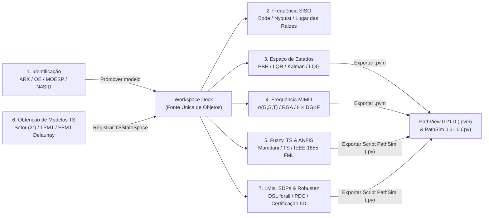

---

## 1. Visão Geral da Interface, Barra Superior e Workspace Dock

Ao abrir o **ControlLab Web** ([https://kozttah.github.io/ControlLab_Web/](https://kozttah.github.io/ControlLab_Web/)), o indicador verde no canto superior esquerdo confirma que o motor científico **Pyodide / WebAssembly** está carregado localmente (inclusive operando offline via *Service Worker* após o primeiro acesso).

A bancada organiza-se em três regiões permanentes:
1. **Barra Superior Global:**
   - Nome editável do projeto e contador de revisões imutáveis;
   - **`Abrir .ctrlab`** e **`Salvar .ctrlab`**: persistência completa do projeto em arquivo ZIP auditado com somas SHA-256 (modelos, controladores, datasets, receitas TS e condições LMI);
   - **`Exportar .pvm`**: exportação direta de malhas lineares/com saturação para o editor visual **PathView `0.21.0`**;
   - **`Workspace`** e **`Inspetor R-27`**: abrem/recolhem a gaveta lateral de objetos e o inspetor de proveniência numérica;
   - Seletor de **casas decimais** e alternador de contraste acessível (**WCAG 2.2 AA / AAA**).
2. **Barra das 7 Abas de Projeto:** organiza o fluxo completo desde dados experimentais até síntese robusta por LMIs.
3. **Gaveta Lateral `Workspace` (Princípio *Workspace-First* — `ADR-014`):** centraliza todas as séries temporais, plantas (`TransferFunction`, `StateSpace`, politopos incertos, modelos `TSStateSpace`) e controladores projetados. Clicando em **`+ Novo`**, você cria ou edita qualquer sistema em um único lugar e o envia em 1 clique (`→ SISO`, `→ SS/LQR`, `→ LMIs`) para qualquer aba.

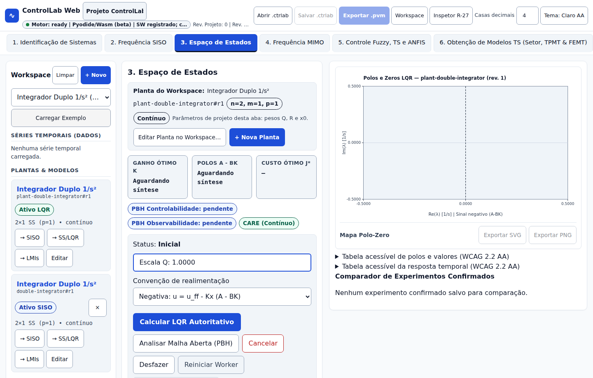

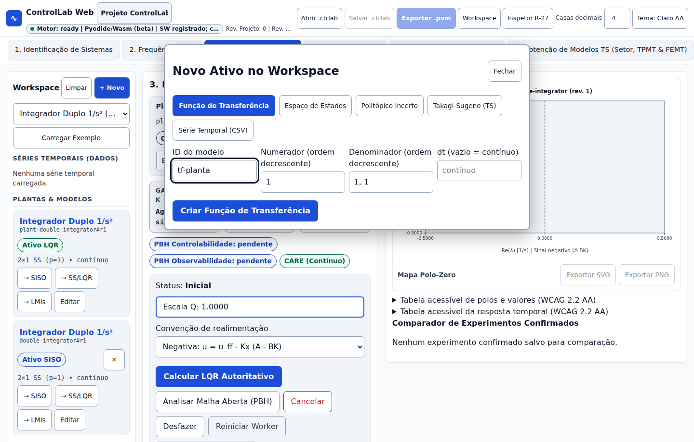

---

## 2. Aba 1 — Identificação de Sistemas (`ARX`, `OE` e Subespaços `MOESP` / `N4SID`)

A **Aba 1 (`1. Identificação de Sistemas`)** conduz a modelagem orientada a dados em 3 etapas:
1. **Carga e Particionamento:** importe um arquivo `.csv` próprio ou carregue benchmarks PRBS prontos, separando conjuntos de **Treino** e **Validação (*Holdout*)** e inspecionando a condição de **Excitação Persistente (`PE`)** e posto numérico.
2. **Estimação Paramétrica ou por Subespaços:** ajuste modelos **`ARX(na, nb, nk)`** (via fatoração QR/SVD sem equações normais mal-condicionadas), **Output-Error (`OE`)** ou métodos de subespaços **`MOESP` / `N4SID`**.
3. **Validação Cruzada e Promoção:** compare simultaneamente **Previsão 1-Passo** vs. **Simulação Livre** (`FIT%`, `RMSE`) e verifique a brancura dos resíduos ($R_{ee}(\tau)$) e descorrelação entrada-resíduo ($R_{ue}(\tau)$) contra as bandas de confiança de 95% e 99%. Quando aprovado, envie o modelo identificado diretamente para as abas **SISO** ou **Espaço de Estados / LQR**.

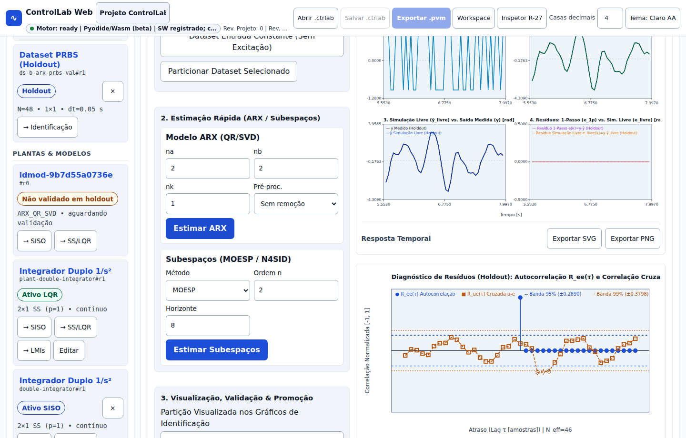

---

## 3. Aba 2 — Controle Clássico SISO no Domínio da Frequência

Na **Aba 2 (`2. Frequência SISO`)**, você projeta compensadores dinâmicos $C(s)$ ou discretos $C(z)$ (por polinômios `num/den` ou polos/zeros/ganho `ZPK`), ajusta o ganho com pré-visualização instantânea e confirmação exata no motor Python, avalia atraso de transporte exato $e^{-j\omega\tau}$ vs. aproximação de Padé e inspeciona quatro visões sincronizadas com *datatips* clicáveis:
- **Diagrama de Bode** (magnitude e fase com **Margem de Ganho**, **Margem de Fase** e **Margem de Atraso**);
- **Diagrama de Nyquist** com destaque do ponto crítico $(-1, j0)$;
- **Lugar das Raízes (*Root Locus*)**;
- **Resposta ao Degrau em Malha Fechada**.

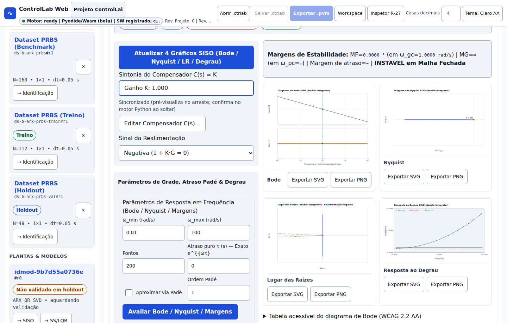

---

## 4. Aba 3 — Espaço de Estados, LQR, Observadores e LQG

A **Aba 3 (`3. Espaço de Estados`)** reúne análise estrutural e projeto moderno por espaço de estados:
- **Diagnóstico Estrutural PBH:** verifica estabilizabilidade e detectabilidade pelo teste espectral de Popov–Belevitch–Hautus em cada modo;
- **Síntese LQR Autoritativa (`CARE` / `DARE`):** resolve a equação algébrica de Riccati com verificação do resíduo matricial, calcula o ganho ótimo $K$, os polos de malha fechada $\lambda(A - BK)$ e o custo ótimo $J^*$;
- **Observadores de Luenberger, Filtro de Kalman e Malha Completa LQG ($u = -K\hat{x}$):** síntese dual e simulação conjunta planta + estimador;
- **Exportação Direta `.pvm` / `.ctrlab` / CSV** e comparador de experimentos confirmados.

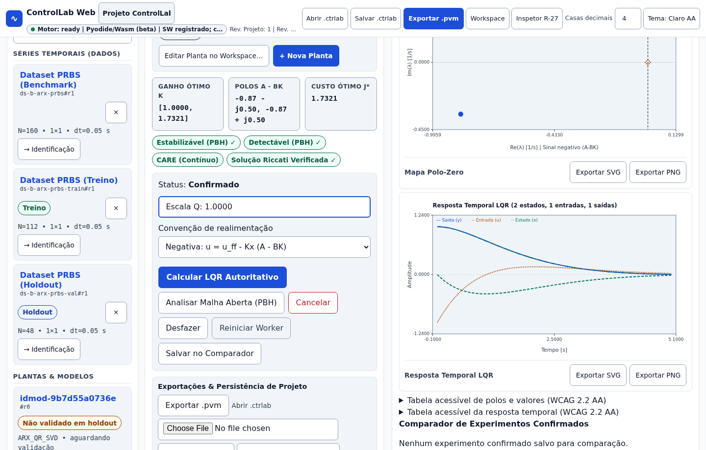

---

## 5. Aba 4 — Frequência MIMO & Síntese Robusta $\mathcal{H}_\infty$

Para sistemas com múltiplas entradas e múltiplas saídas, a **Aba 4 (`4. Frequência MIMO`)** oferece:
- **Valores Singulares $\bar{\sigma}, \underline{\sigma}$** da planta $G(j\omega)$ e das funções de sensibilidade $S(j\omega)$, sensibilidade complementar $T(j\omega)$ e esforço de controle $KS(j\omega)$ (verificando identicamente $\|S + T - I\| \approx 0$);
- **Matriz de Ganho Relativo (`RGA`, $\Lambda(G(j\omega))$)** interativa por frequência com sugestão automática de pareamento entrada-saída;
- **Desacopladores Estáticos/Dinâmicos** e **Síntese Robusta Mista $\mathcal{H}_\infty$ (`DGKF` 2-Riccati — `ADR-012`)** certificada pelo teste Hamiltoniano exato de Bruinsma–Steinbuch.

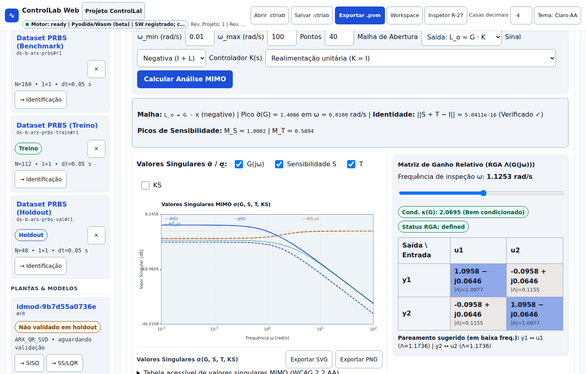

---

## 6. Aba 5 — Controle Fuzzy (Mamdani & TS), ANFIS e IEEE 1855-2016 FML

A **Aba 5 (`5. Controle Fuzzy, TS e ANFIS`)** cobre sistemas de inferência nebulosa:
- Edição visual e paramétrica de **Funções de Pertinência** (`triangular`, `trapezoidal`, `gaussiana`, `bell`, consequentes constantes/lineares);
- Editor de **Base de Regras** e geração da **Superfície de Controle 3D / Mapa de Calor** + avaliação pontual;
- **Ajuste Híbrido `ANFIS`** orientado a dados;
- Intercâmbio completo no padrão internacional **IEEE 1855-2016 (`FML` XML)** e botão **`Exportar Script PathSim (.py)`**.

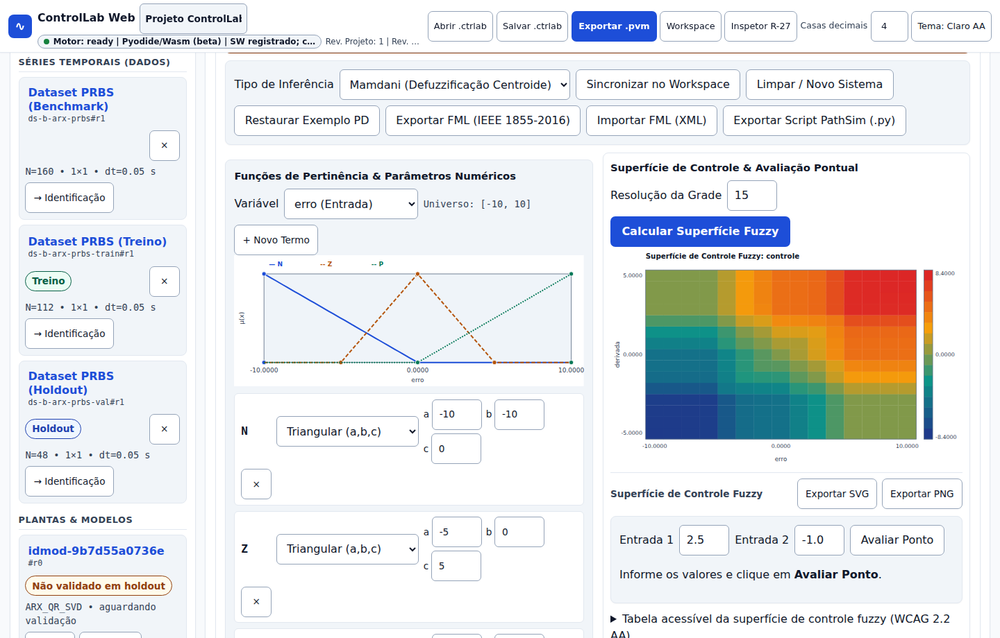

---

## 7. Roteiro Ponta a Ponta em Destaque — Modelo Takagi–Sugeno (Aba 6) $\to$ Controle PDC via LMI (Aba 7) $\to$ Exportação e Simulação (`PathSim 0.31.0`)

Esta seção demonstra passo a passo um dos fluxos mais completos do **ControlLab Web**: partir de uma **planta não linear simbólica qLPV**, obter seu modelo politópico convexo **Takagi–Sugeno (`TSStateSpace`)**, projetar um **regulador de Compensação Paralela Distribuída (`PDC`)** via **LMIs relaxadas**, exportar o código de malha fechada e **simulá-lo no `PathSim 0.31.0`**.

### Passo 7.1 — Definir a Planta qLPV e Comparar as 3 Vias na Aba 6 (`6. Obtenção de Modelos TS`)

Na **Aba 6**, você pode partir de um exemplo físico (como o *Pêndulo Invertido sobre Carro* de 4 estados ou o *Benchmark 2D Acoplado*) ou clicar em **`Limpar / Novo Sistema`** para digitar livremente dimensões, limites de operação $\Omega_x$ e expressões simbólicas célula a célula para $A(x, w), B(x, w), C(x, w), D(x, w)$ (incluindo canais generalizados $B_w, C_z$ e primitivas suaves como `sinc_rad(x3)` para $\sin(x_3)/x_3$, com **zero `eval`**).

A bancada disponibiliza **três vias complementares**:
1. **Via 1 — Não-Linearidade de Setor ($2^{n_n}$ regras):** exata analiticamente no domínio compacto, extraindo extremos globais em 3 estágios (aritmética intervalar + malha/Sobol + refinamento contínuo `L-BFGS-B`/`Brent`).
2. **Via 2 — Transformação do Produto Tensorial (`TPMT v1.3.0`):** decompõe apenas o subespaço variante via **HOSVD / HOOI com centralização modal** e fechos convexos (`SN-NN`, `RNO-INO`, `CNO`), preservando exatamente todas as entradas constantes nos vértices e gerando pertinências 1D separáveis.
3. **Via 3 — Transformação por Elementos Finitos (`FEMT v1.2.0`):** isola as entradas matriciais variantes, extrai a coluna média sobre o grid, aplica **SVD econômica centrada sobre o delta** ($\Delta X_{\text{var}}$) aumentada por peso uniforme $\frac{1}{N_g}\mathbf{1}_{N_g}$ (eliminando colunas extras espúrias em `SN-NN`) e reconstrói as pertinências por **interpolação baricêntrica $P_1$ sobre simplices de Delaunay / Kuhn–Delaunay** — atingindo o **menor número possível de regras** ($N_r = R_\Delta + 1$) quando há acoplamento entre variáveis!

Clicando em **`Comparar Vias na Planta Atual`**, o sistema executa as três vias e exibe lado a lado a contagem de regras $N_r$ e os erros dentro e fora da grade (por exemplo, no Pêndulo Invertido: **16 regras** no Setor vs. **12 regras** na TPMT vs. apenas **6 regras** na FEMT com a mesma precisão!).

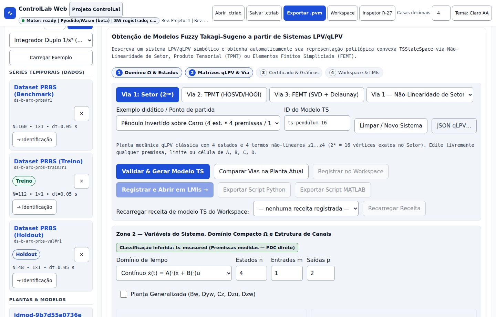

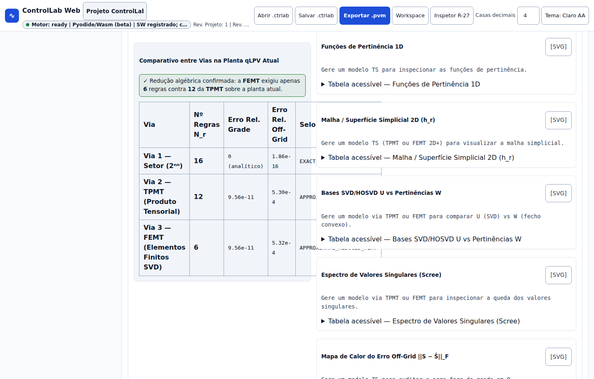

### Passo 7.2 — Derivar o Modelo TS via FEMT (`Delaunay`), Auditar os Gráficos e Enviar para LMIs

Selecionando a **Via 3 (`FEMT`)** com triangulação de **Delaunay explícita** e fecho **`CNO`** sobre a planta não linear acoplada 2D (`ts-coupled-2d`) e clicando em **`Validar & Gerar Modelo TS`**, a Zona 4 apresenta:
- **Certificado de Fidelidade:** apenas **$N_r = 3$ regras** (`Erro Rel. Grade = 6.54e-16`, soma unitária $|\sum_r h_r - 1| = 1.55 \times 10^{-15}$ e $\min h_r \ge 0$);
- **Inspetor de Matrizes Vértices $(A_r, B_r, C_r, D_r)$** preservando entradas constantes com exatidão de ponto flutuante;
- **Malha Triangular 2D de Delaunay** da superfície de pertinência $h_r(x_1, x_2)$, comparador **Bases SVD $U$ vs. Pesos Convexos $W$**, **Espectro Global de Valores Singulares (Eckart–Young)** e **Mapa de Calor do Erro Fora da Grade $\|S(p) - \hat{S}(p)\|_F$** (incluindo canais generalizados se ativos).

Em seguida, basta clicar em **`Registrar e Abrir em LMIs →`** (`#btn-ts-register-open-lmi`): o modelo `TSStateSpace` é gravado no `Workspace` e já aparece selecionado automaticamente na **Aba 7**!

> [!NOTE]
> **Proteção contra rascunho obsoleto:** caso você altere qualquer expressão matricial ou troque de exemplo após gerar o modelo TS, o ControlLab Web bloqueia preventivamente os botões de registro/exportação e exibe um alerta claro até que o novo modelo seja derivado, impedindo misturar vértices de uma planta com a receita de outra.

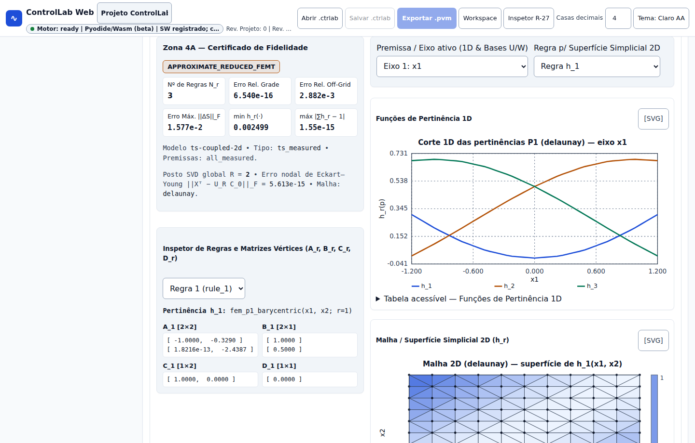

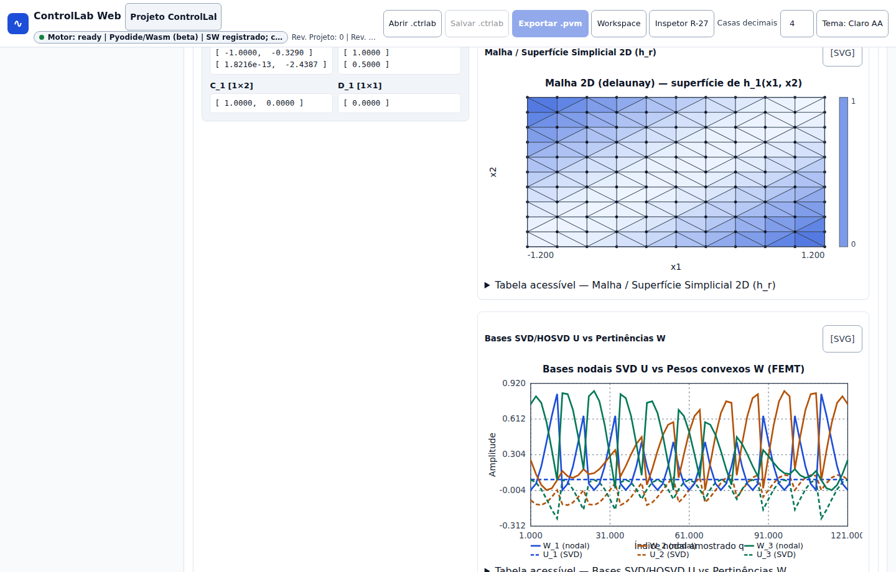

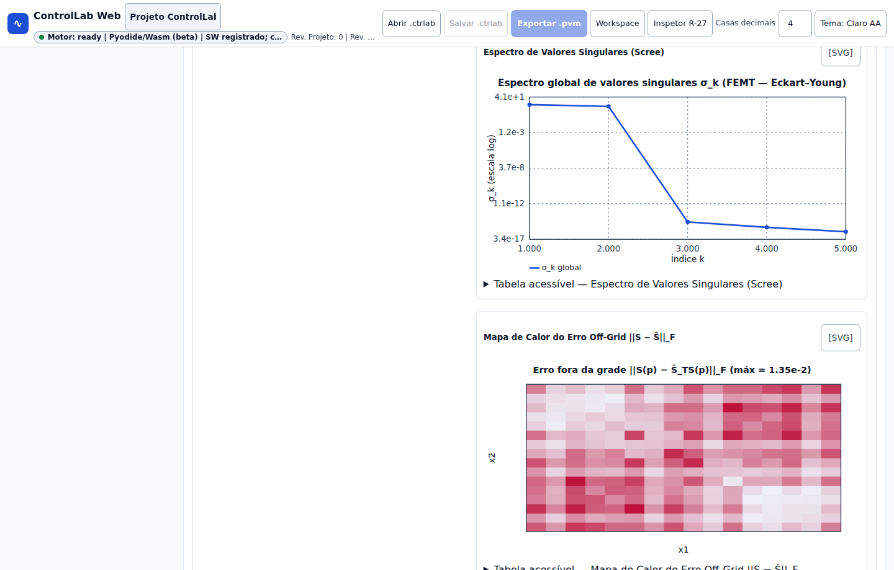

### Passo 7.3 — Projetar o Controlador PDC via LMI Relaxada na Aba 7 (`7. LMIs, SDPs e Síntese Robusta`)

Na **Aba 7**:
1. Confirme que o sistema **`ts-coupled-2d` (`TS 3 regras`, `∑hᵢ(z)=1 Válida`)** está selecionado em **Sistema do Workspace**.
2. Em **Template**, escolha **`Takagi-Sugeno PDC Relaxado (∀ i, ∀ j > i v2.0)`** e clique em **`Sincronizar Diretiva system na DSL`**. O compilador simbólico interpreta as macros `M(i, j)` e os quantificadores `forall i` e `forall i, j where j > i`, expandindo automaticamente os **7 blocos LMI** sem usar `eval`.
3. Clique em **`Resolver LMI`**. O solver **Primal-Dual HSDE nativo** resolve o SDP diretamente no navegador em milissegundos, audita a solução em **5 dimensões independentes** (resíduos primal/dual, *gap*, autovalor mínimo $\lambda_{\min} > 0$ nos blocos originais não escalonados e condicionamento) e recupera automaticamente os ganhos de realimentação de cada regra:
   $$K_1, \; K_2, \; \dots, \; K_{N_r} \qquad \text{via} \quad K_i = Y_i Q^{-1}.$$
4. Clique em **`Registrar Controlador no Workspace`** para salvar o objeto canônico **`PDCController`** (`pdc-ts-coupled-2d#r1`) no `Workspace Dock`.

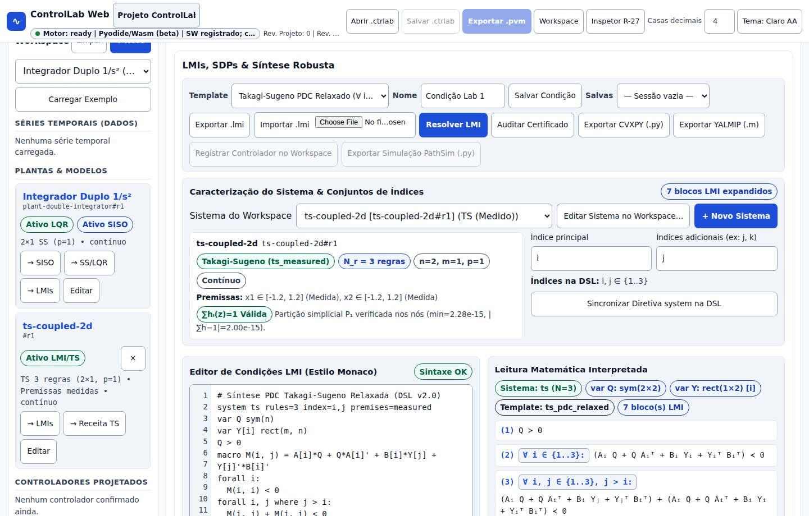

![Aba 7 — Solução concluída em 5 iterações com ganhos PDC K[1]..K[3] recuperados, PDCController registrado no Workspace e gráfico do espectro λ_min](./assets/12_tab7_lmi_pdc_solved.png)

### Passo 7.4 — Exportar e Simular a Malha Fechada Não Linear `TS + PDC` no `PathSim 0.31.0`

> [!IMPORTANT]
> **Por que malhas lineares usam `.pvm` (PathView) e malhas não lineares `TS + PDC` usam script `.py` (PathSim)? (`ADR-013` / `R-21`)**
> Por segurança estrita (`R-21`), o formato JSON `.pvm` do PathView é mantido **100% passivo e declarativo** (restrito aos blocos oficiais lineares e de saturação do PathView `0.21.0`, sem embutir funções Python executáveis arbitrárias em `codeContext`). Como a malha fechada **Takagi–Sugeno + PDC** avalia a cada passo de integração a interpolação não linear $h_r(x(t))$ (de Setor, TPMT ou coordenadas baricêntricas de Delaunay na FEMT) e o ganho escalonado $u(t) = \sum_{r=1}^{N_r} h_r(x(t)) K_r x(t)$, o ControlLab Web exporta um **script Python autossuficiente para o `PathSim 0.31.0`** (o mesmo motor numérico oficial por trás do PathView!).

1. Ainda na **Aba 7**, clique em **`Exportar Simulação PathSim (.py)`** (`#btn-lmi-export-pathsim`).
2. O modal exibe o script completo gerado em modo passivo (`code_executed=false`), contendo os vértices $(A_r, B_r)$, os ganhos sintetizados $K_r$, o avaliador baricêntrico exato `default_h_fn(x, t)` da malha de Delaunay e a simulação `PathSim 0.31.0` com bloco `ODE` + integrador `RKCK54` + `Scope`. Clique em **`Baixar arquivo`**.
3. Execute localmente no seu ambiente Python com `pathsim==0.31.0`:
   ```bash
   python controllab_ts_pdc_pathsim.py
   ```
   A figura abaixo mostra o resultado real da execução do script exportado no **`PathSim 0.31.0`** (partindo de $x(0) = [0.85, -0.65]^T$), sobreposto à integração da planta não linear qLPV exata com o mesmo controlador PDC: os estados convergem suavemente à origem enquanto as pertinências simpliciais $h_1(x(t)), h_2(x(t)), h_3(x(t))$ permanecem não-negativas e somam identicamente $1.0$ durante todo o transitório!

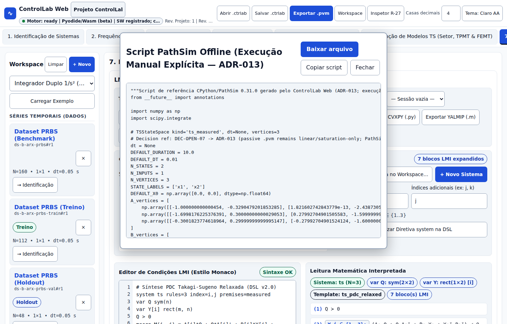

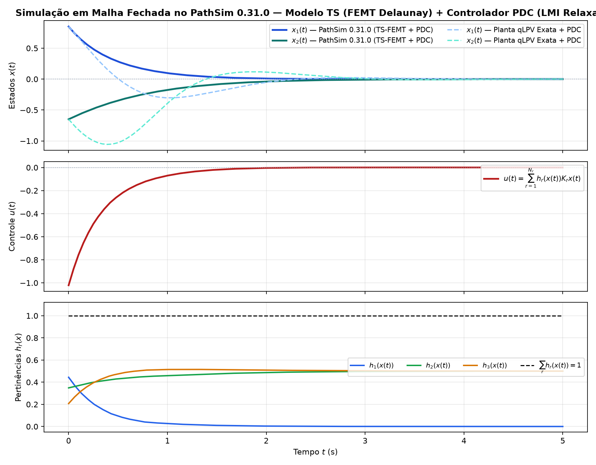

---

## 8. Como Exportar `.pvm` e Importar / Simular Visualmente no `PathView 0.21.0`

Para todas as malhas em espaço de estados contínuas ou discretas síncronas com controladores estáticos (`StateFeedbackController` de LQR ou LMI LTI, com ou sem saturação e pré-filtro $N$) ou controladores dinâmicos (`DynamicController` de compensadores SISO, observadores/LQG ou $\mathcal{H}_\infty$ MIMO), o ControlLab Web gera arquivos **`.pvm` oficiais** prontos para abertura direta na interface gráfica do **PathView `0.21.0`**.

### Passo a Passo Ilustrado (ControlLab Web $\to$ PathView `0.21.0`)

1. **Exporte o `.pvm` no ControlLab Web:**
   - Após confirmar um controlador (por exemplo, clicando em **`Calcular LQR Autoritativo`** na Aba 3, ou registrando um controlador LTI na Aba 7 / $\mathcal{H}_\infty$ na Aba 4), clique em **`Exportar .pvm`** na barra superior (ou no cartão de exportações da Aba 3) e salve o arquivo `.pvm` no seu computador.
2. **Inicie o PathView (`0.21.0`):**
   - No terminal local onde `pathview==0.21.0` e `pathsim==0.31.0` estão instalados, execute `pathview` (ou acesse sua instância local do PathView) e clique em **`New`** na tela inicial para abrir o canvas de diagramas de blocos.
3. **Importe o arquivo `.pvm` (`Open/Import`):**
   - Na barra superior esquerda do editor do PathView, clique no ícone **`Open/Import`** (`Ctrl+O`) e selecione o arquivo `.pvm` exportado pelo ControlLab Web.
   - O diagrama de blocos completo é montado automaticamente com todas as conexões escalares e matrizes configuradas: `ReferenceSource_0` $\to$ `Prefilter_N` $\to$ `ControlSum_negative` $\to$ `StateSpace` (planta) $\to$ `OutputScope`, realimentado por `FeedbackGain_K`!
4. **Execute a Simulação ao Vivo (`Run` $\to$ `Pin Previews`):**
   - Clique no ícone de alfinete (**`Pin Previews`**) no canto superior direito para exibir os mini-osciloscópios ao lado dos blocos `Scope` e, em seguida, clique no botão **`Run` (`▶`)** na barra lateral esquerda.
   - O console inferior confirma `Simulation completed successfully` em milissegundos e a curva da resposta ao degrau aparece renderizada imediatamente ao lado do bloco **`OutputScope`**!
5. **Inspecione o Código Python Equivalente (`View Python Code`):**
   - Clicando no ícone **`<>` (`View Python Code`)** na barra lateral esquerda do PathView, você também visualiza ou baixa o código `PathSim` equivalente gerado a partir do diagrama `.pvm`.

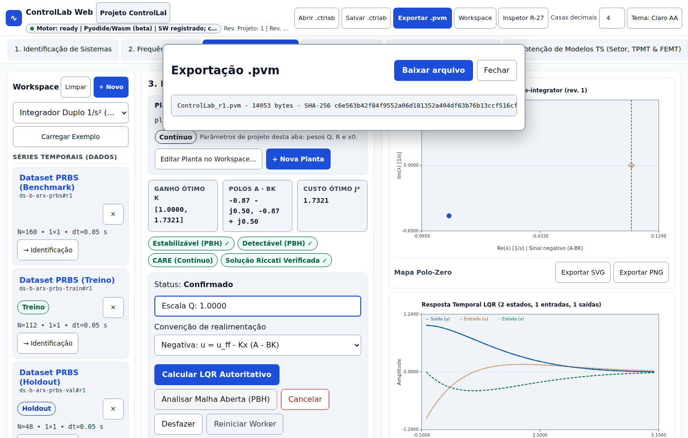

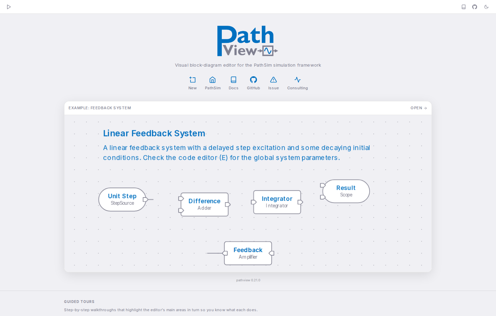

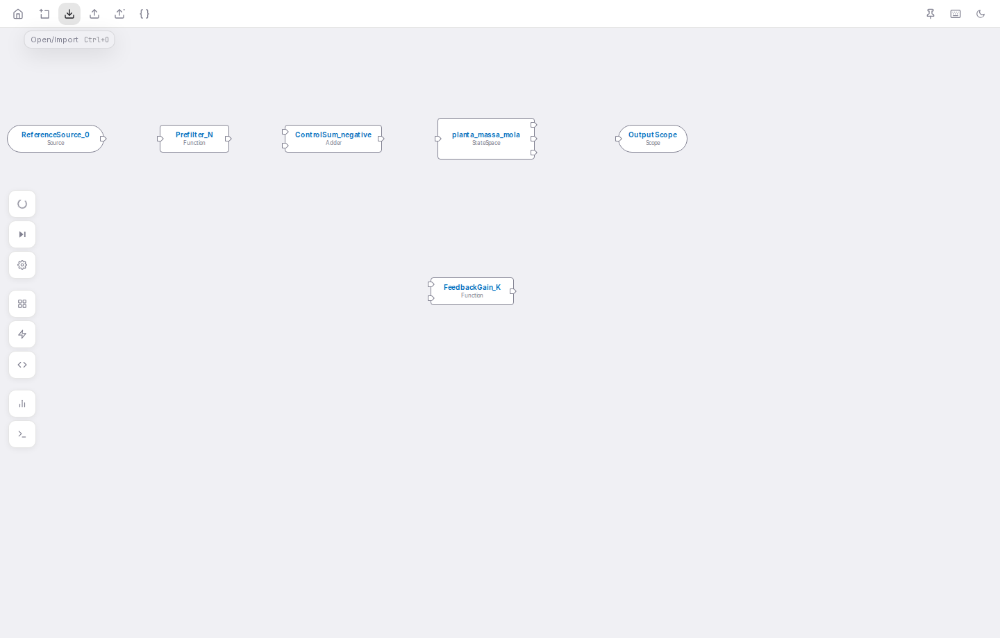

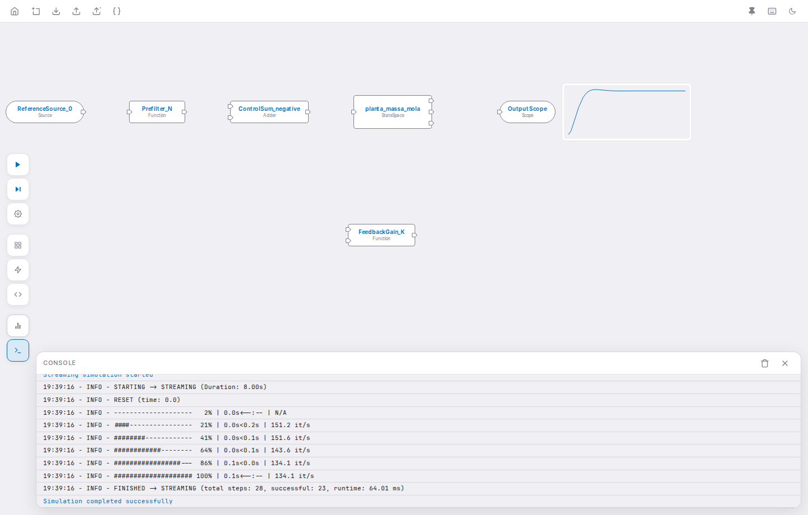

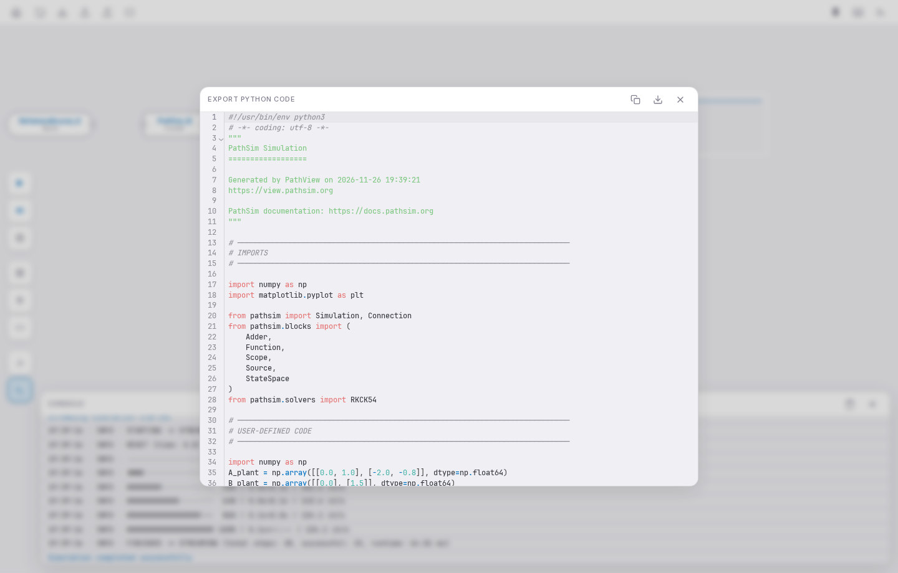

---

## 9. Resumo de Formatos de Exportação e Interoperabilidade Científica

| Formato / Botão | Onde Encontrar | Finalidade Prática |
| :--- | :--- | :--- |
| **Projeto `.ctrlab` (ZIP)** | Barra Superior (`Abrir .ctrlab` / `Salvar .ctrlab`) | Salva e restaura todo o estado da bancada (modelos, controladores, datasets, receitas TS e condições LMI) com manifesto SHA-256. |
| **Diagrama `.pvm` (`PathView 0.21.0`)** | Barra Superior (`Exportar .pvm`) e Aba 3 | Importação visual direta (`Open/Import`) e simulação interativa de malhas lineares/saturadas (`StateSpace` + LQR / LQG / SISO / $\mathcal{H}_\infty$) no PathView. |
| **Simulação `PathSim 0.31.0` (`.py`)** | Aba 7 (`Exportar Simulação PathSim (.py)`) e Aba 5 | Simulação autossuficiente em malha fechada de sistemas não lineares **Takagi–Sugeno + PDC** (Setor, TPMT e FEMT Delaunay) e **Fuzzy Mamdani/TS**. |
| **Scripts de Derivação TS (`.py` / `.m`)** | Aba 6 (`Exportar Script Python` / `Exportar Script MATLAB`) | Reproduz offline (em NumPy/SciPy ou MATLAB) exatamente os mesmos vértices $(A_r, B_r, C_r, D_r)$ da derivação Setor, TPMT ou FEMT, inclusive para malhas densas acima do teto do navegador. |
| **Scripts de Otimização LMI (`.py` / `.m` / `.lmi`)** | Aba 7 (`Exportar CVXPY (.py)` / `Exportar YALMIP (.m)` / `Exportar .lmi`) | Permite auditar ou resolver problemas SDP de grande porte offline em solvers externos como **MOSEK**, **Clarabel**, **SeDuMi** ou **SDPT3**. |
| **Padrão `IEEE 1855-2016 FML` (`.xml`)** | Aba 5 (`Exportar FML` / `Importar FML`) | Intercâmbio padronizado de controladores nebulosos Mamdani e Takagi–Sugeno com outras ferramentas de inteligência computacional. |
| **Gráficos Vetoriais & Dados (`SVG`, `PNG`, `CSV`)** | Abaixo de todos os gráficos da bancada | Exportação direta para artigos científicos, relatórios técnicos e apresentações, acompanhada de tabelas acessíveis **WCAG 2.2 AA**. |
